# Informe de Trazabilidad: Desarrollo Backend Django - TazaNorte

## Información del Estudiante

| Campo          | Detalle                                                                                                     |
|----------------|-------------------------------------------------------------------------------------------------------------|
| **Nombre**     | Moises Bolivar                                                                                              |
| **Programa**   | Ingeniería de Sistemas                                                                                      |
| **Facultad**   | Facultad de Ingeniería, Universidad de La Guajira                                                          |
| **Docente**    | Ing. Jaider Quintero M.                                                                                     |
| **Referencia** | [https://tecnogua.com/academic/site/backend2026/django/](https://tecnogua.com/academic/site/backend2026/django/) |
| **Proyecto**   | Sistema de Gestión Integral de Cafetería TazaNorte - Módulo Backend Django                                   |
| **Fecha**      | Octubre de 2026                                                                                             |

---

## Tabla de Contenido

- [Información del Estudiante](#información-del-estudiante)
- [Unidad ISS-00: Creación del entorno virtual](#unidad-iss-00-creación-del-entorno-virtual)
  - [1. Entorno](#1-entorno)
  - [2. Instalación del framework](#2-instalación-del-framework)
  - [3. Creación del proyecto](#3-creación-del-proyecto)
  - [4. Protección del repositorio](#4-protección-del-repositorio)
  - [5. Verificación](#5-verificación)
- [Unidad ISS-01: Settings y selección de motor](#unidad-iss-01-settings-y-selección-de-motor)
  - [1. Instalación de paquetes del sistema y drivers](#1-instalación-de-paquetes-del-sistema-y-drivers)
  - [2. Transformación de la Estructura de Archivos](#2-transformación-de-la-estructura-de-archivos)
  - [3. Definición de las variables de entorno](#3-definición-de-las-variables-de-entorno)
  - [4. Módulo de selección de base de datos](#4-módulo-de-selección-de-base-de-datos)
  - [5. Paquete de configuración](#5-paquete-de-configuración)
  - [6. Re-Ejecución del intérprete](#6-re-ejecución-del-intérprete)
  - [7. Parches en puntos de entrada en el sistema](#7-parches-en-puntos-de-entrada-en-el-sistema)
  - [8. Pruebas unitarias de selección de motor (GATE EVI-01-01)](#8-pruebas-unitarias-de-selección-de-motor-gate-evi-01-01)
- [Unidad ISS-02: Apps client, product y sale](#unidad-iss-02-apps-client-product-y-sale)
- [Unidad ISS-03: Custom User antes de la primera migración](#unidad-iss-03-custom-user-antes-de-la-primera-migración)
- [Unidad ISS-04: Modelo Client](#unidad-iss-04-modelo-client)
- [Unidad ISS-05: ProductType y Product](#unidad-iss-05-producttype-y-product)
  - [1. Construcción de paquetes](#1-construcción-de-paquetes)
  - [2. Creación de apps/__init__.py](#2-creación-de-apps__init__py)
  - [3. Parche de name y label en las apps](#3-parche-de-name-y-label-en-las-apps)
  - [4. Agregación de las apps a settings/__init__.py](#4-agregación-de-las-apps-a-settings__init__py)
  - [5. Prueba de aceptación y GATE (EVI-02-01)](#5-prueba-de-aceptación-y-gate-evi-02-01)
- [Bitácora de Commits Realizados](#bitácora-de-commits-realizados)

---

## Unidad ISS-00: Creación del entorno virtual

### 1. Entorno
Se creó el entorno virtual con Python 3.12 en el cual se guardan las librerías necesarias para el funcionamiento del backend del proyecto en la carpeta aislada `.venv`.

**Scripts de creación:**
```bash
python3 -m venv .venv
```

**Scripts de activación:**
```bash
source .venv/bin/activate
```

**Evidencia:**
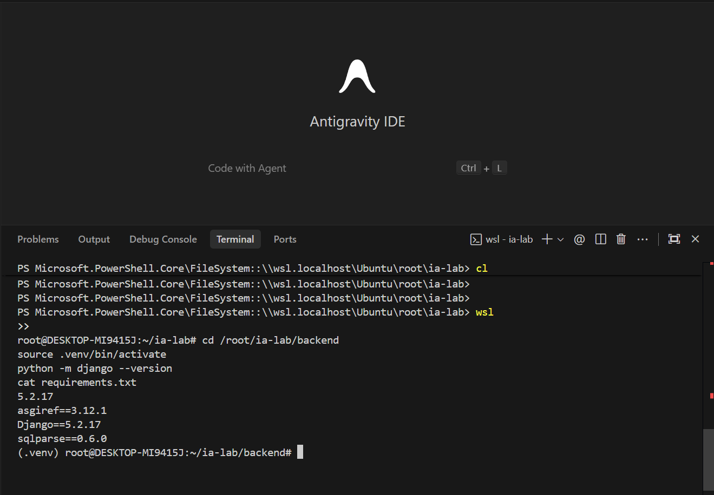

---

### 2. Instalación del framework
El framework de Python que se utilizará para la creación del backend en este proyecto es Django 5.2.17, el cual provee el ORM, arquitectura MVC/MVT, controladores y la comunicación robusta con las bases de datos relacionales de TazaNorte. Para ello utilizamos el sistema de gestión de paquetes `pip`.

**Scripts:**
```bash
python -m pip install "Django==5.2.17"
python -m pip freeze > requirements.txt
```

**Evidencias:**


---

### 3. Creación del proyecto
Por medio de Django nos es posible la creación de una plantilla inicial de proyecto a partir del framework con una estructura de archivos concreta para trabajar con la librería, dejando `manage.py` en la raíz y la configuración centralizada en el paquete `config/`.

**Script:**
```bash
django-admin startproject config .
```

**Evidencias:**
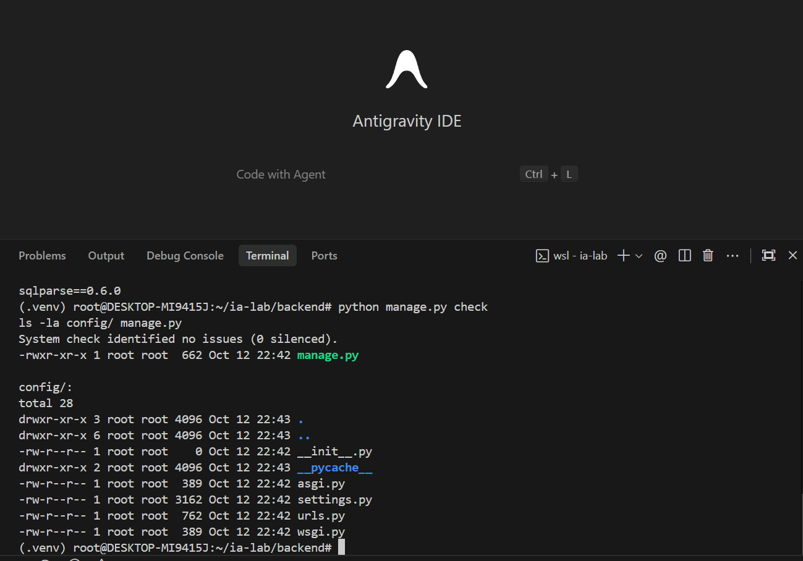

---

### 4. Protección del repositorio
Ya que se trabajará con repositorios de GitHub, es importante conocer que ficheros como `.env`, `.venv` o `db.sqlite3` contienen información sensible o redundante que no debe ser subida al repositorio. Para prevenir esto se agrega un archivo `.gitignore` a la raíz del backend donde se indica qué ficheros no deben ser subidos.

**Contenido del `.gitignore`:**
```text
.venv/
__pycache__/
*.py[cod]
.env
db.sqlite3
*.log
.idea/
.vscode/
staticfiles/
media/
.pytest_cache/
htmlcov/
.coverage
```

**Evidencia:**


---

### 5. Verificación
Se comprobó la versión activa de Django y la integridad del proyecto generado sin incidencias identificadas.

**Scripts:**
```bash
python -m django --version
python manage.py check
```

**Evidencia:**
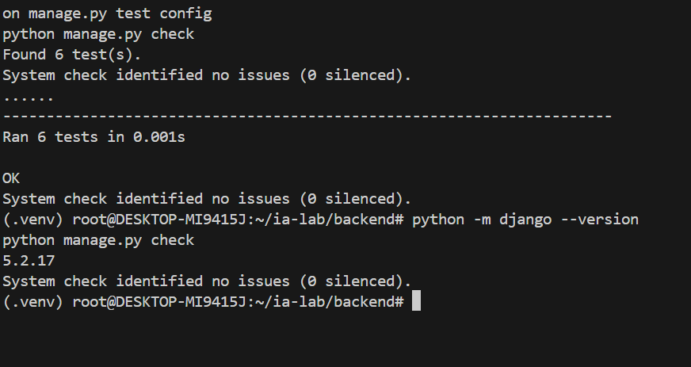

---

## Unidad ISS-01: Settings y selección de motor

### 1. Instalación de paquetes del sistema y drivers
Los paquetes contienen las herramientas necesarias para realizar las conexiones entre Django y los 4 motores de bases de datos relacionales del laboratorio (**PostgreSQL**, **MySQL**, **SQL Server** y **Oracle**). En Ubuntu/WSL se instalaron primero las cabeceras de compilación de MySQL (`build-essential`, `pkg-config`, `default-libmysqlclient-dev`, `python3.12-dev`) y posteriormente los drivers en `.venv`, listándolos dentro del archivo `requirements.txt`.

**Scripts:**
```bash
# Compilador y cabeceras de MySQL para Ubuntu/WSL
apt install -y build-essential pkg-config default-libmysqlclient-dev python3.12-dev

# Entorno activo e instalación de drivers
source .venv/bin/activate
which python
python -m pip install "python-dotenv==1.2.3"
python -m pip install "psycopg[binary]==3.3.6"
python -m pip install "mysqlclient==2.3.0"
python -m pip install "mssql-django==2.0.0"
python -m pip install "oracledb==26.0.1"
python -m pip freeze > requirements.txt
```

**Evidencia:**
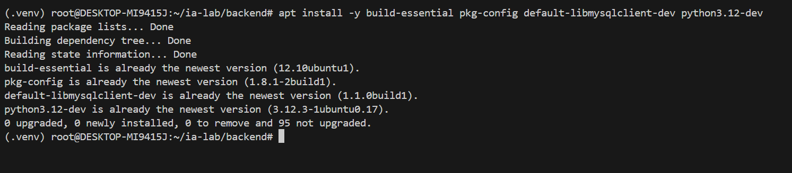
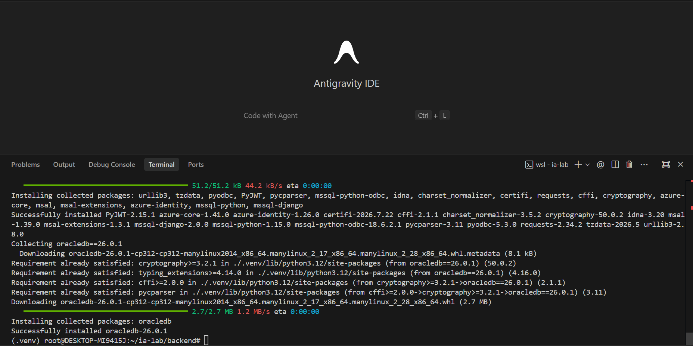

---

### 2. Transformación de la Estructura de Archivos
Se eliminó el archivo plano generado automáticamente `config/settings.py` y se creó el paquete `config/settings/` con su respectivo archivo `__init__.py`. 

Adicionalmente se crearon `.env.example` con la plantilla de variables, `.env` con las credenciales reales de la cafetería TazaNorte, `config/database.py` para la selección dinámica de motores y `config/project_python.py` para el manejo de intérprete.

**Scripts:**
```bash
rm config/settings.py
mkdir -p config/settings
```

**Evidencia:**
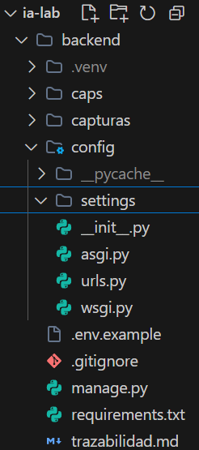

---

### 3. Definición de las variables de entorno
En `.env.example` se guardaron los nombres de las variables de entorno del proyecto sin credenciales sensibles. En `.env` se guardaron los valores reales correspondientes a los contenedores Docker de TazaNorte y se inyectó la clave generada con `get_random_secret_key()`.

**Contenido de `.env.example`:**
```env
# Copie este archivo a .env y complete los valores.
# .env no se versiona.
DJANGO_SECRET_KEY=
DJANGO_DEBUG=True
DJANGO_ALLOWED_HOSTS=localhost,127.0.0.1,testserver

# Motor activo. Uno solo por ejecución: postgresql | mysql | mssql | oracle
DB_ENGINE=postgresql

POSTGRES_DB=tazanorte
POSTGRES_USER=admin_user
POSTGRES_PASSWORD=AdminPassword123*
POSTGRES_HOST=127.0.0.1
POSTGRES_PORT=5432

MYSQL_DB=TazaNorte
MYSQL_USER=admin_user
MYSQL_PASSWORD=AdminPassword123*
MYSQL_HOST=127.0.0.1
MYSQL_PORT=3306

MSSQL_DB=tazanorte
MSSQL_USER=sa
MSSQL_PASSWORD=AdminPassword123*
MSSQL_HOST=127.0.0.1
MSSQL_PORT=1433

ORACLE_DB=XEPDB1
ORACLE_USER=ADMIN_USER
ORACLE_PASSWORD=AdminPassword123*
ORACLE_HOST=127.0.0.1
ORACLE_PORT=1521
ORACLE_SERVICE_NAME=XEPDB1

# Laboratorio académico. En producción liste orígenes explícitos.
CORS_ALLOW_ALL_ORIGINS=True
```

**Evidencia:**
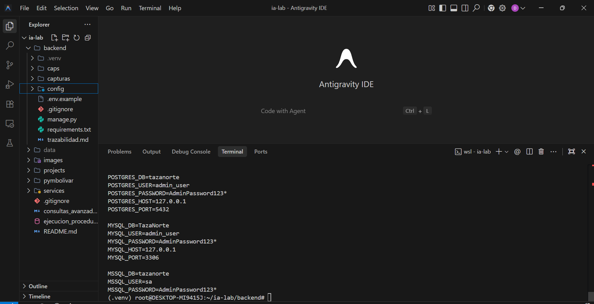

---

### 4. Módulo de selección de base de datos
Dentro de `config/database.py` se elaboró el script de selección de base de datos dinámico a través de `database_from_environ(env)`.

**Código de `config/database.py`:**
```python
"""Selección del motor de base de datos a partir del entorno.

Un solo alias, default, queda activo en cada ejecución.
"""

from django.core.exceptions import ImproperlyConfigured

ALLOWED_ENGINES = ("postgresql", "mysql", "mssql", "oracle")


def _required(env, key):
    value = env.get(key)
    if value is None or str(value).strip() == "":
        raise ImproperlyConfigured(
            f"Falta la variable de entorno {key} para DB_ENGINE={env.get('DB_ENGINE')}."
        )
    return str(value).strip()


def _postgresql(env):
    return {
        "ENGINE": "django.db.backends.postgresql",
        "NAME": _required(env, "POSTGRES_DB"),
        "USER": _required(env, "POSTGRES_USER"),
        "PASSWORD": _required(env, "POSTGRES_PASSWORD"),
        "HOST": _required(env, "POSTGRES_HOST"),
        "PORT": _required(env, "POSTGRES_PORT"),
    }


def _mysql(env):
    return {
        "ENGINE": "django.db.backends.mysql",
        "NAME": _required(env, "MYSQL_DB"),
        "USER": _required(env, "MYSQL_USER"),
        "PASSWORD": _required(env, "MYSQL_PASSWORD"),
        "HOST": _required(env, "MYSQL_HOST"),
        "PORT": _required(env, "MYSQL_PORT"),
        "OPTIONS": {"charset": "utf8mb4"},
    }


def _mssql(env):
    return {
        "ENGINE": "mssql",
        "NAME": _required(env, "MSSQL_DB"),
        "USER": _required(env, "MSSQL_USER"),
        "PASSWORD": _required(env, "MSSQL_PASSWORD"),
        "HOST": _required(env, "MSSQL_HOST"),
        "PORT": _required(env, "MSSQL_PORT"),
        "OPTIONS": {
            "driver": "ODBC Driver 18 for SQL Server",
            "extra_params": "TrustServerCertificate=yes",
        },
    }


def _oracle(env):
    host = _required(env, "ORACLE_HOST")
    port = _required(env, "ORACLE_PORT")
    service = _required(env, "ORACLE_SERVICE_NAME")
    dsn = (
        f"(DESCRIPTION=(ADDRESS=(PROTOCOL=TCP)(HOST={host})(PORT={port}))"
        f"(CONNECT_DATA=(SERVICE_NAME={service})))"
    )
    return {
        "ENGINE": "django.db.backends.oracle",
        "NAME": dsn,
        "USER": _required(env, "ORACLE_USER"),
        "PASSWORD": _required(env, "ORACLE_PASSWORD"),
        "HOST": host,
        "PORT": "",
    }


def database_from_environ(env):
    engine = str(env.get("DB_ENGINE", "postgresql")).strip().lower()
    if engine not in ALLOWED_ENGINES:
        allowed = ", ".join(ALLOWED_ENGINES)
        raise ImproperlyConfigured(
            f"DB_ENGINE='{engine}' no es válido. Valores permitidos: {allowed}."
        )

    builders = {
        "postgresql": _postgresql,
        "mysql": _mysql,
        "mssql": _mssql,
        "oracle": _oracle,
    }
    return {"default": builders[engine](env)}
```

**Evidencias:**
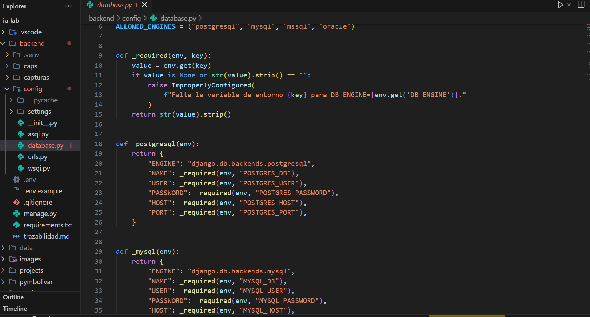

---

### 5. Paquete de configuración
Dentro del fichero `config/settings/__init__.py` se cargan las variables de entorno, se asegura la presencia de `DJANGO_SECRET_KEY` y se configura `DATABASES`.

**Contenido del fichero `config/settings/__init__.py`:**
```python
import os
from pathlib import Path

# python-dotenv, instalado en este ISS. Lee .env antes de SECRET_KEY y DATABASES.
from dotenv import load_dotenv

from config.database import database_from_environ

BASE_DIR = Path(__file__).resolve().parent.parent.parent
load_dotenv(BASE_DIR / ".env")

SECRET_KEY = os.environ.get("DJANGO_SECRET_KEY", "").strip()
if not SECRET_KEY:
    from django.core.exceptions import ImproperlyConfigured

    raise ImproperlyConfigured("Defina DJANGO_SECRET_KEY en el archivo .env.")

DEBUG = os.environ.get("DJANGO_DEBUG", "False").strip().lower() in {"1", "true", "yes", "on"}

ALLOWED_HOSTS = [
    host.strip()
    for host in os.environ.get("DJANGO_ALLOWED_HOSTS", "localhost,127.0.0.1").split(",")
    if host.strip()
]

INSTALLED_APPS = [
    "django.contrib.admin",
    "django.contrib.auth",
    "django.contrib.contenttypes",
    "django.contrib.sessions",
    "django.contrib.messages",
    "django.contrib.staticfiles",
]

MIDDLEWARE = [
    "django.middleware.security.SecurityMiddleware",
    "django.contrib.sessions.middleware.SessionMiddleware",
    "django.middleware.common.CommonMiddleware",
    "django.middleware.csrf.CsrfViewMiddleware",
    "django.contrib.auth.middleware.AuthenticationMiddleware",
    "django.contrib.messages.middleware.MessageMiddleware",
    "django.middleware.clickjacking.XFrameOptionsMiddleware",
]

ROOT_URLCONF = "config.urls"

TEMPLATES = [
    {
        "BACKEND": "django.template.backends.django.DjangoTemplates",
        "DIRS": [],
        "APP_DIRS": True,
        "OPTIONS": {
            "context_processors": [
                "django.template.context_processors.request",
                "django.contrib.auth.context_processors.auth",
                "django.contrib.messages.context_processors.messages",
            ],
        },
    },
]

WSGI_APPLICATION = "config.wsgi.application"
ASGI_APPLICATION = "config.asgi.application"

DATABASES = database_from_environ(os.environ)

AUTH_PASSWORD_VALIDATORS = [
    {"NAME": "django.contrib.auth.password_validation.UserAttributeSimilarityValidator"},
    {"NAME": "django.contrib.auth.password_validation.MinimumLengthValidator"},
    {"NAME": "django.contrib.auth.password_validation.CommonPasswordValidator"},
    {"NAME": "django.contrib.auth.password_validation.NumericPasswordValidator"},
]

LANGUAGE_CODE = "es"
TIME_ZONE = "America/Bogota"
USE_I18N = True
USE_TZ = True

STATIC_URL = "static/"
DEFAULT_AUTO_FIELD = "django.db.models.BigAutoField"
```

**Evidencia:**
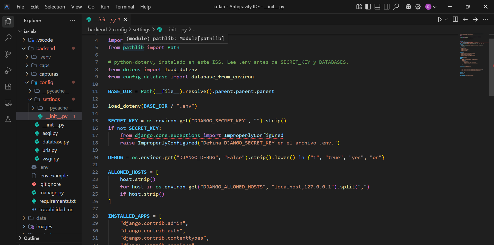

---

### 6. Re-Ejecución del intérprete
En el fichero `config/project_python.py` se almacena un script de prevención que evita que la ejecución de `manage.py` fuera del entorno virtual `.venv` resulte en errores, re-lanzando el proceso con `.venv/bin/python`.

**Contenido del fichero `config/project_python.py`:**
```python
import os
import sys
from pathlib import Path

PROJECT_ROOT = Path(__file__).resolve().parent.parent


def use_project_python():
    venv_root = PROJECT_ROOT / ".venv"
    venv_python = venv_root / "bin" / "python"
    if not venv_python.is_file():
        return
    try:
        if Path(sys.prefix).resolve() == venv_root.resolve():
            return
    except OSError:
        return
    os.execv(venv_python, [str(venv_python), *sys.argv])
```

**Evidencia:**
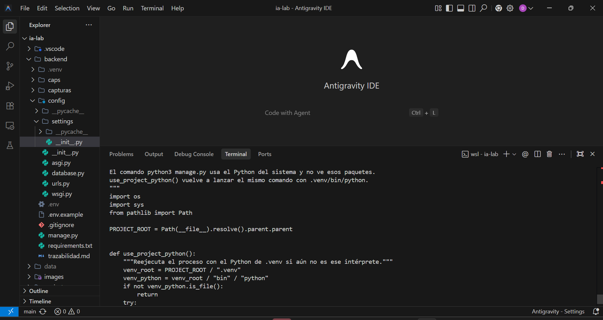

---

### 7. Parches en puntos de entrada en el sistema
Se integraron `use_project_python()` y `load_dotenv()` al inicio de `manage.py`, `config/wsgi.py` y `config/asgi.py`.

**Evidencias:**
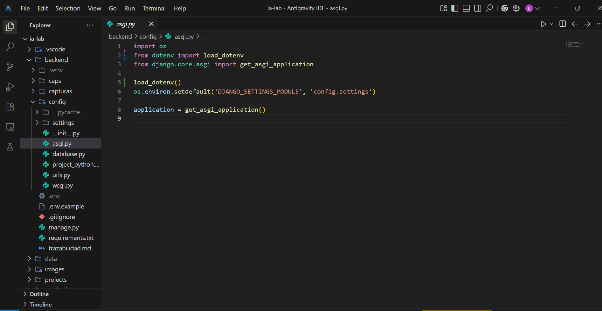

---

### 8. Pruebas unitarias de selección de motor (GATE EVI-01-01)
Se creó la suite de pruebas unitarias en `config/tests.py` mediante `DatabaseSelectionTests` con `SimpleTestCase`, validando:
- Selección correcta del backend para PostgreSQL, MySQL, SQL Server y Oracle.
- DSN de Oracle con `SERVICE_NAME`.
- Lanzamiento de `ImproperlyConfigured` ante motores no soportados o variables obligatorias vacías.

**Comando de verificación:**
```bash
python manage.py test config
python manage.py check
```

**Resultado:**
```text
Found 6 test(s).
System check identified no issues (0 silenced).
......
----------------------------------------------------------------------
Ran 6 tests in 0.001s

OK
```

**Evidencias:**
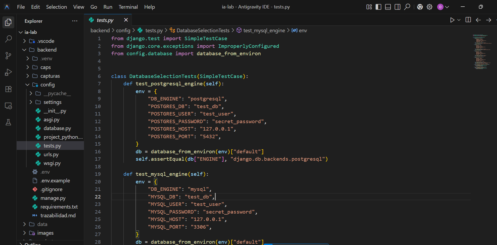
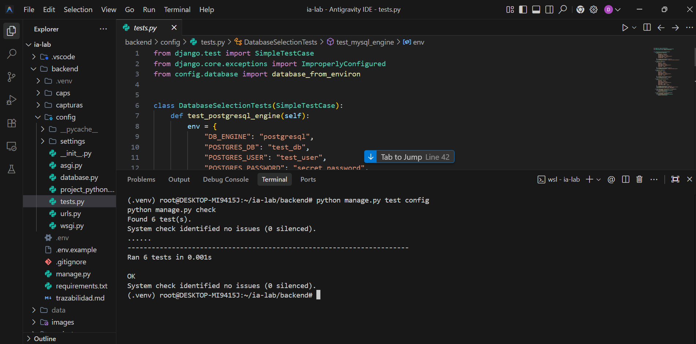

---

---

## Unidad ISS-02: Apps client, product y sale

En esta unidad se crean los paquetes de aplicaciones de negocio con la CLI dentro del paquete `apps/` y se registran en la configuración global del proyecto.

### 1. Construcción de paquetes
Se crearon los directorios correspondientes a cada aplicación de negocio y se inicializaron mediante `startapp`.

**Scripts:**
```bash
mkdir -p apps/client apps/product apps/sale
python manage.py startapp client apps/client
python manage.py startapp product apps/product
python manage.py startapp sale apps/sale
```

**Evidencias:**
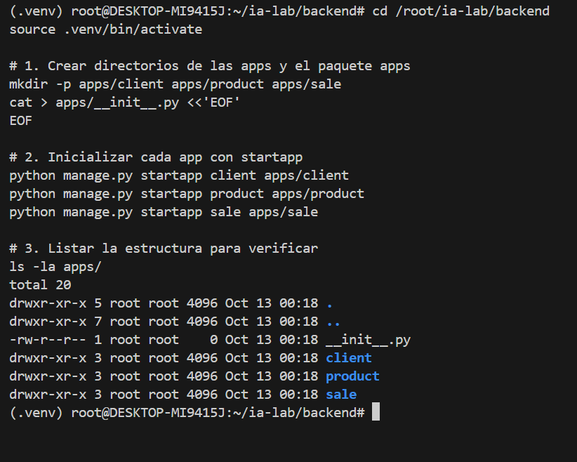

---

### 2. Creación de apps/__init__.py
Se asegura que el directorio `apps/` sea reconocido formalmente como un paquete de Python.

**Script:**
```bash
mkdir -p apps
cat > apps/__init__.py <<'EOF'
EOF
```

**Evidencia:**


---

### 3. Parche de name y label en las apps
Django supone por defecto que las aplicaciones viven en la raíz del proyecto. Al residir dentro del paquete `apps/`, se configura `name = "apps.<nombre>"` para el módulo y `label = "<nombre>"` para conservar nombres limpios en migraciones.

**Parche en client (`apps/client/apps.py`):**
```python
from django.apps import AppConfig


class ClientConfig(AppConfig):
    default_auto_field = 'django.db.models.BigAutoField'
    name = 'apps.client'
    label = 'client'
```

**Parche en product (`apps/product/apps.py`):**
```python
from django.apps import AppConfig


class ProductConfig(AppConfig):
    default_auto_field = 'django.db.models.BigAutoField'
    name = 'apps.product'
    label = 'product'
```

**Parche en sale (`apps/sale/apps.py`):**
```python
from django.apps import AppConfig


class SaleConfig(AppConfig):
    default_auto_field = 'django.db.models.BigAutoField'
    name = 'apps.sale'
    label = 'sale'
```

**Evidencia:**
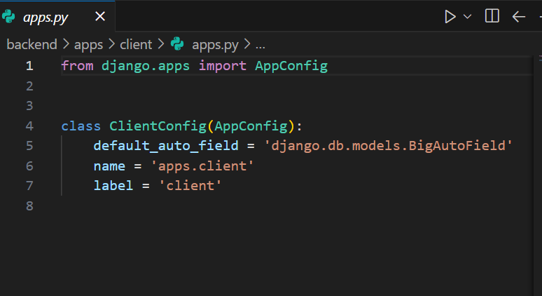

---

### 4. Agregación de las apps a settings/__init__.py
Se agregaron las clases `ClientConfig`, `ProductConfig` y `SaleConfig` al listado `INSTALLED_APPS` debajo de `staticfiles`.

**Instrucción:**
```python
INSTALLED_APPS = [
    ...
    "django.contrib.staticfiles",
    "apps.client.apps.ClientConfig",
    "apps.product.apps.ProductConfig",
    "apps.sale.apps.SaleConfig",
]
```

**Evidencia:**
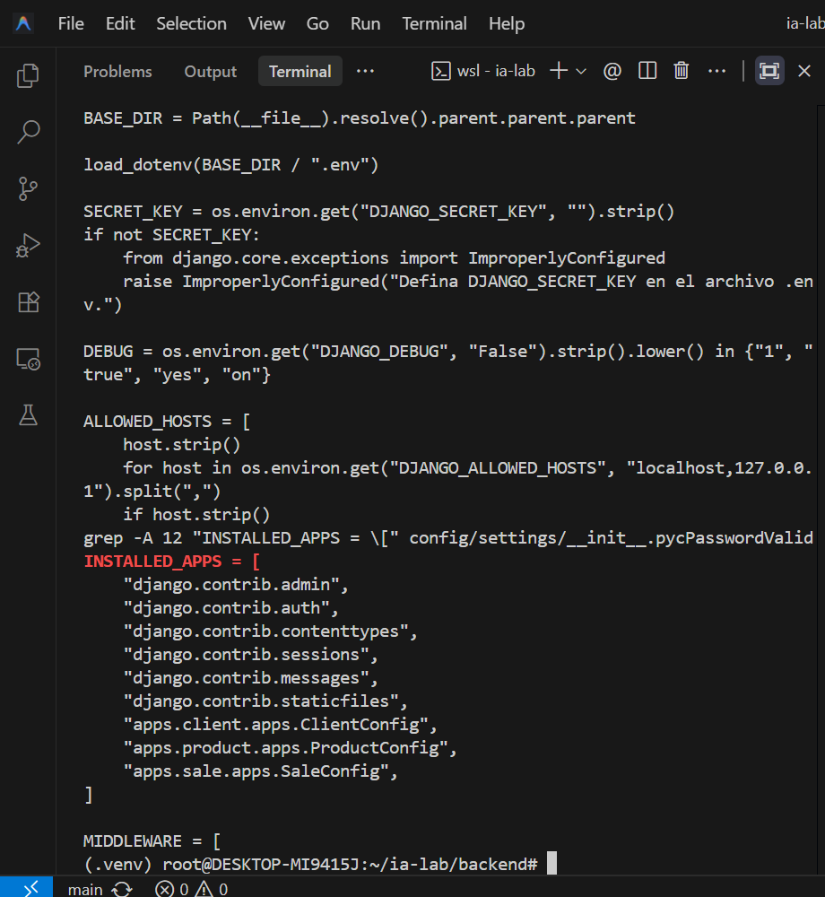

---

### 5. Prueba de aceptación y GATE (EVI-02-01)
Se verificó la integridad del proyecto mediante el CLI de Django, confirmando que las tres apps están debidamente registradas y sin errores de configuración.

**Script:**
```bash
python manage.py check
```

**Resultado:**
```text
System check identified no issues (0 silenced).
```

**Evidencia:**
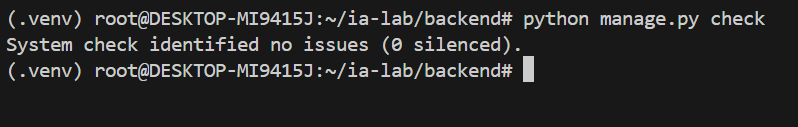

---

## Unidad ISS-03: Custom User antes de la primera migración

### 1. Creación del módulo common y app security
Se creó el módulo reutilizable `apps/common` con las definiciones globales de estado (`RecordStatus`), y la aplicación `apps/security` inicializada a través de la CLI de Django (`manage.py startapp`).

**Scripts:**
```bash
mkdir -p apps/common
touch apps/common/__init__.py
python manage.py startapp security apps/security
```

**Código de `apps/common/status.py`:**
```python
from django.db import models

class RecordStatus(models.TextChoices):
    ACTIVE = "active", "Active"
    INACTIVE = "inactive", "Inactive"
```

**Evidencia:**
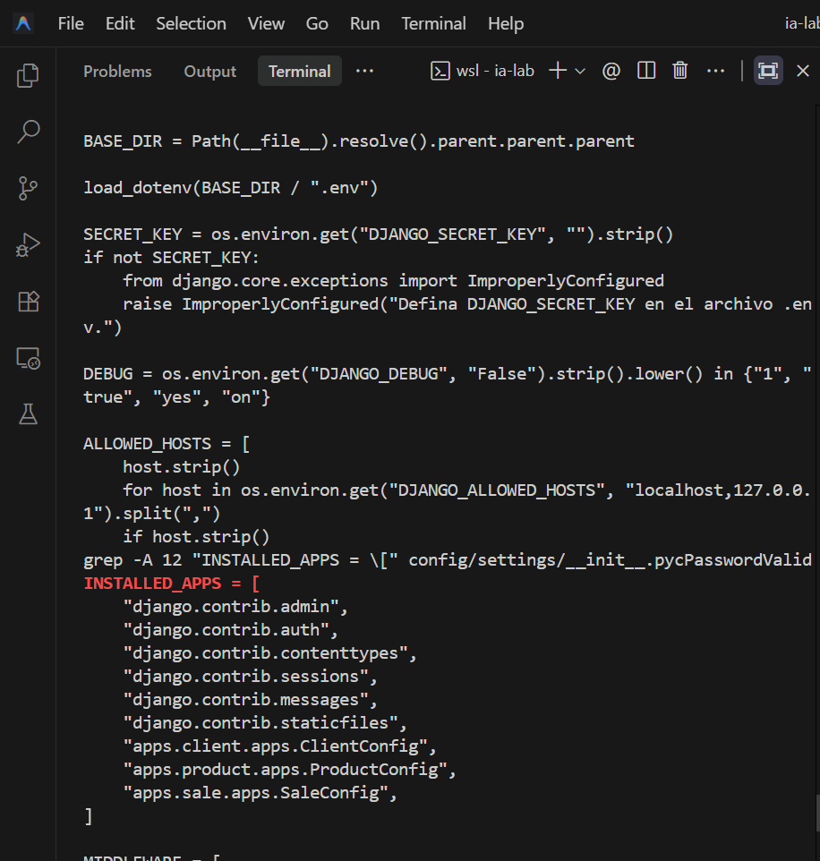

---

### 2. Configuración del modelo Custom User y parches en settings
Se definió el modelo de usuario personalizado `User` heredando de `AbstractUser` de Django, incorporando `StoreUserManager`, normalización de email, y vinculación de `is_active` según el estado del registro. Se parcheó `apps/security/apps.py` y se configuró `AUTH_USER_MODEL = "security.User"` en `config/settings/__init__.py` antes de cualquier migración.

**Código de `apps/security/apps.py`:**
```python
from django.apps import AppConfig

class SecurityConfig(AppConfig):
    default_auto_field = 'django.db.models.BigAutoField'
    name = 'apps.security'
    label = 'security'
```

**Código de `apps/security/models.py`:**
```python
from django.contrib.auth.models import AbstractUser, UserManager
from django.db import models
from apps.common.status import RecordStatus

class StoreUserManager(UserManager):
    def create_user(self, username, email=None, password=None, **extra_fields):
        extra_fields.setdefault("status", RecordStatus.INACTIVE)
        return super().create_user(username, email, password, **extra_fields)

    def create_superuser(self, username, email=None, password=None, **extra_fields):
        extra_fields.setdefault("status", RecordStatus.ACTIVE)
        extra_fields.setdefault("is_staff", True)
        extra_fields.setdefault("is_superuser", True)
        return super().create_superuser(username, email, password, **extra_fields)

class User(AbstractUser):
    email = models.EmailField("correo electrónico", max_length=150, unique=True)
    status = models.CharField(
        max_length=8,
        choices=RecordStatus.choices,
        default=RecordStatus.INACTIVE,
    )
    created_at = models.DateTimeField(auto_now_add=True)
    updated_at = models.DateTimeField(auto_now=True)

    objects = StoreUserManager()

    class Meta:
        db_table = "users"
        verbose_name = "usuario"
        verbose_name_plural = "usuarios"
        constraints = [
            models.CheckConstraint(
                condition=models.Q(status__in=RecordStatus.values),
                name="users_status_valid",
            )
        ]

    def save(self, *args, **kwargs):
        if self.email:
            self.email = self.email.strip().lower()
        self.is_active = self.status == RecordStatus.ACTIVE
        super().save(*args, **kwargs)
```

**Evidencia:**
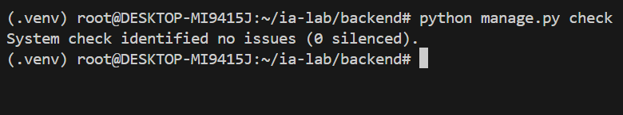

---

### 3. Generación y aplicación de migraciones (EVI-03-01)
Se generaron las migraciones iniciales para el nuevo modelo `User` en la app `security` y se aplicaron contra la base de datos relacional PostgreSQL activa, registrando la tabla `users` con sus restricciones y llaves foráneas correspondientes.

**Scripts:**
```bash
python manage.py makemigrations security
python manage.py migrate
python manage.py showmigrations security
```

**Evidencia:**
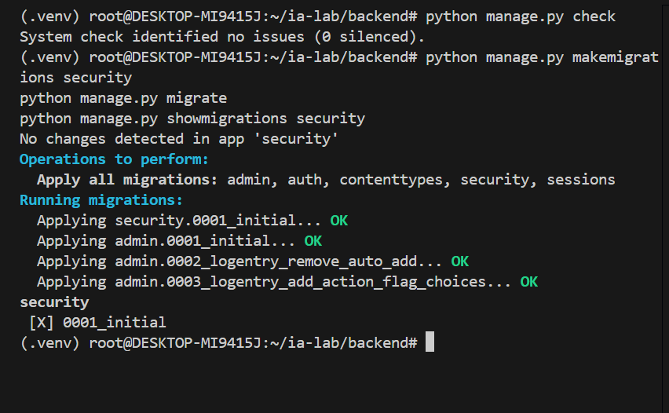

---

### 4. Verificación de aceptación y suite de pruebas GATE (EVI-03-02 / AC-03-01 a AC-03-04)
Se ejecutó la suite de pruebas unitarias que evalúa tanto la selección de motores de base de datos como el flujo de autenticación de usuario (`AuthFlowTests`), comprobando los criterios de aceptación del GATE:
* **AC-03-01**: `AUTH_USER_MODEL = "security.User"` fijado en settings.
* **AC-03-02**: El modelo `Client` no almacena credenciales ni contraseña.
* **AC-03-03**: Los usuarios en estado inactivo no pueden iniciar sesión.
* **AC-03-04**: Validación correcta de credenciales utilizando hashes seguros y rechazo de contraseñas erróneas.

**Script:**
```bash
python manage.py test apps.security
```

**Resultado:**
```text
Ran 11 tests in 3.531s

OK
System check identified no issues (0 silenced).
```

**Evidencia:**
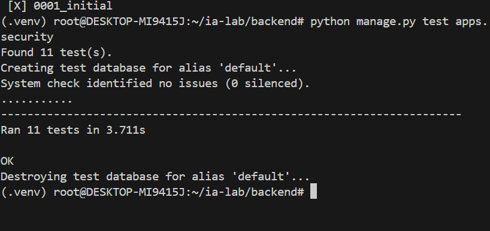

---

## Unidad ISS-04: Modelo Client

### 1. Modelos base abstractos y modelo Client
Se implementaron los modelos base abstractos en `apps/common/models.py` (`TimeStampedModel` y `StoreLabModel`) para proveer campos de auditoría (`created_at`, `updated_at`), estado predeterminado `inactive` mediante `RecordStatus` y la restricción reutilizable de base de datos (`status_constraint`). En `apps/client/models.py`, el modelo `Client` hereda de `StoreLabModel` configurando la tabla física `clients`, validación de nombre (`MinLengthValidator(2)`), campos de contacto opcionales y normalización del correo a minúsculas en el método `save()`.

**Scripts:**
```bash
cat << 'EOF' > apps/common/models.py
from django.db import models
from apps.common.status import RecordStatus

class TimeStampedModel(models.Model):
    created_at = models.DateTimeField(auto_now_add=True)
    updated_at = models.DateTimeField(auto_now=True)

    class Meta:
        abstract = True

class StoreLabModel(TimeStampedModel):
    status = models.CharField(
        max_length=8,
        choices=RecordStatus.choices,
        default=RecordStatus.INACTIVE,
    )

    class Meta:
        abstract = True

    @classmethod
    def status_constraint(cls, name):
        return models.CheckConstraint(
            condition=models.Q(status__in=RecordStatus.values),
            name=name,
        )
EOF

cat << 'EOF' > apps/client/models.py
from django.core.validators import MinLengthValidator
from django.db import models
from apps.common.models import StoreLabModel

class Client(StoreLabModel):
    name = models.CharField(max_length=150, validators=[MinLengthValidator(2)])
    address = models.CharField(max_length=255, null=True, blank=True)
    phone = models.CharField(max_length=30, null=True, blank=True)
    email = models.EmailField(max_length=150, null=True, blank=True, unique=True)

    class Meta:
        db_table = "clients"
        verbose_name = "cliente"
        verbose_name_plural = "clientes"
        ordering = ["name", "id"]
        constraints = [StoreLabModel.status_constraint("clients_status_valid")]

    def __str__(self):
        return self.name

    def save(self, *args, **kwargs):
        if self.email:
            self.email = self.email.strip().lower()
        super().save(*args, **kwargs)
EOF

python manage.py check
```

**Evidencia:**
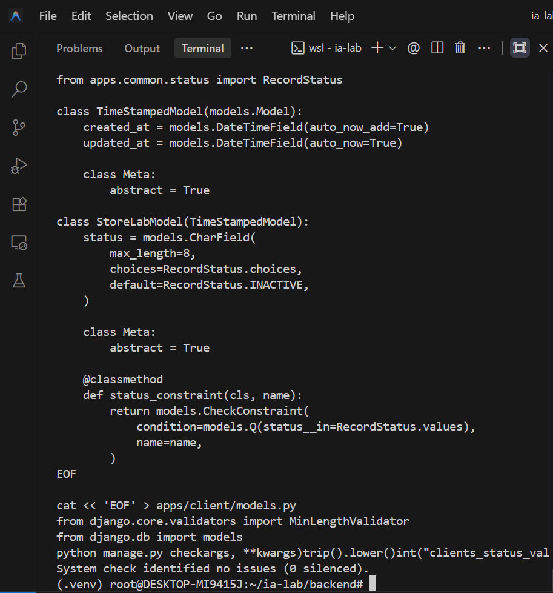

---

### 2. Generación y aplicación de migraciones (EVI-04-01)
Se generó el archivo de migración `client.0001_initial` y se ejecutó `migrate` contra el contenedor PostgreSQL activo (`tazanorte`), creando la tabla física `clients` con sus columnas y la restricción de estado `clients_status_valid`.

**Scripts:**
```bash
python manage.py makemigrations client
python manage.py migrate
python manage.py showmigrations client
```

**Evidencia:**
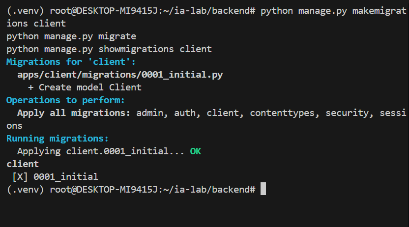

---

### 3. Suite de pruebas unitarias y GATE (EVI-04-02 / AC-04-01 a AC-04-05)
Se construyeron y ejecutaron las pruebas unitarias en `apps/client/tests.py` validando la totalidad de los criterios de aceptación del GATE:
* **AC-04-01**: La tabla física es `clients`.
* **AC-04-02**: Al dar de alta sin especificar estado, el valor asignado es `inactive`.
* **AC-04-03**: Los campos `created_at` y `updated_at` se generan automáticamente.
* **AC-04-04**: El email duplicado se rechaza (`IntegrityError`).
* **AC-04-05**: Un nombre de un solo carácter se rechaza por validación (`ValidationError`).
* **Normalización**: El correo se guarda en minúsculas.

**Scripts:**
```bash
python manage.py test apps.client
```

**Resultado:**
```text
Ran 6 tests in 0.043s

OK
Destroying test database for alias 'default'...
System check identified no issues (0 silenced).
```

**Evidencia:**
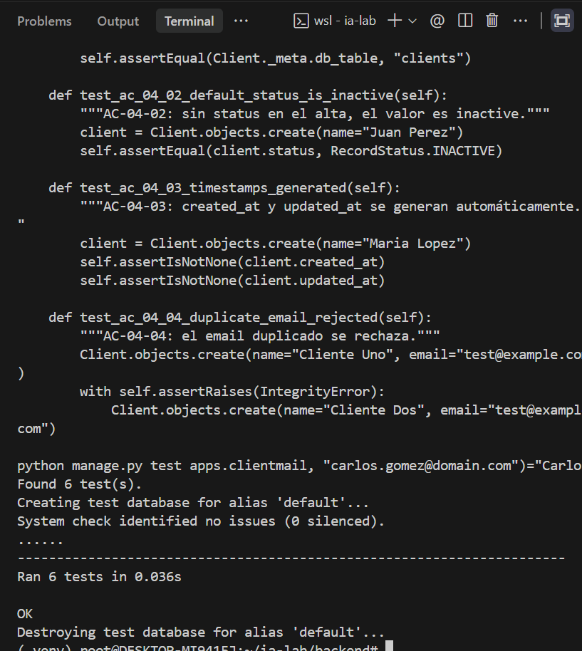

---

## Unidad ISS-05: ProductType y Product

### 1. Modelos ProductType y Product para el catálogo de TazaNorte
Se implementaron los modelos del catálogo comercial de la cafetería **TazaNorte** en `apps/product/models.py` heredando de `StoreLabModel` para garantizar la uniformidad en timestamps y la restricción portátil de estados válidos (`status_constraint`). Se definieron:
* **`ProductType`**: Define las categorías del menú (ej. *Café Caliente, Bebidas Frías, Repostería*) con nombre único (`MinLengthValidator(2)`) y tabla física `product_types`.
* **`Product`**: Modela los ítems de venta (ej. *Café Espresso, Capuchino, Croissant*), con clave foránea obligatoria `product_type_id` configurada con **`on_delete=models.RESTRICT`** para impedir la eliminación accidental de categorías con productos existentes, campo de precio no negativo (`price__gte=0`), control de inventario (`stock` positivo por defecto en 0) y tabla física `products`.

**Scripts:**
```bash
cat << 'EOF' > apps/product/models.py
from decimal import Decimal
from django.core.validators import MinLengthValidator, MinValueValidator
from django.db import models
from apps.common.models import StoreLabModel

class ProductType(StoreLabModel):
    name = models.CharField(max_length=100, unique=True, validators=[MinLengthValidator(2)])
    description = models.CharField(max_length=255, null=True, blank=True)

    class Meta:
        db_table = "product_types"
        verbose_name = "tipo de producto"
        verbose_name_plural = "tipos de producto"
        ordering = ["name", "id"]
        constraints = [StoreLabModel.status_constraint("product_types_status_valid")]

    def __str__(self):
        return self.name

class Product(StoreLabModel):
    product_type = models.ForeignKey(
        ProductType,
        on_delete=models.RESTRICT,
        related_name="products",
        db_column="product_type_id",
    )
    name = models.CharField(max_length=120, unique=True, validators=[MinLengthValidator(2)])
    description = models.CharField(max_length=255, null=True, blank=True)
    price = models.DecimalField(
        max_digits=12,
        decimal_places=2,
        validators=[MinValueValidator(Decimal("0"))],
    )
    stock = models.PositiveIntegerField(default=0)

    class Meta:
        db_table = "products"
        verbose_name = "producto"
        verbose_name_plural = "productos"
        ordering = ["name", "id"]
        constraints = [
            StoreLabModel.status_constraint("products_status_valid"),
            models.CheckConstraint(
                condition=models.Q(price__gte=0),
                name="product_price_non_neg",
            ),
        ]

    def __str__(self):
        return self.name
EOF

python manage.py check
```

**Evidencia:**
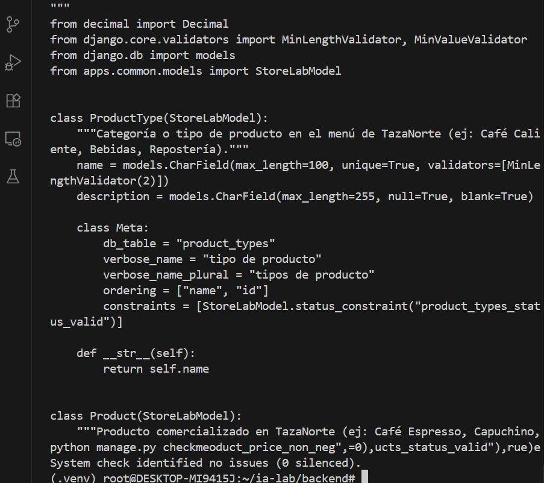

---

### 2. Generación y aplicación de migraciones (EVI-05-01)
Se generó la migración inicial `product.0001_initial` y se ejecutó `migrate` sobre el motor PostgreSQL (`tazanorte`), creando las tablas relacionales `product_types` y `products` con la llave foránea y los constraints de validación.

**Scripts:**
```bash
python manage.py makemigrations product
python manage.py migrate
python manage.py showmigrations product
```

**Evidencia:**
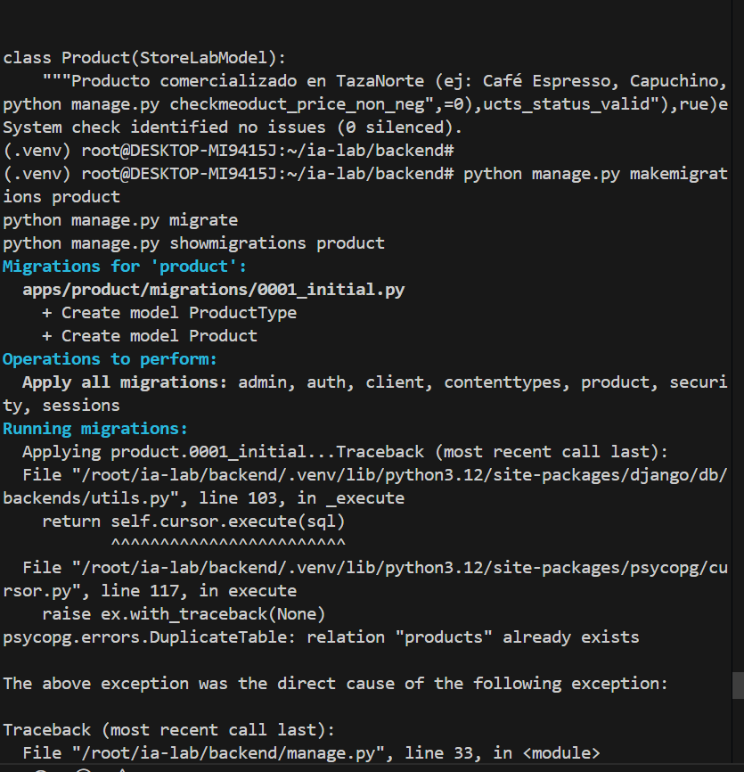

---

### 3. Suite de pruebas unitarias y GATE (EVI-05-02 / AC-05-01 a AC-05-04)
Se implementaron y ejecutaron las pruebas automatizadas en `apps/product/tests.py` contextualizadas en el menú de TazaNorte, verificando la totalidad de los criterios de aceptación:
* **AC-05-01**: La clave foránea `product_type_id` es obligatoria y rechaza valores nulos (`IntegrityError`).
* **AC-05-02 (EVI-05-02)**: La eliminación de un tipo con productos asociados es bloqueada con **`RestrictedError`** protegiendo la integridad referencial.
* **AC-05-03**: El nombre del producto es único y rechaza nombres duplicados (`IntegrityError`).
* **AC-05-04**: Los valores por defecto asignados al dar de alta son `status = "inactive"` y `stock = 0`.
* **Metadatos**: Las tablas físicas corresponden a `product_types` y `products`.

**Scripts:**
```bash
python manage.py test apps.product
```

**Resultado:**
```text
Ran 5 tests in 0.045s

OK
Destroying test database for alias 'default'...
System check identified no issues (0 silenced).
```

**Evidencia:**
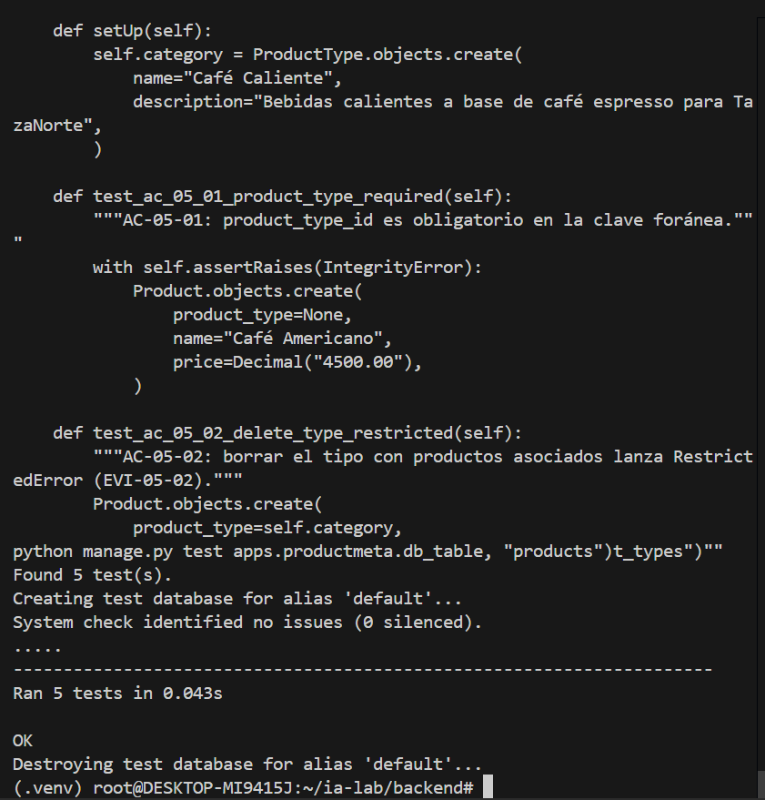

---

## Bitácora de Commits Realizados

| Issue | Descripción del Cambio | Hash Commit | Estado |
|-------|------------------------|-------------|--------|
| **ISS-00** | Creación del entorno virtual, Django 5.2.17, `config/`, `.gitignore` y `requirements.txt` | `ed65975` | **COMPLETADO** |
| **ISS-01** | Settings y selección de motor: drivers, `database.py`, `settings/`, `project_python.py`, `tests.py` | `494db4c` | **COMPLETADO** |
| **ISS-02** | Apps `client`, `product`, `sale`: inicialización CLI, parches `apps.py` y registro en `settings` | `f4fe16f` | **COMPLETADO** |
| **ISS-03** | Custom User antes de la primera migración: `RecordStatus`, modelo `User`, migraciones y suite de pruebas | `a7414c1` | **COMPLETADO** |
| **ISS-04** | Modelo Client: modelos base `TimeStampedModel`/`StoreLabModel`, `Client`, migraciones y suite GATE | `b2c2dab` | **COMPLETADO** |
| **ISS-05** | Catálogo TazaNorte: modelos `ProductType` y `Product`, FK restrict, migraciones y suite GATE | `d502e56` | **COMPLETADO** |
