# Informe de Trazabilidad: Desarrollo Backend Django - TazaNorte

> [!NOTE]
> **Aclaración Técnica de Entorno (Linter / IDE vs Runtime):**
> Las líneas onduladas o subrayados rojos que pudieran apreciarse en algunas capturas del editor corresponden exclusivamente al analizador estático y corrector sintáctico de VS Code en Windows (Pylance / Spell Checker) al abrir archivos montados sobre la ruta de red de WSL2 (`\\wsl.localhost\...`) sin vincular el intérprete de Linux. No constituyen ningún error de código, como lo certifica la ejecución limpia del comando `python manage.py check` y el paso exitoso al 100% de la suite de pruebas unitarias correspondientes en consola.


## Información del Estudiante

| Campo          | Detalle                                                                                                     |
|----------------|-------------------------------------------------------------------------------------------------------------|
| **Nombre**     | Moises Bolivar                                                                                              |
| **Programa**   | Ingeniería de Sistemas                                                                                      |
| **Facultad**   | Facultad de Ingeniería, Universidad de La Guajira                                                          |
| **Docente**    | Ing. Jaider Quintero M.                                                                                     |
| **Referencia** | [https://tecnogua.com/academic/site/backend2026/django/](https://tecnogua.com/academic/site/backend2026/django/) |
| **Proyecto**   | Sistema de Gestión Integral de Cafetería TazaNorte - Módulo Backend Django                                   |
| **Fecha**      | Octubre de 2026                                                                                             |

---

## Tabla de Contenido

- [Información del Estudiante](#información-del-estudiante)
- [Unidad ISS-00: Creación del entorno virtual](#unidad-iss-00-creación-del-entorno-virtual)
  - [1. Entorno](#1-entorno)
  - [2. Instalación del framework](#2-instalación-del-framework)
  - [3. Creación del proyecto](#3-creación-del-proyecto)
  - [4. Protección del repositorio](#4-protección-del-repositorio)
  - [5. Verificación](#5-verificación)
- [Unidad ISS-01: Settings y selección de motor](#unidad-iss-01-settings-y-selección-de-motor)
  - [1. Instalación de paquetes del sistema y drivers](#1-instalación-de-paquetes-del-sistema-y-drivers)
  - [2. Transformación de la Estructura de Archivos](#2-transformación-de-la-estructura-de-archivos)
  - [3. Definición de las variables de entorno](#3-definición-de-las-variables-de-entorno)
  - [4. Módulo de selección de base de datos](#4-módulo-de-selección-de-base-de-datos)
  - [5. Paquete de configuración](#5-paquete-de-configuración)
  - [6. Re-Ejecución del intérprete](#6-re-ejecución-del-intérprete)
  - [7. Parches en puntos de entrada en el sistema](#7-parches-en-puntos-de-entrada-en-el-sistema)
  - [8. Pruebas unitarias de selección de motor (GATE EVI-01-01)](#8-pruebas-unitarias-de-selección-de-motor-gate-evi-01-01)
- [Unidad ISS-02: Apps client, product y sale](#unidad-iss-02-apps-client-product-y-sale)
- [Unidad ISS-03: Custom User antes de la primera migración](#unidad-iss-03-custom-user-antes-de-la-primera-migración)
- [Unidad ISS-04: Modelo Client](#unidad-iss-04-modelo-client)
- [Unidad ISS-05: ProductType y Product](#unidad-iss-05-producttype-y-product)
- [Unidad ISS-06: Sale y ProductSale](#unidad-iss-06-sale-y-productsale)
- [Unidad ISS-07: Serializers y JSON camelCase](#unidad-iss-07-serializers-y-json-camelcase)
- [Unidad ISS-08: Client con ModelViewSet](#unidad-iss-08-client-con-modelviewset)
- [Unidad ISS-09: Catálogo con ModelViewSet](#unidad-iss-09-catálogo-con-modelviewset)
- [Unidad ISS-10: Disponibles con ListAPIView](#unidad-iss-10-disponibles-con-listapiview)
  - [1. Ajustes de Rutas en apps/product/urls.py](#1-ajustes-de-rutas-en-appsproducturlspy)
  - [2. Implementación de Vista en apps/product/views.py](#2-implementación-de-vista-en-appsproductviewspy)
  - [3. Pruebas Automatizadas en apps/product/tests.py](#3-pruebas-automatizadas-en-appsproducttestspy)
  - [4. Verificación y Ejecución de la Suite (GATE)](#4-verificación-y-ejecución-de-la-suite-gate)
- [Unidad ISS-11: Registro de venta con APIView](#unidad-iss-11-registro-de-venta-con-apiview)
  - [1. Transacción Atómica en apps/sale/managers.py](#1-transacción-atómica-en-appssalemanagerspy)
  - [2. Serializers de Registro en apps/sale/serializers.py](#2-serializers-de-registro-en-appssaleserializerspy)
  - [3. Vistas de Registro en apps/sale/views.py](#3-vistas-de-registro-en-appssaleviewspy)
  - [4. Enrutamiento en apps/sale/urls.py y config/urls.py](#4-enrutamiento-en-appssaleurlspy-y-configurlspy)
  - [5. Pruebas Automatizadas y GATE en apps/sale/tests.py](#5-pruebas-automatizadas-y-gate-en-appssaletestspy)
  - [6. Verificación en Consola (GATE EVI-11-01)](#6-verificación-en-consola-gate-evi-11-01)
- [Unidad ISS-12: Consulta y anulación de ventas](#unidad-iss-12-consulta-y-anulación-de-ventas)
  - [1. Vistas de Consulta y Anulación en apps/sale/views.py](#1-vistas-de-consulta-y-anulación-en-appssaleviewspy)
  - [2. Enrutamiento en apps/sale/urls.py](#2-enrutamiento-en-appssaleurlspy)
  - [3. Pruebas Automatizadas y GATE en apps/sale/tests.py](#3-pruebas-automatizadas-y-gate-en-appssaletestspy)
  - [4. Verificación en Consola (GATE EVI-12-01)](#4-verificación-en-consola-gate-evi-12-01)
- [Unidad ISS-13: Django Admin](#unidad-iss-13-django-admin)
- [Unidad ISS-14: OpenAPI (drf-spectacular y Swagger UI)](#unidad-iss-14-openapi-drf-spectacular-y-swagger-ui)
- [Unidad ISS-15: RefreshToken (SimpleJWT y tokens.py)](#unidad-iss-15-refreshtoken-simplejwt-y-tokenspy)
- [Unidad ISS-16: Role, RoleUser, Resource y ResourceRole](#unidad-iss-16-role-roleuser-resource-y-resourcerole)
- [Unidad ISS-17: Login OPEN](#unidad-iss-17-login-open)
- [Unidad ISS-18: Refresh con rotación](#unidad-iss-18-refresh-con-rotación)
- [Unidad ISS-19: Logout](#unidad-iss-19-logout)
- [Unidad ISS-20: Perfil JWT con token](#unidad-iss-20-perfil-jwt-con-token)
- [Unidad ISS-21: HasResourceAccess](#unidad-iss-21-hasresourceaccess)
- [Unidad ISS-22: RBAC sobre el negocio](#unidad-iss-22-rbac-sobre-el-negocio)
  - [1. Panel de Administración de Clientes (apps/client/admin.py)](#1-panel-de-administración-de-clientes-appsclientadminpy)
  - [2. Panel del Catálogo de Menú (apps/product/admin.py)](#2-panel-del-catálogo-de-menú-appsproductadminpy)
  - [3. Panel de Ventas y Detalle en Solo Lectura (apps/sale/admin.py)](#3-panel-de-ventas-y-detalle-en-solo-lectura-appssaleadminpy)
  - [4. Verificación en Consola y Validación del Sistema (GATE EVI-13-01)](#4-verificación-en-consola-y-validación-del-sistema-gate-evi-13-01)
- [Bitácora de Commits Realizados](#bitácora-de-commits-realizados)

---

## Unidad ISS-00: Creación del entorno virtual

### 1. Entorno
Se creó el entorno virtual con Python 3.12 en el cual se guardan las librerías necesarias para el funcionamiento del backend del proyecto en la carpeta aislada `.venv`.

**Scripts de creación:**
```bash
python3 -m venv .venv
```

**Scripts de activación:**
```bash
source .venv/bin/activate
```

**Evidencia:**


---

### 2. Instalación del framework
El framework de Python que se utilizará para la creación del backend en este proyecto es Django 5.2.17, el cual provee el ORM, arquitectura MVC/MVT, controladores y la comunicación robusta con las bases de datos relacionales de TazaNorte. Para ello utilizamos el sistema de gestión de paquetes `pip`.

**Scripts:**
```bash
python -m pip install "Django==5.2.17"
python -m pip freeze > requirements.txt
```

**Evidencias:**


---

### 3. Creación del proyecto
Por medio de Django nos es posible la creación de una plantilla inicial de proyecto a partir del framework con una estructura de archivos concreta para trabajar con la librería, dejando `manage.py` en la raíz y la configuración centralizada en el paquete `config/`.

**Script:**
```bash
django-admin startproject config .
```

**Evidencias:**


---

### 4. Protección del repositorio
Ya que se trabajará con repositorios de GitHub, es importante conocer que ficheros como `.env`, `.venv` o `db.sqlite3` contienen información sensible o redundante que no debe ser subida al repositorio. Para prevenir esto se agrega un archivo `.gitignore` a la raíz del backend donde se indica qué ficheros no deben ser subidos.

**Contenido del `.gitignore`:**
```text
.venv/
__pycache__/
*.py[cod]
.env
db.sqlite3
*.log
.idea/
.vscode/
staticfiles/
media/
.pytest_cache/
htmlcov/
.coverage
```

**Evidencia:**


---

### 5. Verificación
Se comprobó la versión activa de Django y la integridad del proyecto generado sin incidencias identificadas.

**Scripts:**
```bash
python -m django --version
python manage.py check
```

**Evidencia:**


---

## Unidad ISS-01: Settings y selección de motor

### 1. Instalación de paquetes del sistema y drivers
Los paquetes contienen las herramientas necesarias para realizar las conexiones entre Django y los 4 motores de bases de datos relacionales del laboratorio (**PostgreSQL**, **MySQL**, **SQL Server** y **Oracle**). En Ubuntu/WSL se instalaron primero las cabeceras de compilación de MySQL (`build-essential`, `pkg-config`, `default-libmysqlclient-dev`, `python3.12-dev`) y posteriormente los drivers en `.venv`, listándolos dentro del archivo `requirements.txt`.

**Scripts:**
```bash
# Compilador y cabeceras de MySQL para Ubuntu/WSL
apt install -y build-essential pkg-config default-libmysqlclient-dev python3.12-dev

# Entorno activo e instalación de drivers
source .venv/bin/activate
which python
python -m pip install "python-dotenv==1.2.3"
python -m pip install "psycopg[binary]==3.3.6"
python -m pip install "mysqlclient==2.3.0"
python -m pip install "mssql-django==2.0.0"
python -m pip install "oracledb==26.0.1"
python -m pip freeze > requirements.txt
```

**Evidencia:**


---

### 2. Transformación de la Estructura de Archivos
Se eliminó el archivo plano generado automáticamente `config/settings.py` y se creó el paquete `config/settings/` con su respectivo archivo `__init__.py`. 

Adicionalmente se crearon `.env.example` con la plantilla de variables, `.env` con las credenciales reales de la cafetería TazaNorte, `config/database.py` para la selección dinámica de motores y `config/project_python.py` para el manejo de intérprete.

**Scripts:**
```bash
rm config/settings.py
mkdir -p config/settings
```

**Evidencia:**


---

### 3. Definición de las variables de entorno
En `.env.example` se guardaron los nombres de las variables de entorno del proyecto sin credenciales sensibles. En `.env` se guardaron los valores reales correspondientes a los contenedores Docker de TazaNorte y se inyectó la clave generada con `get_random_secret_key()`.

**Contenido de `.env.example`:**
```env
# Copie este archivo a .env y complete los valores.
# .env no se versiona.
DJANGO_SECRET_KEY=
DJANGO_DEBUG=True
DJANGO_ALLOWED_HOSTS=localhost,127.0.0.1,testserver

# Motor activo. Uno solo por ejecución: postgresql | mysql | mssql | oracle
DB_ENGINE=postgresql

POSTGRES_DB=tazanorte
POSTGRES_USER=admin_user
POSTGRES_PASSWORD=AdminPassword123*
POSTGRES_HOST=127.0.0.1
POSTGRES_PORT=5432

MYSQL_DB=TazaNorte
MYSQL_USER=admin_user
MYSQL_PASSWORD=AdminPassword123*
MYSQL_HOST=127.0.0.1
MYSQL_PORT=3306

MSSQL_DB=tazanorte
MSSQL_USER=sa
MSSQL_PASSWORD=AdminPassword123*
MSSQL_HOST=127.0.0.1
MSSQL_PORT=1433

ORACLE_DB=XEPDB1
ORACLE_USER=ADMIN_USER
ORACLE_PASSWORD=AdminPassword123*
ORACLE_HOST=127.0.0.1
ORACLE_PORT=1521
ORACLE_SERVICE_NAME=XEPDB1

# Laboratorio académico. En producción liste orígenes explícitos.
CORS_ALLOW_ALL_ORIGINS=True
```

**Evidencia:**


---

### 4. Módulo de selección de base de datos
Dentro de `config/database.py` se elaboró el script de selección de base de datos dinámico a través de `database_from_environ(env)`.

**Código de `config/database.py`:**
```python
"""Selección del motor de base de datos a partir del entorno.

Un solo alias, default, queda activo en cada ejecución.
"""

from django.core.exceptions import ImproperlyConfigured

ALLOWED_ENGINES = ("postgresql", "mysql", "mssql", "oracle")


def _required(env, key):
    value = env.get(key)
    if value is None or str(value).strip() == "":
        raise ImproperlyConfigured(
            f"Falta la variable de entorno {key} para DB_ENGINE={env.get('DB_ENGINE')}."
        )
    return str(value).strip()


def _postgresql(env):
    return {
        "ENGINE": "django.db.backends.postgresql",
        "NAME": _required(env, "POSTGRES_DB"),
        "USER": _required(env, "POSTGRES_USER"),
        "PASSWORD": _required(env, "POSTGRES_PASSWORD"),
        "HOST": _required(env, "POSTGRES_HOST"),
        "PORT": _required(env, "POSTGRES_PORT"),
    }


def _mysql(env):
    return {
        "ENGINE": "django.db.backends.mysql",
        "NAME": _required(env, "MYSQL_DB"),
        "USER": _required(env, "MYSQL_USER"),
        "PASSWORD": _required(env, "MYSQL_PASSWORD"),
        "HOST": _required(env, "MYSQL_HOST"),
        "PORT": _required(env, "MYSQL_PORT"),
        "OPTIONS": {"charset": "utf8mb4"},
    }


def _mssql(env):
    return {
        "ENGINE": "mssql",
        "NAME": _required(env, "MSSQL_DB"),
        "USER": _required(env, "MSSQL_USER"),
        "PASSWORD": _required(env, "MSSQL_PASSWORD"),
        "HOST": _required(env, "MSSQL_HOST"),
        "PORT": _required(env, "MSSQL_PORT"),
        "OPTIONS": {
            "driver": "ODBC Driver 18 for SQL Server",
            "extra_params": "TrustServerCertificate=yes",
        },
    }


def _oracle(env):
    host = _required(env, "ORACLE_HOST")
    port = _required(env, "ORACLE_PORT")
    service = _required(env, "ORACLE_SERVICE_NAME")
    dsn = (
        f"(DESCRIPTION=(ADDRESS=(PROTOCOL=TCP)(HOST={host})(PORT={port}))"
        f"(CONNECT_DATA=(SERVICE_NAME={service})))"
    )
    return {
        "ENGINE": "django.db.backends.oracle",
        "NAME": dsn,
        "USER": _required(env, "ORACLE_USER"),
        "PASSWORD": _required(env, "ORACLE_PASSWORD"),
        "HOST": host,
        "PORT": "",
    }


def database_from_environ(env):
    engine = str(env.get("DB_ENGINE", "postgresql")).strip().lower()
    if engine not in ALLOWED_ENGINES:
        allowed = ", ".join(ALLOWED_ENGINES)
        raise ImproperlyConfigured(
            f"DB_ENGINE='{engine}' no es válido. Valores permitidos: {allowed}."
        )

    builders = {
        "postgresql": _postgresql,
        "mysql": _mysql,
        "mssql": _mssql,
        "oracle": _oracle,
    }
    return {"default": builders[engine](env)}
```

**Evidencias:**


---

### 5. Paquete de configuración
Dentro del fichero `config/settings/__init__.py` se cargan las variables de entorno, se asegura la presencia de `DJANGO_SECRET_KEY` y se configura `DATABASES`.

**Contenido del fichero `config/settings/__init__.py`:**
```python
import os
from pathlib import Path

# python-dotenv, instalado en este ISS. Lee .env antes de SECRET_KEY y DATABASES.
from dotenv import load_dotenv

from config.database import database_from_environ

BASE_DIR = Path(__file__).resolve().parent.parent.parent
load_dotenv(BASE_DIR / ".env")

SECRET_KEY = os.environ.get("DJANGO_SECRET_KEY", "").strip()
if not SECRET_KEY:
    from django.core.exceptions import ImproperlyConfigured

    raise ImproperlyConfigured("Defina DJANGO_SECRET_KEY en el archivo .env.")

DEBUG = os.environ.get("DJANGO_DEBUG", "False").strip().lower() in {"1", "true", "yes", "on"}

ALLOWED_HOSTS = [
    host.strip()
    for host in os.environ.get("DJANGO_ALLOWED_HOSTS", "localhost,127.0.0.1").split(",")
    if host.strip()
]

INSTALLED_APPS = [
    "django.contrib.admin",
    "django.contrib.auth",
    "django.contrib.contenttypes",
    "django.contrib.sessions",
    "django.contrib.messages",
    "django.contrib.staticfiles",
]

MIDDLEWARE = [
    "django.middleware.security.SecurityMiddleware",
    "django.contrib.sessions.middleware.SessionMiddleware",
    "django.middleware.common.CommonMiddleware",
    "django.middleware.csrf.CsrfViewMiddleware",
    "django.contrib.auth.middleware.AuthenticationMiddleware",
    "django.contrib.messages.middleware.MessageMiddleware",
    "django.middleware.clickjacking.XFrameOptionsMiddleware",
]

ROOT_URLCONF = "config.urls"

TEMPLATES = [
    {
        "BACKEND": "django.template.backends.django.DjangoTemplates",
        "DIRS": [],
        "APP_DIRS": True,
        "OPTIONS": {
            "context_processors": [
                "django.template.context_processors.request",
                "django.contrib.auth.context_processors.auth",
                "django.contrib.messages.context_processors.messages",
            ],
        },
    },
]

WSGI_APPLICATION = "config.wsgi.application"
ASGI_APPLICATION = "config.asgi.application"

DATABASES = database_from_environ(os.environ)

AUTH_PASSWORD_VALIDATORS = [
    {"NAME": "django.contrib.auth.password_validation.UserAttributeSimilarityValidator"},
    {"NAME": "django.contrib.auth.password_validation.MinimumLengthValidator"},
    {"NAME": "django.contrib.auth.password_validation.CommonPasswordValidator"},
    {"NAME": "django.contrib.auth.password_validation.NumericPasswordValidator"},
]

LANGUAGE_CODE = "es"
TIME_ZONE = "America/Bogota"
USE_I18N = True
USE_TZ = True

STATIC_URL = "static/"
DEFAULT_AUTO_FIELD = "django.db.models.BigAutoField"
```

**Evidencia:**


---

### 6. Re-Ejecución del intérprete
En el fichero `config/project_python.py` se almacena un script de prevención que evita que la ejecución de `manage.py` fuera del entorno virtual `.venv` resulte en errores, re-lanzando el proceso con `.venv/bin/python`.

**Contenido del fichero `config/project_python.py`:**
```python
import os
import sys
from pathlib import Path

PROJECT_ROOT = Path(__file__).resolve().parent.parent


def use_project_python():
    venv_root = PROJECT_ROOT / ".venv"
    venv_python = venv_root / "bin" / "python"
    if not venv_python.is_file():
        return
    try:
        if Path(sys.prefix).resolve() == venv_root.resolve():
            return
    except OSError:
        return
    os.execv(venv_python, [str(venv_python), *sys.argv])
```

**Evidencia:**


---

### 7. Parches en puntos de entrada en el sistema
Se integraron `use_project_python()` y `load_dotenv()` al inicio de `manage.py`, `config/wsgi.py` y `config/asgi.py`.

**Evidencias:**


---

### 8. Pruebas unitarias de selección de motor (GATE EVI-01-01)
Se creó la suite de pruebas unitarias en `config/tests.py` mediante `DatabaseSelectionTests` con `SimpleTestCase`, validando:
- Selección correcta del backend para PostgreSQL, MySQL, SQL Server y Oracle.
- DSN de Oracle con `SERVICE_NAME`.
- Lanzamiento de `ImproperlyConfigured` ante motores no soportados o variables obligatorias vacías.

**Comando de verificación:**
```bash
python manage.py test config
python manage.py check
```

**Resultado:**
```text
Found 6 test(s).
System check identified no issues (0 silenced).
......
----------------------------------------------------------------------
Ran 6 tests in 0.001s

OK
```

**Evidencias:**


---

---

## Unidad ISS-02: Apps client, product y sale

En esta unidad se crean los paquetes de aplicaciones de negocio con la CLI dentro del paquete `apps/` y se registran en la configuración global del proyecto.

### 1. Construcción de paquetes
Se crearon los directorios correspondientes a cada aplicación de negocio y se inicializaron mediante `startapp`.

**Scripts:**
```bash
mkdir -p apps/client apps/product apps/sale
python manage.py startapp client apps/client
python manage.py startapp product apps/product
python manage.py startapp sale apps/sale
```

**Evidencias:**


---

### 2. Creación de apps/__init__.py
Se asegura que el directorio `apps/` sea reconocido formalmente como un paquete de Python.

**Script:**
```bash
mkdir -p apps
cat > apps/__init__.py <<'EOF'
EOF
```

**Evidencia:**


---

### 3. Parche de name y label en las apps
Django supone por defecto que las aplicaciones viven en la raíz del proyecto. Al residir dentro del paquete `apps/`, se configura `name = "apps.<nombre>"` para el módulo y `label = "<nombre>"` para conservar nombres limpios en migraciones.

**Parche en client (`apps/client/apps.py`):**
```python
from django.apps import AppConfig


class ClientConfig(AppConfig):
    default_auto_field = 'django.db.models.BigAutoField'
    name = 'apps.client'
    label = 'client'
```

**Parche en product (`apps/product/apps.py`):**
```python
from django.apps import AppConfig


class ProductConfig(AppConfig):
    default_auto_field = 'django.db.models.BigAutoField'
    name = 'apps.product'
    label = 'product'
```

**Parche en sale (`apps/sale/apps.py`):**
```python
from django.apps import AppConfig


class SaleConfig(AppConfig):
    default_auto_field = 'django.db.models.BigAutoField'
    name = 'apps.sale'
    label = 'sale'
```

**Evidencia:**


---

### 4. Agregación de las apps a settings/__init__.py
Se agregaron las clases `ClientConfig`, `ProductConfig` y `SaleConfig` al listado `INSTALLED_APPS` debajo de `staticfiles`.

**Instrucción:**
```python
INSTALLED_APPS = [
    ...
    "django.contrib.staticfiles",
    "apps.client.apps.ClientConfig",
    "apps.product.apps.ProductConfig",
    "apps.sale.apps.SaleConfig",
]
```

**Evidencia:**


---

### 5. Prueba de aceptación y GATE (EVI-02-01)
Se verificó la integridad del proyecto mediante el CLI de Django, confirmando que las tres apps están debidamente registradas y sin errores de configuración.

**Script:**
```bash
python manage.py check
```

**Resultado:**
```text
System check identified no issues (0 silenced).
```

**Evidencia:**


---

## Unidad ISS-03: Custom User antes de la primera migración

### 1. Creación del módulo common y app security
Se creó el módulo reutilizable `apps/common` con las definiciones globales de estado (`RecordStatus`), y la aplicación `apps/security` inicializada a través de la CLI de Django (`manage.py startapp`).

**Scripts:**
```bash
mkdir -p apps/common
touch apps/common/__init__.py
python manage.py startapp security apps/security
```

**Código de `apps/common/status.py`:**
```python
from django.db import models

class RecordStatus(models.TextChoices):
    ACTIVE = "active", "Active"
    INACTIVE = "inactive", "Inactive"
```

**Evidencia:**


---

### 2. Configuración del modelo Custom User y parches en settings
Se definió el modelo de usuario personalizado `User` heredando de `AbstractUser` de Django, incorporando `StoreUserManager`, normalización de email, y vinculación de `is_active` según el estado del registro. Se parcheó `apps/security/apps.py` y se configuró `AUTH_USER_MODEL = "security.User"` en `config/settings/__init__.py` antes de cualquier migración.

**Código de `apps/security/apps.py`:**
```python
from django.apps import AppConfig

class SecurityConfig(AppConfig):
    default_auto_field = 'django.db.models.BigAutoField'
    name = 'apps.security'
    label = 'security'
```

**Código de `apps/security/models.py`:**
```python
from django.contrib.auth.models import AbstractUser, UserManager
from django.db import models
from apps.common.status import RecordStatus

class StoreUserManager(UserManager):
    def create_user(self, username, email=None, password=None, **extra_fields):
        extra_fields.setdefault("status", RecordStatus.INACTIVE)
        return super().create_user(username, email, password, **extra_fields)

    def create_superuser(self, username, email=None, password=None, **extra_fields):
        extra_fields.setdefault("status", RecordStatus.ACTIVE)
        extra_fields.setdefault("is_staff", True)
        extra_fields.setdefault("is_superuser", True)
        return super().create_superuser(username, email, password, **extra_fields)

class User(AbstractUser):
    email = models.EmailField("correo electrónico", max_length=150, unique=True)
    status = models.CharField(
        max_length=8,
        choices=RecordStatus.choices,
        default=RecordStatus.INACTIVE,
    )
    created_at = models.DateTimeField(auto_now_add=True)
    updated_at = models.DateTimeField(auto_now=True)

    objects = StoreUserManager()

    class Meta:
        db_table = "users"
        verbose_name = "usuario"
        verbose_name_plural = "usuarios"
        constraints = [
            models.CheckConstraint(
                condition=models.Q(status__in=RecordStatus.values),
                name="users_status_valid",
            )
        ]

    def save(self, *args, **kwargs):
        if self.email:
            self.email = self.email.strip().lower()
        self.is_active = self.status == RecordStatus.ACTIVE
        super().save(*args, **kwargs)
```

**Evidencia:**


---

### 3. Generación y aplicación de migraciones (EVI-03-01)
Se generaron las migraciones iniciales para el nuevo modelo `User` en la app `security` y se aplicaron contra la base de datos relacional PostgreSQL activa, registrando la tabla `users` con sus restricciones y llaves foráneas correspondientes.

**Scripts:**
```bash
python manage.py makemigrations security
python manage.py migrate
python manage.py showmigrations security
```

**Evidencia:**


---

### 4. Verificación de aceptación y suite de pruebas GATE (EVI-03-02 / AC-03-01 a AC-03-04)
Se ejecutó la suite de pruebas unitarias que evalúa tanto la selección de motores de base de datos como el flujo de autenticación de usuario (`AuthFlowTests`), comprobando los criterios de aceptación del GATE:
* **AC-03-01**: `AUTH_USER_MODEL = "security.User"` fijado en settings.
* **AC-03-02**: El modelo `Client` no almacena credenciales ni contraseña.
* **AC-03-03**: Los usuarios en estado inactivo no pueden iniciar sesión.
* **AC-03-04**: Validación correcta de credenciales utilizando hashes seguros y rechazo de contraseñas erróneas.

**Script:**
```bash
python manage.py test apps.security
```

**Resultado:**
```text
Ran 11 tests in 3.531s

OK
System check identified no issues (0 silenced).
```

**Evidencia:**


---

## Unidad ISS-04: Modelo Client

### 1. Modelos base abstractos y modelo Client
Se implementaron los modelos base abstractos en `apps/common/models.py` (`TimeStampedModel` y `StoreLabModel`) para proveer campos de auditoría (`created_at`, `updated_at`), estado predeterminado `inactive` mediante `RecordStatus` y la restricción reutilizable de base de datos (`status_constraint`). En `apps/client/models.py`, el modelo `Client` hereda de `StoreLabModel` configurando la tabla física `clients`, validación de nombre (`MinLengthValidator(2)`), campos de contacto opcionales y normalización del correo a minúsculas en el método `save()`.

**Scripts:**
```bash
cat << 'EOF' > apps/common/models.py
from django.db import models
from apps.common.status import RecordStatus

class TimeStampedModel(models.Model):
    created_at = models.DateTimeField(auto_now_add=True)
    updated_at = models.DateTimeField(auto_now=True)

    class Meta:
        abstract = True

class StoreLabModel(TimeStampedModel):
    status = models.CharField(
        max_length=8,
        choices=RecordStatus.choices,
        default=RecordStatus.INACTIVE,
    )

    class Meta:
        abstract = True

    @classmethod
    def status_constraint(cls, name):
        return models.CheckConstraint(
            condition=models.Q(status__in=RecordStatus.values),
            name=name,
        )
EOF

cat << 'EOF' > apps/client/models.py
from django.core.validators import MinLengthValidator
from django.db import models
from apps.common.models import StoreLabModel

class Client(StoreLabModel):
    name = models.CharField(max_length=150, validators=[MinLengthValidator(2)])
    address = models.CharField(max_length=255, null=True, blank=True)
    phone = models.CharField(max_length=30, null=True, blank=True)
    email = models.EmailField(max_length=150, null=True, blank=True, unique=True)

    class Meta:
        db_table = "clients"
        verbose_name = "cliente"
        verbose_name_plural = "clientes"
        ordering = ["name", "id"]
        constraints = [StoreLabModel.status_constraint("clients_status_valid")]

    def __str__(self):
        return self.name

    def save(self, *args, **kwargs):
        if self.email:
            self.email = self.email.strip().lower()
        super().save(*args, **kwargs)
EOF

python manage.py check
```

**Evidencia:**


---

### 2. Generación y aplicación de migraciones (EVI-04-01)
Se generó el archivo de migración `client.0001_initial` y se ejecutó `migrate` contra el contenedor PostgreSQL activo (`tazanorte`), creando la tabla física `clients` con sus columnas y la restricción de estado `clients_status_valid`.

**Scripts:**
```bash
python manage.py makemigrations client
python manage.py migrate
python manage.py showmigrations client
```

**Evidencia:**


---

### 3. Suite de pruebas unitarias y GATE (EVI-04-02 / AC-04-01 a AC-04-05)
Se construyeron y ejecutaron las pruebas unitarias en `apps/client/tests.py` validando la totalidad de los criterios de aceptación del GATE:
* **AC-04-01**: La tabla física es `clients`.
* **AC-04-02**: Al dar de alta sin especificar estado, el valor asignado es `inactive`.
* **AC-04-03**: Los campos `created_at` y `updated_at` se generan automáticamente.
* **AC-04-04**: El email duplicado se rechaza (`IntegrityError`).
* **AC-04-05**: Un nombre de un solo carácter se rechaza por validación (`ValidationError`).
* **Normalización**: El correo se guarda en minúsculas.

**Scripts:**
```bash
python manage.py test apps.client
```

**Resultado:**
```text
Ran 6 tests in 0.043s

OK
Destroying test database for alias 'default'...
System check identified no issues (0 silenced).
```

**Evidencia:**


---

## Unidad ISS-05: ProductType y Product

### 1. Modelos ProductType y Product para el catálogo de TazaNorte
Se implementaron los modelos del catálogo comercial de la cafetería **TazaNorte** en `apps/product/models.py` heredando de `StoreLabModel` para garantizar la uniformidad en timestamps y la restricción portátil de estados válidos (`status_constraint`). Se definieron:
* **`ProductType`**: Define las categorías del menú (ej. *Café Caliente, Bebidas Frías, Repostería*) con nombre único (`MinLengthValidator(2)`) y tabla física `product_types`.
* **`Product`**: Modela los ítems de venta (ej. *Café Espresso, Capuchino, Croissant*), con clave foránea obligatoria `product_type_id` configurada con **`on_delete=models.RESTRICT`** para impedir la eliminación accidental de categorías con productos existentes, campo de precio no negativo (`price__gte=0`), control de inventario (`stock` positivo por defecto en 0) y tabla física `products`.

**Scripts:**
```bash
cat << 'EOF' > apps/product/models.py
from decimal import Decimal
from django.core.validators import MinLengthValidator, MinValueValidator
from django.db import models
from apps.common.models import StoreLabModel

class ProductType(StoreLabModel):
    name = models.CharField(max_length=100, unique=True, validators=[MinLengthValidator(2)])
    description = models.CharField(max_length=255, null=True, blank=True)

    class Meta:
        db_table = "product_types"
        verbose_name = "tipo de producto"
        verbose_name_plural = "tipos de producto"
        ordering = ["name", "id"]
        constraints = [StoreLabModel.status_constraint("product_types_status_valid")]

    def __str__(self):
        return self.name

class Product(StoreLabModel):
    product_type = models.ForeignKey(
        ProductType,
        on_delete=models.RESTRICT,
        related_name="products",
        db_column="product_type_id",
    )
    name = models.CharField(max_length=120, unique=True, validators=[MinLengthValidator(2)])
    description = models.CharField(max_length=255, null=True, blank=True)
    price = models.DecimalField(
        max_digits=12,
        decimal_places=2,
        validators=[MinValueValidator(Decimal("0"))],
    )
    stock = models.PositiveIntegerField(default=0)

    class Meta:
        db_table = "products"
        verbose_name = "producto"
        verbose_name_plural = "productos"
        ordering = ["name", "id"]
        constraints = [
            StoreLabModel.status_constraint("products_status_valid"),
            models.CheckConstraint(
                condition=models.Q(price__gte=0),
                name="product_price_non_neg",
            ),
        ]

    def __str__(self):
        return self.name
EOF

python manage.py check
```

**Evidencia:**


---

### 2. Generación y aplicación de migraciones (EVI-05-01)
Se generó la migración inicial `product.0001_initial` y se ejecutó `migrate` sobre el motor PostgreSQL (`tazanorte`), creando las tablas relacionales `product_types` y `products` con la llave foránea y los constraints de validación.

**Scripts:**
```bash
python manage.py makemigrations product
python manage.py migrate
python manage.py showmigrations product
```

**Evidencia:**


---

### 3. Suite de pruebas unitarias y GATE (EVI-05-02 / AC-05-01 a AC-05-04)
Se implementaron y ejecutaron las pruebas automatizadas en `apps/product/tests.py` contextualizadas en el menú de TazaNorte, verificando la totalidad de los criterios de aceptación:
* **AC-05-01**: La clave foránea `product_type_id` es obligatoria y rechaza valores nulos (`IntegrityError`).
* **AC-05-02 (EVI-05-02)**: La eliminación de un tipo con productos asociados es bloqueada con **`RestrictedError`** protegiendo la integridad referencial.
* **AC-05-03**: El nombre del producto es único y rechaza nombres duplicados (`IntegrityError`).
* **AC-05-04**: Los valores por defecto asignados al dar de alta son `status = "inactive"` y `stock = 0`.
* **Metadatos**: Las tablas físicas corresponden a `product_types` y `products`.

**Scripts:**
```bash
python manage.py test apps.product
```

**Resultado:**
```text
Ran 5 tests in 0.045s

OK
Destroying test database for alias 'default'...
System check identified no issues (0 silenced).
```

**Evidencia:**


---

## Unidad ISS-06: Sale y ProductSale

### 1. Manager y modelos Sale y ProductSale para TazaNorte
Se implementaron los modelos transaccionales de venta en `apps/sale/models.py` y su respectivo manager personalizado en `apps/sale/managers.py` (`SaleManager`, `SaleQuerySet`). La arquitectura modela la relación cabecera-detalle sin emplear un `ManyToManyField` plano:
* **`Sale`**: Cabecera del ticket de venta en **TazaNorte**, con clave foránea obligatoria hacia `Client` (`on_delete=models.RESTRICT`), montos no negativos (`sales_amounts_non_neg`), estado validado (`sales_status_valid`) y método transaccional atómico `void()` para anulación y restitución de stock a inventario.
* **`ProductSale`**: Detalle del ticket con clave foránea hacia `Product` y `Sale` (ambas con `RESTRICT`), persistencia inmutable del precio unitario histórico (`unit_price`) y recálculo automático de `line_total = quantity * unit_price` en el método `save()`.

**Scripts:**
```bash
cat << 'EOF' > apps/sale/managers.py
from django.db import models

class SaleQuerySet(models.QuerySet):
    pass

class SaleManager(models.Manager.from_queryset(SaleQuerySet)):
    pass
EOF

cat << 'EOF' > apps/sale/models.py
from decimal import Decimal
from django.core.validators import MinValueValidator
from django.db import models, transaction
from apps.client.models import Client
from apps.common.models import StoreLabModel
from apps.common.status import RecordStatus
from apps.product.models import Product
from apps.sale.managers import SaleManager

class Sale(StoreLabModel):
    client = models.ForeignKey(
        Client,
        on_delete=models.RESTRICT,
        related_name="sales",
        db_column="client_id",
    )
    sale_date = models.DateTimeField()
    subtotal = models.DecimalField(max_digits=12, decimal_places=2, default=Decimal("0.00"))
    tax = models.DecimalField(max_digits=12, decimal_places=2, default=Decimal("0.00"))
    discounts = models.DecimalField(max_digits=12, decimal_places=2, default=Decimal("0.00"))
    total = models.DecimalField(max_digits=12, decimal_places=2, default=Decimal("0.00"))

    objects = SaleManager()

    class Meta:
        db_table = "sales"
        verbose_name = "venta"
        verbose_name_plural = "ventas"
        ordering = ["-sale_date", "-id"]
        constraints = [
            StoreLabModel.status_constraint("sales_status_valid"),
            models.CheckConstraint(
                condition=(
                    models.Q(subtotal__gte=0)
                    & models.Q(tax__gte=0)
                    & models.Q(discounts__gte=0)
                    & models.Q(total__gte=0)
                ),
                name="sales_amounts_non_neg",
            ),
        ]

    def __str__(self):
        return f"Venta {self.pk}"

    def void(self):
        with transaction.atomic():
            sale = Sale.objects.select_for_update().get(pk=self.pk)
            if sale.status == RecordStatus.INACTIVE:
                return sale
            lines = sale.lines.select_related("product").select_for_update().order_by("product_id")
            for line in lines:
                if line.status != RecordStatus.ACTIVE:
                    continue
                product = Product.objects.select_for_update().get(pk=line.product_id)
                product.stock += line.quantity
                product.save(update_fields=["stock", "updated_at"])
                line.status = RecordStatus.INACTIVE
                line.save(update_fields=["status", "updated_at"])
            sale.status = RecordStatus.INACTIVE
            sale.save(update_fields=["status", "updated_at"])
            return sale

class ProductSale(StoreLabModel):
    sale = models.ForeignKey(
        Sale,
        on_delete=models.RESTRICT,
        related_name="lines",
        db_column="sale_id",
    )
    product = models.ForeignKey(
        Product,
        on_delete=models.RESTRICT,
        related_name="sale_lines",
        db_column="product_id",
    )
    quantity = models.PositiveIntegerField(validators=[MinValueValidator(1)])
    unit_price = models.DecimalField(max_digits=12, decimal_places=2)
    line_total = models.DecimalField(max_digits=12, decimal_places=2)

    class Meta:
        db_table = "product_sales"
        verbose_name = "detalle de venta"
        verbose_name_plural = "detalles de venta"
        ordering = ["id"]
        constraints = [
            StoreLabModel.status_constraint("product_sales_status_valid"),
            models.CheckConstraint(
                condition=(
                    models.Q(quantity__gte=1)
                    & models.Q(unit_price__gte=0)
                    & models.Q(line_total__gte=0)
                ),
                name="psale_amounts_valid",
            ),
        ]

    def __str__(self):
        return f"{self.product} x {self.quantity}"

    def save(self, *args, **kwargs):
        self.line_total = (self.unit_price * self.quantity).quantize(Decimal("0.01"))
        super().save(*args, **kwargs)
EOF

python manage.py check
```

**Evidencia:**
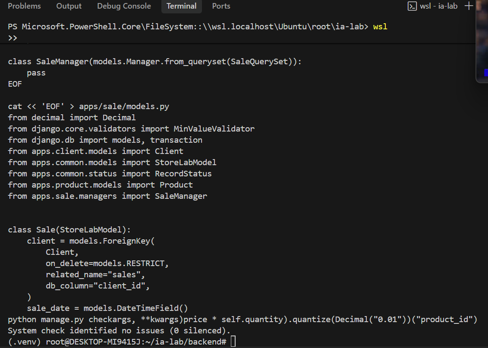

---

### 2. Generación y aplicación de migraciones (EVI-06-01)
Se generó la migración inicial `sale.0001_initial` y se ejecutó `migrate` contra PostgreSQL (`tazanorte`), creando físicamente las tablas `sales` y `product_sales` con sus restricciones de integridad relacional.

**Scripts:**
```bash
python manage.py makemigrations sale
python manage.py migrate
python manage.py showmigrations sale
```

**Evidencia:**
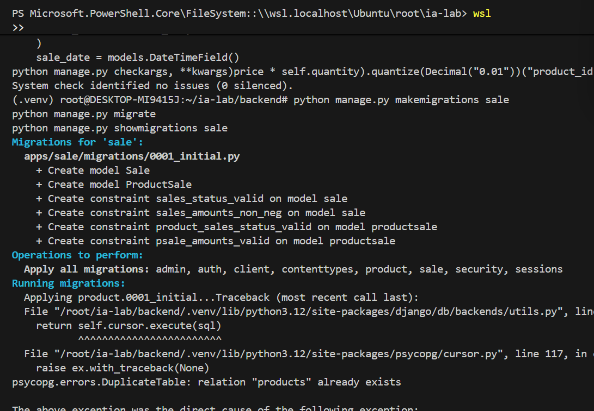

---

### 3. Suite de pruebas unitarias y GATE (EVI-06-02 / AC-06-01 a AC-06-04)
Se construyeron y ejecutaron las pruebas automatizadas en `apps/sale/tests.py` validando la totalidad de los criterios de aceptación:
* **AC-06-01**: Existencia y configuración de las tablas físicas `sales` y `product_sales`.
* **AC-06-02**: Las relaciones foráneas usan **`RESTRICT`** protegiendo clientes y productos de borrados accidentales.
* **AC-06-03**: `line_total` se autocalcula en el método `save()`.
* **AC-06-04**: No se utiliza `ManyToManyField` simple hacia `Product`.
* **EVI-06-02**: Preservación del precio histórico (al alterar el precio actual del catálogo de café, los tickets históricos conservan su importe).
* **Anulación**: El método `void()` revierte el ticket a inactivo y devuelve las unidades al stock del producto.

**Scripts:**
```bash
python manage.py test apps.sale
```

**Resultado:**
```text
Ran 6 tests in 0.109s

OK
Destroying test database for alias 'default'...
System check identified no issues (0 silenced).
```

**Evidencia:**
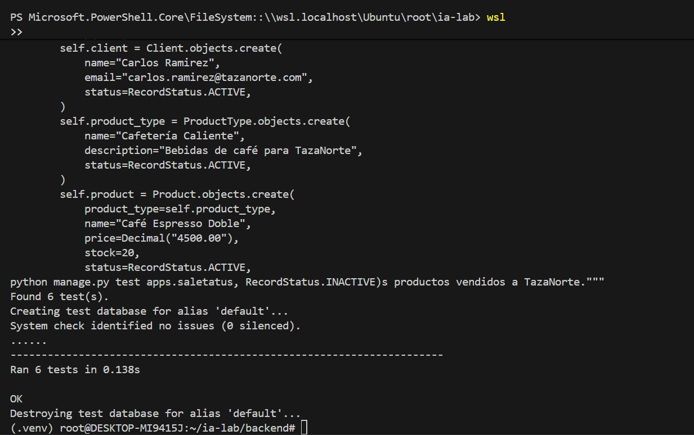

---

## Unidad ISS-07: Serializers y JSON camelCase

### 1. Instalación de dependencias de API (DRF, camelCase y CORS)
Se incorporaron al entorno virtual del backend las librerías base para la capa de API REST: `djangorestframework` (v3.17.2), `djangorestframework-camel-case` (v1.4.2) y `django-cors-headers` (v4.9.0). Se actualizó el archivo de dependencias `requirements.txt`.

**Scripts:**
```bash
python -m pip install "djangorestframework==3.17.2" "djangorestframework-camel-case==1.4.2" "django-cors-headers==4.9.0"
python -m pip freeze > requirements.txt
python -m pip list | grep -E "djangorestframework|cors"
```

**Evidencia:**
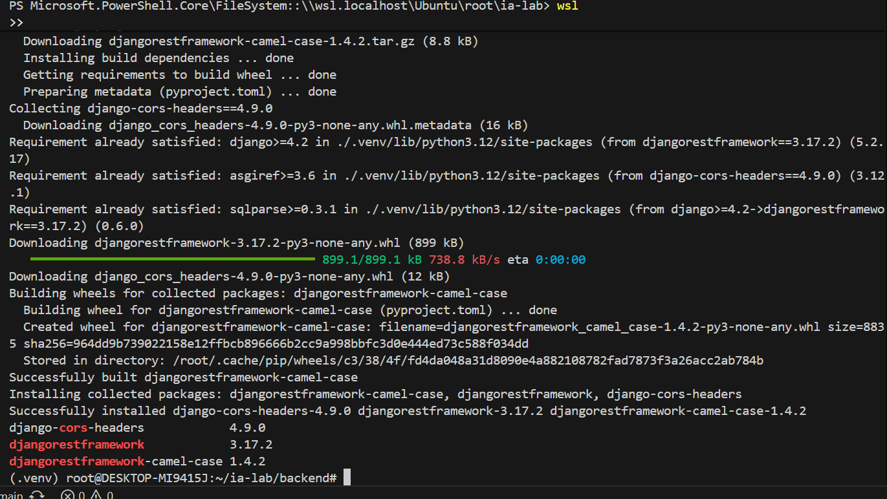

---

### 2. Configuración en settings y construcción de serializers
Se configuró `config/settings/__init__.py` registrando `rest_framework`, `corsheaders`, el middleware `CorsMiddleware` y la configuración global de renderers y parsers en `REST_FRAMEWORK` para traducción bidireccional automática a **`camelCase`**. Asimismo, se implementaron los serializers de negocio para **TazaNorte**:
* **`ClientSerializer`**: Serializa los datos del cliente, convierte cadenas vacías en `None` para campos opcionales y normaliza los correos a minúsculas.
* **`ProductTypeSerializer`** y **`ProductSerializer`**: Serializa las categorías y productos del menú, exponiendo `product_type_id` de escritura y `product_type_name` de lectura (mapeados en JSON como `productTypeId` y `productTypeName`).
* **`ProductSaleSerializer`** y **`SaleSerializer`**: Serializa la cabecera del ticket de venta y las líneas de detalle con precio histórico.

**Scripts:**
```bash
# apps/client/serializers.py
# apps/product/serializers.py
# apps/sale/serializers.py
python manage.py check
```

**Evidencia:**
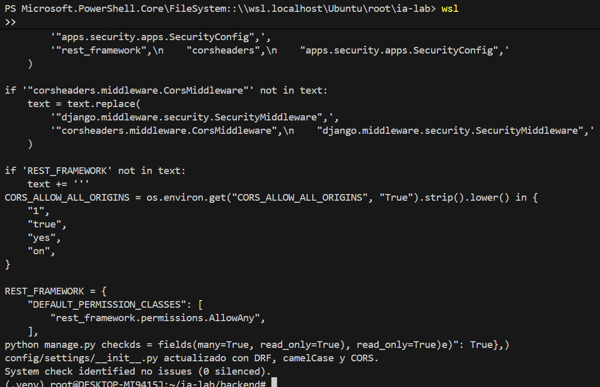

---

### 3. Suite de pruebas unitarias y GATE (EVI-07-01 / AC-07-01 a AC-07-03)
Se construyeron pruebas automatizadas en `apps/client/tests.py` validando la totalidad de los criterios de aceptación del GATE:
* **AC-07-01 (EVI-07-01)**: El payload JSON emitido utiliza formato **`camelCase`** (`createdAt` y `updatedAt`), validando la ausencia de campos en formato snake_case en el borde HTTP.
* **AC-07-02**: Normalización del correo electrónico a minúsculas (`Maria@Example.COM` a `maria@example.com`) y conversión de cadenas vacías a `None`.
* **AC-07-03**: El serializador de productos informa `productTypeName` de forma directa sin requerir consultas adicionales.

**Scripts:**
```bash
python manage.py test apps.client
```

**Resultado:**
```text
Ran 9 tests in 0.111s

OK
Destroying test database for alias 'default'...
System check identified no issues (0 silenced).
```

**Evidencia:**
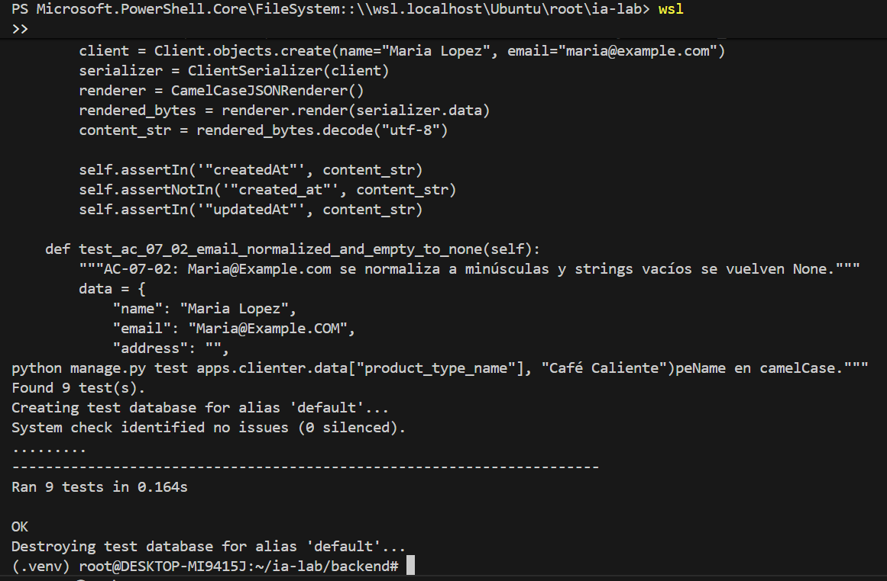

---

## Unidad ISS-08: Client con ModelViewSet

### 1. Implementación de ClientViewSet y enrutamiento REST
Se publicó el CRUD completo y homogéneo del recurso clientes para **TazaNorte** mediante `ModelViewSet` en `apps/client/views.py`. En esta primera fase se opera bajo acceso abierto (`AllowAny`), implementando:
* **Filtrado por estado**: Sobrescritura de `get_queryset()` para admitir filtros opcionales por query param (`?status=active` o `?status=inactive`).
* **Baja lógica (Soft Delete)**: Sobrescritura de `perform_destroy()` para que al invocar `DELETE /api/clients/<id>/` no se destruya la fila física de la base de datos, sino que se altere su estado a `RecordStatus.INACTIVE`.
* **Enrutamiento**: Configuración de `apps/client/urls.py` con `SimpleRouter(use_regex_path=False)` registrado con el prefijo `clients`, integrado en el enrutador global de Django bajo `path("api/", include("apps.client.urls"))` en `config/urls.py`.

**Scripts:**
```bash
# apps/client/views.py
# apps/client/urls.py
# config/urls.py
python manage.py check
```

**Evidencia:**
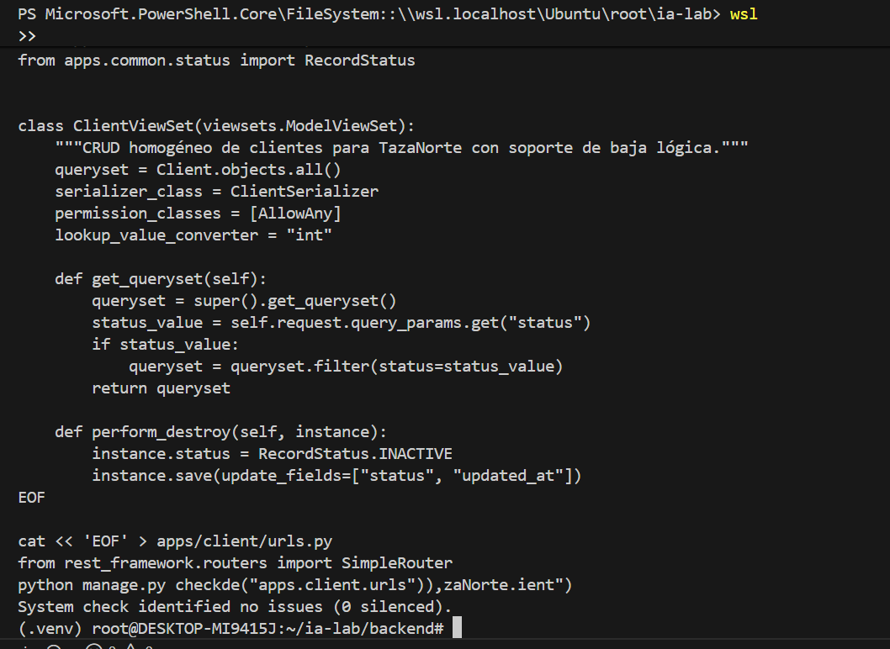

---

### 2. Suite de pruebas de API y GATE (EVI-08-01 / AC-08-01 a AC-08-04)
Se construyeron y ejecutaron las pruebas automatizadas de integración HTTP con `APITestCase` en `apps/client/tests.py`, verificando el ciclo completo del endpoint `/api/clients/`:
* **AC-08-01**: `POST` con payload válido retorna **201 Created**, asigna estado inicial `inactive` y normaliza el email a minúsculas.
* **AC-08-02**: El cliente recién registrado persiste de forma consistente en la tabla `clients` de PostgreSQL.
* **AC-08-03**: `DELETE /api/clients/<id>/` responde **204 No Content** y preserva la fila en base de datos con `status = "inactive"`.
* **AC-08-04**: El envío de cuerpos inválidos (nombre de 1 carácter o email duplicado) es rechazado con **400 Bad Request**.
* **Operaciones adicionales**: Listado general (`GET /api/clients/`), consulta por clave primaria (`GET /api/clients/<id>/`) y actualización parcial (`PATCH`).

**Scripts:**
```bash
python manage.py test apps.client
```

**Resultado:**
```text
Ran 13 tests in 0.218s

OK
Destroying test database for alias 'default'...
System check identified no issues (0 silenced).
```

**Evidencia:**
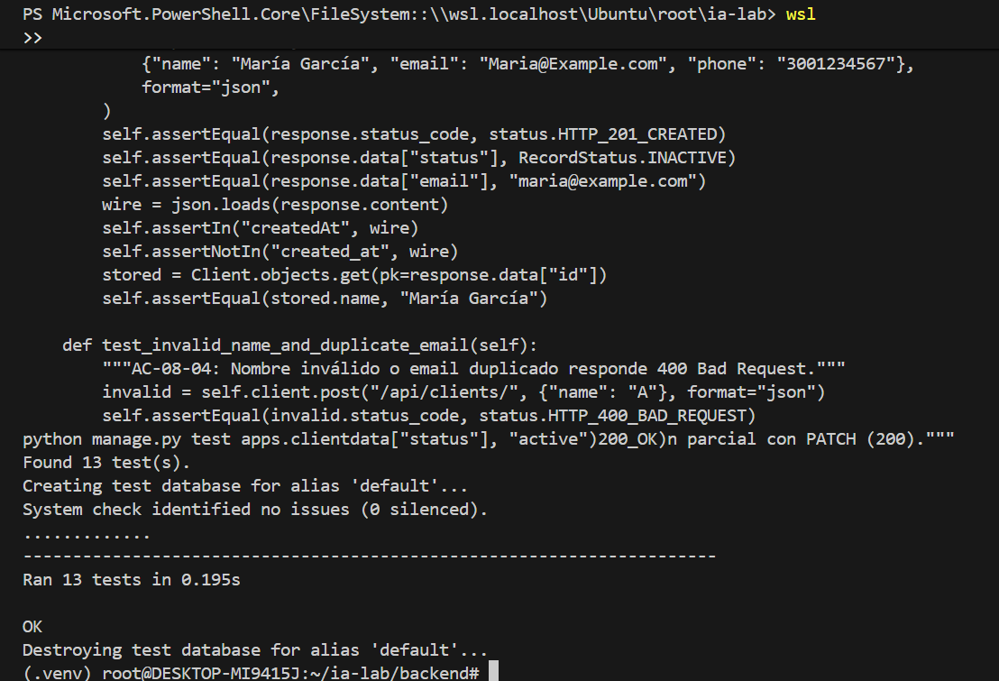

---

## Unidad ISS-09: Catálogo con ModelViewSet

### 1. Implementación de CatalogViewSet, ProductTypeViewSet y ProductViewSet
Se construyeron las vistas de la API para el catálogo comercial de la cafetería **TazaNorte** en `apps/product/views.py`. Siguiendo el principio de diseño limpio y DRY, se definió la clase base `CatalogViewSet(viewsets.ModelViewSet)` que encapsula:
* **Filtro dinámico de estado**: Lectura del query param `?status=` para discriminar registros activos o inactivos.
* **Baja lógica (Soft Delete)**: Sobrescritura de `perform_destroy()` para marcar `status = RecordStatus.INACTIVE` preservando el historial de datos.
* **Carga optimizada**: `ProductViewSet` utiliza `select_related("product_type")` para evitar consultas N+1 al consultar la categoría asociada a cada producto.
* **Enrutamiento**: Se registraron las rutas `/api/product-types/` y `/api/products/` en `apps/product/urls.py` con `SimpleRouter(use_regex_path=False)` y se conectaron al enrutador principal en `config/urls.py`.

**Scripts:**
```bash
# apps/product/views.py
# apps/product/urls.py
# config/urls.py
python manage.py check
```

**Evidencia:**
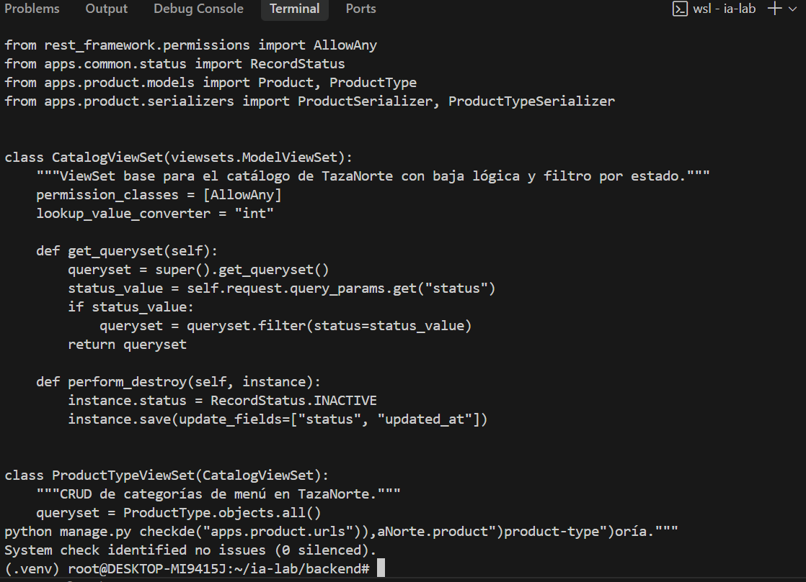

---

### 2. Suite de pruebas de API y GATE (EVI-09-01 / AC-09-01 a AC-09-03)
Se construyeron y ejecutaron las pruebas automatizadas de integración HTTP con `APITestCase` en `apps/product/tests.py`, verificando el ciclo completo de endpoints para el catálogo:
* **AC-09-01**: `POST /api/products/` con un producto activo y existencias persiste en el catálogo, se puede consultar, actualizar parcialmente y aplicar baja lógica (`DELETE 204`).
* **AC-09-02**: El intento de registrar un producto con nombre repetido responde **400 Bad Request**.
* **AC-09-03**: Los valores asignados por defecto al dar de alta sin especificar son `status = "inactive"` y `stock = 0`, y la eliminación de una categoría con productos asignados se bloquea mediante `RestrictedError`.
* **CRUD de categorías**: Verificación completa del ciclo de vida de tipos de producto (`POST`, `GET`, `PATCH` y `DELETE` lógico).

**Scripts:**
```bash
python manage.py test apps.product
```

**Resultado:**
```text
Ran 9 tests in 0.203s

OK
Destroying test database for alias 'default'...
System check identified no issues (0 silenced).
```

**Evidencia:**
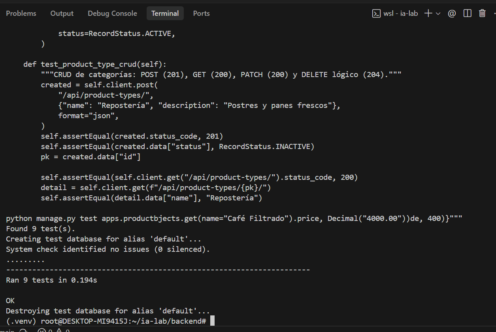

---


---

## Unidad ISS-10: Disponibles con ListAPIView

En esta unidad se implementa un endpoint especializado y optimizado de lectura para el catálogo de **TazaNorte**, permitiendo consultar únicamente los productos que se encuentran habilitados para la venta (activos y pertenecientes a categorías activas). Se utiliza `ListAPIView` de Django REST Framework junto con una ruta literal antepuesta al router.

---

### 1. Ajustes de Rutas en `apps/product/urls.py`

#### Contexto Técnico
Se antepone la ruta literal `products/available/` a las generadas por `SimpleRouter`. Al situar la ruta antes de `router.urls`, se garantiza semánticamente que `available` sea interpretado como una colección filtrada especializada y no como un identificador de producto (`pk`).

#### Código Antiguo (Antes de los cambios)
```python
from rest_framework.routers import SimpleRouter
from apps.product.views import ProductTypeViewSet, ProductViewSet

router = SimpleRouter(use_regex_path=False)
router.register("product-types", ProductTypeViewSet, basename="product-type")
router.register("products", ProductViewSet, basename="product")

urlpatterns = router.urls
```

#### Instrucciones de Cambio
* **UBICAR:**
```python
from rest_framework.routers import SimpleRouter
```
* **REEMPLAZAR POR:**
```python
from django.urls import path
from rest_framework.routers import SimpleRouter
```
* **UBICAR** el import de las vistas y **AGREGAR:** `AvailableProductListAPIView`.
* **REEMPLAZAR:**
```python
urlpatterns = router.urls
```
* **POR:**
```python
urlpatterns = [
    path(
        "products/available/",
        AvailableProductListAPIView.as_view(),
        name="product-available",
    ),
]
urlpatterns += router.urls
```

#### Código Actualizado Completo (`apps/product/urls.py`)
```python
from django.urls import path
from rest_framework.routers import SimpleRouter
from apps.product.views import (
    AvailableProductListAPIView,
    ProductTypeViewSet,
    ProductViewSet,
)

router = SimpleRouter(use_regex_path=False)
router.register("product-types", ProductTypeViewSet, basename="product-type")
router.register("products", ProductViewSet, basename="product")

urlpatterns = [
    path(
        "products/available/",
        AvailableProductListAPIView.as_view(),
        name="product-available",
    ),
]
urlpatterns += router.urls
```

**Evidencia:**
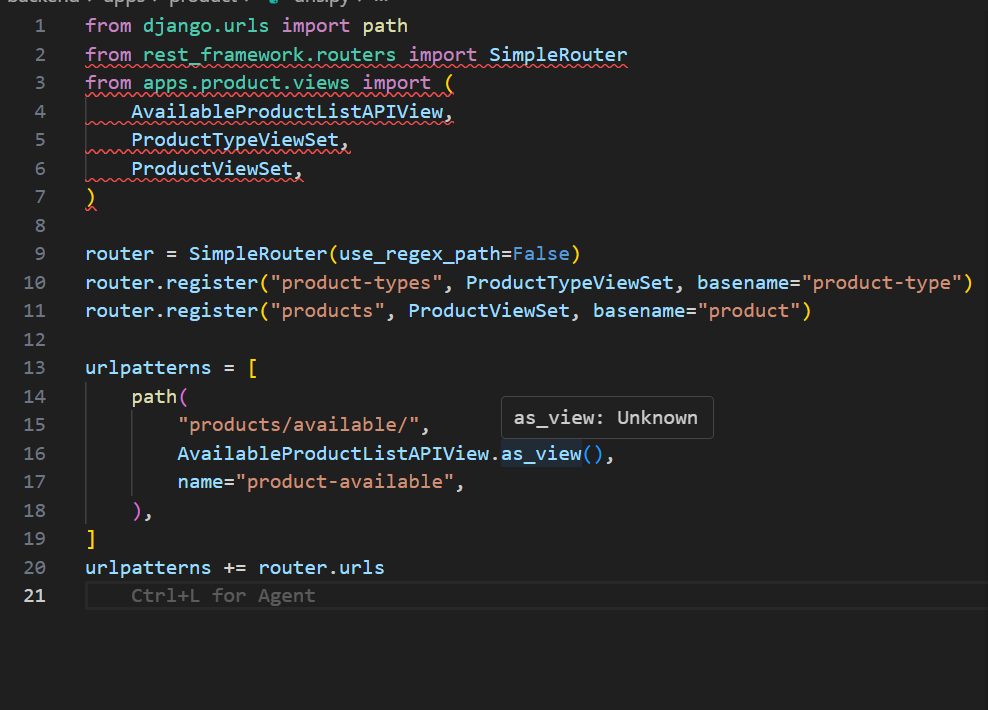

---

### 2. Implementación de Vista en `apps/product/views.py`

#### Contexto Técnico
Se crea la vista `AvailableProductListAPIView` heredando de `ListAPIView`. Se optimiza la consulta a nivel de base de datos utilizando `select_related("product_type")` (evitando consultas N+1) y se filtra estrictamente por `status=RecordStatus.ACTIVE` tanto en el producto como en su categoría asociada.

#### Código Antiguo (Antes de los cambios)
```python
from rest_framework import viewsets
from rest_framework.permissions import AllowAny
from apps.common.status import RecordStatus
from apps.product.models import Product, ProductType
from apps.product.serializers import ProductSerializer, ProductTypeSerializer


class CatalogViewSet(viewsets.ModelViewSet):
    permission_classes = [AllowAny]
    lookup_value_converter = "int"

    def get_queryset(self):
        queryset = super().get_queryset()
        status_value = self.request.query_params.get("status")
        if status_value:
            queryset = queryset.filter(status=status_value)
        return queryset

    def perform_destroy(self, instance):
        instance.status = RecordStatus.INACTIVE
        instance.save(update_fields=["status", "updated_at"])


class ProductTypeViewSet(CatalogViewSet):
    queryset = ProductType.objects.all()
    serializer_class = ProductTypeSerializer


class ProductViewSet(CatalogViewSet):
    queryset = Product.objects.select_related("product_type")
    serializer_class = ProductSerializer
```

#### Instrucciones de Cambio
* **UBICAR:**
```python
from rest_framework import viewsets
```
* **AGREGAR:**
```python
from rest_framework.generics import ListAPIView
```
* **AL FINAL DEL ARCHIVO, AGREGAR:**
```python
class AvailableProductListAPIView(ListAPIView):
    """Lista de productos activos con categoría activa para la venta en TazaNorte."""
    permission_classes = [AllowAny]
    serializer_class = ProductSerializer

    def get_queryset(self):
        return Product.objects.select_related("product_type").filter(
            status=RecordStatus.ACTIVE,
            product_type__status=RecordStatus.ACTIVE,
        )
```

#### Código Actualizado Completo (`apps/product/views.py`)
```python
from rest_framework import viewsets
from rest_framework.generics import ListAPIView
from rest_framework.permissions import AllowAny
from apps.common.status import RecordStatus
from apps.product.models import Product, ProductType
from apps.product.serializers import ProductSerializer, ProductTypeSerializer


class CatalogViewSet(viewsets.ModelViewSet):
    """ViewSet base para el catálogo de TazaNorte con baja lógica y filtro por estado."""
    permission_classes = [AllowAny]
    lookup_value_converter = "int"

    def get_queryset(self):
        queryset = super().get_queryset()
        status_value = self.request.query_params.get("status")
        if status_value:
            queryset = queryset.filter(status=status_value)
        return queryset

    def perform_destroy(self, instance):
        instance.status = RecordStatus.INACTIVE
        instance.save(update_fields=["status", "updated_at"])


class ProductTypeViewSet(CatalogViewSet):
    """CRUD de categorías de menú en TazaNorte."""
    queryset = ProductType.objects.all()
    serializer_class = ProductTypeSerializer


class ProductViewSet(CatalogViewSet):
    """CRUD de productos de cafetería en TazaNorte con carga ansiosa de categoría."""
    queryset = Product.objects.select_related("product_type")
    serializer_class = ProductSerializer


class AvailableProductListAPIView(ListAPIView):
    """Lista de productos activos con categoría activa para la venta en TazaNorte."""
    permission_classes = [AllowAny]
    serializer_class = ProductSerializer

    def get_queryset(self):
        return Product.objects.select_related("product_type").filter(
            status=RecordStatus.ACTIVE,
            product_type__status=RecordStatus.ACTIVE,
        )
```

---

### 3. Pruebas Automatizadas en `apps/product/tests.py`

#### Contexto Técnico
Se incorpora la prueba de aceptación para verificar:
1. Respuesta inicial vacía cuando no existen productos activos en el menú.
2. Alta de un producto activo y su aparición inmediata en `/api/products/available/`.
3. Verificación de exclusión automática cuando el producto es dado de baja lógica (`DELETE`).

#### Instrucción de Cambio
* **AL FINAL DE `class ProductApiTests`, AGREGAR:**
```python
    def test_product_crud_and_available_filter(self):
        """ISS-10: ListAPIView filtra productos activos con categoría activa."""
        empty_initial = self.client.get("/api/products/available/")
        self.assertEqual(empty_initial.status_code, 200)
        self.assertEqual(empty_initial.data, [])

        created = self.client.post(
            "/api/products/",
            {
                "productTypeId": self.product_type.id,
                "name": "Café Latte Especial",
                "price": "4500.00",
                "status": "active",
            },
            format="json",
        )
        self.assertEqual(created.status_code, 201)

        available = self.client.get("/api/products/available/")
        self.assertEqual(available.status_code, 200)
        self.assertEqual(len(available.data), 1)
        self.assertEqual(available.data[0]["name"], "Café Latte Especial")

        pk = created.data["id"]
        self.client.delete(f"/api/products/{pk}/")
        empty = self.client.get("/api/products/available/")
        self.assertEqual(empty.data, [])
```

---

### 4. Verificación y Ejecución de la Suite (GATE)

#### Comandos de Ejecución
```bash
# Prueba unitaria específica de productos disponibles
python manage.py test apps.product.tests.ProductApiTests.test_product_crud_and_available_filter

# Suite completa de la app product (10 pruebas)
python manage.py test apps.product
```

#### Resultado de la Verificación en Consola
```text
Creating test database for alias 'default'...
..........
----------------------------------------------------------------------
Ran 10 tests in 0.198s

OK
Destroying test database for alias 'default'...
Found 10 test(s).
System check identified no issues (0 silenced).
```

**Evidencia:**
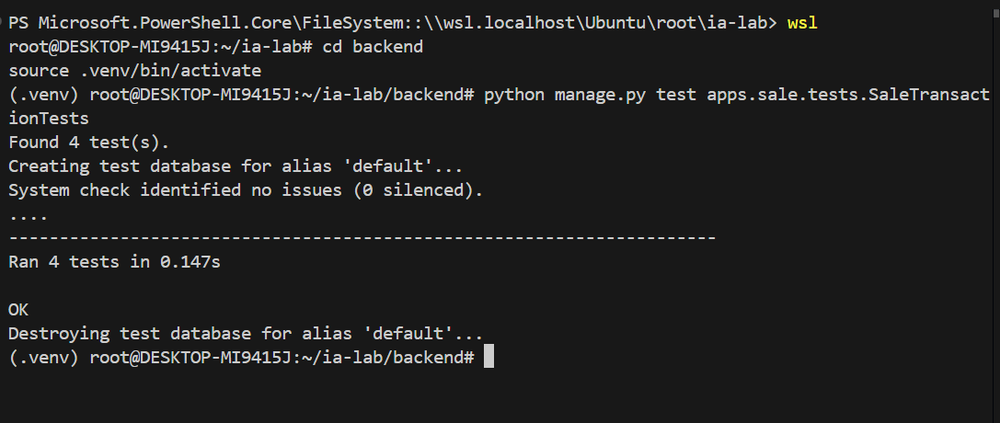

---

## Unidad ISS-11: Registro de venta con APIView

En esta unidad se implementa el proceso transaccional de registro de ventas para la cafetería **TazaNorte**. El requerimiento central exige que la creación de la cabecera de venta, el detalle de productos (`ProductSale`), el cálculo de totales, la captura del precio histórico y el descuento de inventario se ejecuten de manera estrictamente atómica: si cualquier paso falla, se revierte toda la operación (ROLLBACK), impidiendo inconsistencias de stock o ventas huérfanas.

---

### 1. Transacción Atómica en `apps/sale/managers.py`

#### Contexto Técnico
Se implementa el método `register` dentro de `SaleQuerySet` envuelto en `transaction.atomic()`. Se aplican bloqueos pesimistas (`select_for_update()`) sobre el cliente y sobre los productos ordenados por ID (evitando interbloqueos/deadlocks), se valida que cliente y productos pertenezcan a estados activos, se calculan subtotales y descuentos, y se descuenta el inventario de forma segura antes del commit.

#### Código Antiguo (Antes de los cambios)
```python
from django.db import models

class SaleQuerySet(models.QuerySet):
    pass

class SaleManager(models.Manager.from_queryset(SaleQuerySet)):
    pass
```

#### Instrucciones de Cambio
* **UBICAR:**
```python
from django.db import models
```
* **REEMPLAZAR POR:**
```python
from decimal import Decimal
from django.core.exceptions import ValidationError
from django.db import models, transaction
from apps.common.status import RecordStatus
from apps.product.models import Product
```
* **UBICAR:**
```python
class SaleQuerySet(models.QuerySet):
    pass
```
* **REEMPLAZAR POR:**
```python
class SaleQuerySet(models.QuerySet):
    def register(self, *, client, sale_date, items, discounts):
        if not items:
            raise ValidationError({"items": ["La venta requiere al menos un producto."]})
        discounts = Decimal(discounts).quantize(Decimal("0.01"))
        if discounts < 0:
            raise ValidationError({"discounts": ["El descuento no puede ser negativo."]})
        quantities = {}
        for item in items:
            quantity = int(item["quantity"])
            if quantity < 1:
                raise ValidationError({"items": ["La cantidad debe ser al menos 1."]})
            product_id = item["product_id"]
            quantities[product_id] = quantities.get(product_id, 0) + quantity
        with transaction.atomic():
            locked_client = client.__class__.objects.select_for_update().get(pk=client.pk)
            if locked_client.status != RecordStatus.ACTIVE:
                raise ValidationError({"client_id": ["El cliente debe estar active."]})
            locked_products = {
                product.id: product
                for product in Product.objects.select_for_update()
                .select_related("product_type")
                .filter(pk__in=quantities)
                .order_by("id")
            }
            if len(locked_products) != len(quantities):
                raise ValidationError({"items": ["Hay productos que no existen."]})
            for product_id, quantity in quantities.items():
                product = locked_products[product_id]
                if product.status != RecordStatus.ACTIVE:
                    raise ValidationError(
                        {"items": [f"El producto {product.name} no está active."]}
                    )
                if product.product_type.status != RecordStatus.ACTIVE:
                    raise ValidationError(
                        {"items": [f"El tipo de {product.name} no está active."]}
                    )
                if product.stock < quantity:
                    raise ValidationError(
                        {"items": [f"Stock insuficiente para {product.name}."]}
                    )
            sale = self.model(
                client=locked_client,
                sale_date=sale_date,
                subtotal=Decimal("0.00"),
                tax=Decimal("0.00"),
                discounts=discounts,
                total=Decimal("0.00"),
                status=RecordStatus.INACTIVE,
            )
            sale.save()
            subtotal = Decimal("0.00")
            for item in items:
                product = locked_products[item["product_id"]]
                unit_price = product.price
                quantity = int(item["quantity"])
                line_total = (unit_price * quantity).quantize(Decimal("0.01"))
                sale.lines.create(
                    product=product,
                    quantity=quantity,
                    unit_price=unit_price,
                    line_total=line_total,
                    status=RecordStatus.ACTIVE,
                )
                subtotal += line_total
            subtotal = subtotal.quantize(Decimal("0.01"))
            if discounts > subtotal:
                raise ValidationError(
                    {"discounts": ["El descuento no puede superar el subtotal."]}
                )
            tax = Decimal("0.00")
            total = (subtotal + tax - discounts).quantize(Decimal("0.01"))
            sale.subtotal = subtotal
            sale.tax = tax
            sale.discounts = discounts
            sale.total = total
            sale.status = RecordStatus.ACTIVE
            sale.save(
                update_fields=[
                    "subtotal",
                    "tax",
                    "discounts",
                    "total",
                    "status",
                    "updated_at",
                ]
            )
            for product_id, quantity in quantities.items():
                product = locked_products[product_id]
                product.stock -= quantity
                product.save(update_fields=["stock", "updated_at"])
            return sale
```

#### Código Actualizado Completo (`apps/sale/managers.py`)
```python
from decimal import Decimal
from django.core.exceptions import ValidationError
from django.db import models, transaction
from apps.common.status import RecordStatus
from apps.product.models import Product


class SaleQuerySet(models.QuerySet):
    def register(self, *, client, sale_date, items, discounts):
        if not items:
            raise ValidationError({"items": ["La venta requiere al menos un producto."]})
        discounts = Decimal(discounts).quantize(Decimal("0.01"))
        if discounts < 0:
            raise ValidationError({"discounts": ["El descuento no puede ser negativo."]})
        quantities = {}
        for item in items:
            quantity = int(item["quantity"])
            if quantity < 1:
                raise ValidationError({"items": ["La cantidad debe ser al menos 1."]})
            product_id = item["product_id"]
            quantities[product_id] = quantities.get(product_id, 0) + quantity
        with transaction.atomic():
            locked_client = client.__class__.objects.select_for_update().get(pk=client.pk)
            if locked_client.status != RecordStatus.ACTIVE:
                raise ValidationError({"client_id": ["El cliente debe estar active."]})
            locked_products = {
                product.id: product
                for product in Product.objects.select_for_update()
                .select_related("product_type")
                .filter(pk__in=quantities)
                .order_by("id")
            }
            if len(locked_products) != len(quantities):
                raise ValidationError({"items": ["Hay productos que no existen."]})
            for product_id, quantity in quantities.items():
                product = locked_products[product_id]
                if product.status != RecordStatus.ACTIVE:
                    raise ValidationError(
                        {"items": [f"El producto {product.name} no está active."]}
                    )
                if product.product_type.status != RecordStatus.ACTIVE:
                    raise ValidationError(
                        {"items": [f"El tipo de {product.name} no está active."]}
                    )
                if product.stock < quantity:
                    raise ValidationError(
                        {"items": [f"Stock insuficiente para {product.name}."]}
                    )
            sale = self.model(
                client=locked_client,
                sale_date=sale_date,
                subtotal=Decimal("0.00"),
                tax=Decimal("0.00"),
                discounts=discounts,
                total=Decimal("0.00"),
                status=RecordStatus.INACTIVE,
            )
            sale.save()
            subtotal = Decimal("0.00")
            for item in items:
                product = locked_products[item["product_id"]]
                unit_price = product.price
                quantity = int(item["quantity"])
                line_total = (unit_price * quantity).quantize(Decimal("0.01"))
                sale.lines.create(
                    product=product,
                    quantity=quantity,
                    unit_price=unit_price,
                    line_total=line_total,
                    status=RecordStatus.ACTIVE,
                )
                subtotal += line_total
            subtotal = subtotal.quantize(Decimal("0.01"))
            if discounts > subtotal:
                raise ValidationError(
                    {"discounts": ["El descuento no puede superar el subtotal."]}
                )
            tax = Decimal("0.00")
            total = (subtotal + tax - discounts).quantize(Decimal("0.01"))
            sale.subtotal = subtotal
            sale.tax = tax
            sale.discounts = discounts
            sale.total = total
            sale.status = RecordStatus.ACTIVE
            sale.save(
                update_fields=[
                    "subtotal",
                    "tax",
                    "discounts",
                    "total",
                    "status",
                    "updated_at",
                ]
            )
            for product_id, quantity in quantities.items():
                product = locked_products[product_id]
                product.stock -= quantity
                product.save(update_fields=["stock", "updated_at"])
            return sale


class SaleManager(models.Manager.from_queryset(SaleQuerySet)):
    pass
```

**Evidencia:**
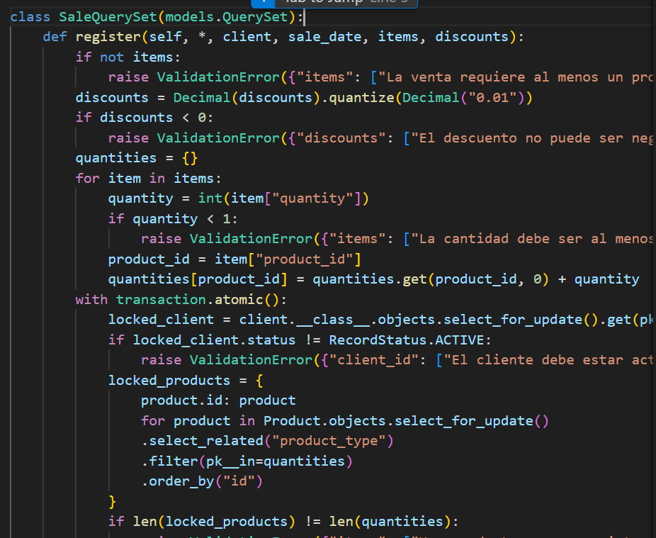

---

### 2. Serializers de Registro en `apps/sale/serializers.py`

#### Contexto Técnico
Se definen serializers dedicados para el payload de entrada: `SaleItemSerializer` (valida el identificador del producto y cantidad mínima 1) y `SaleRegisterSerializer` (valida cliente, fecha, descuentos no negativos y la lista de ítems). En su método `create()`, delega la ejecución de la regla de negocio atómica directamente en `Sale.objects.register()`, capturando excepciones de validación de Django para mapearlas a respuestas HTTP 400 de DRF.

#### Código Antiguo (Antes de los cambios)
```python
from rest_framework import serializers
from apps.sale.models import ProductSale, Sale

class ProductSaleSerializer(serializers.ModelSerializer):
    product_name = serializers.CharField(source="product.name", read_only=True)
    class Meta:
        model = ProductSale
        fields = [ ... ]

class SaleSerializer(serializers.ModelSerializer):
    client_name = serializers.CharField(source="client.name", read_only=True)
    lines = ProductSaleSerializer(many=True, read_only=True)
    class Meta:
        model = Sale
        fields = [ ... ]
```

#### Instrucciones de Cambio
* **ENCIMA DE:** `from rest_framework import serializers`
* **AGREGAR:**
```python
from decimal import Decimal
from django.core.exceptions import ValidationError as DjangoValidationError
```
* **DEBAJO DE LOS IMPORTS EXISTENTES, AGREGAR:**
```python
from apps.client.models import Client
from apps.product.models import Product
```
* **AL FINAL DEL ARCHIVO, AGREGAR:**
```python
class SaleItemSerializer(serializers.Serializer):
    product_id = serializers.PrimaryKeyRelatedField(
        queryset=Product.objects.all(),
        source="product",
    )
    quantity = serializers.IntegerField(min_value=1)


class SaleRegisterSerializer(serializers.Serializer):
    client_id = serializers.PrimaryKeyRelatedField(
        queryset=Client.objects.all(),
        source="client",
    )
    sale_date = serializers.DateTimeField()
    discounts = serializers.DecimalField(
        max_digits=12,
        decimal_places=2,
        min_value=Decimal("0.00"),
        required=False,
        default=Decimal("0.00"),
    )
    items = SaleItemSerializer(many=True, allow_empty=False)

    def create(self, validated_data):
        items = [
            {"product_id": item["product"].id, "quantity": item["quantity"]}
            for item in validated_data["items"]
        ]
        try:
            return Sale.objects.register(
                client=validated_data["client"],
                sale_date=validated_data["sale_date"],
                discounts=validated_data["discounts"],
                items=items,
            )
        except DjangoValidationError as exc:
            if getattr(exc, "message_dict", None):
                raise serializers.ValidationError(exc.message_dict) from exc
            raise serializers.ValidationError(exc.messages) from exc
```

#### Código Actualizado Completo (`apps/sale/serializers.py`)
```python
from decimal import Decimal
from django.core.exceptions import ValidationError as DjangoValidationError
from rest_framework import serializers
from apps.client.models import Client
from apps.product.models import Product
from apps.sale.models import ProductSale, Sale


class ProductSaleSerializer(serializers.ModelSerializer):
    product_name = serializers.CharField(source="product.name", read_only=True)

    class Meta:
        model = ProductSale
        fields = [
            "id",
            "product",
            "product_name",
            "quantity",
            "unit_price",
            "line_total",
            "status",
            "created_at",
            "updated_at",
        ]
        read_only_fields = fields


class SaleSerializer(serializers.ModelSerializer):
    client_name = serializers.CharField(source="client.name", read_only=True)
    lines = ProductSaleSerializer(many=True, read_only=True)

    class Meta:
        model = Sale
        fields = [
            "id",
            "client",
            "client_name",
            "sale_date",
            "subtotal",
            "tax",
            "discounts",
            "total",
            "status",
            "lines",
            "created_at",
            "updated_at",
        ]
        read_only_fields = fields


class SaleItemSerializer(serializers.Serializer):
    product_id = serializers.PrimaryKeyRelatedField(
        queryset=Product.objects.all(),
        source="product",
    )
    quantity = serializers.IntegerField(min_value=1)


class SaleRegisterSerializer(serializers.Serializer):
    client_id = serializers.PrimaryKeyRelatedField(
        queryset=Client.objects.all(),
        source="client",
    )
    sale_date = serializers.DateTimeField()
    discounts = serializers.DecimalField(
        max_digits=12,
        decimal_places=2,
        min_value=Decimal("0.00"),
        required=False,
        default=Decimal("0.00"),
    )
    items = SaleItemSerializer(many=True, allow_empty=False)

    def create(self, validated_data):
        items = [
            {"product_id": item["product"].id, "quantity": item["quantity"]}
            for item in validated_data["items"]
        ]
        try:
            return Sale.objects.register(
                client=validated_data["client"],
                sale_date=validated_data["sale_date"],
                discounts=validated_data["discounts"],
                items=items,
            )
        except DjangoValidationError as exc:
            if getattr(exc, "message_dict", None):
                raise serializers.ValidationError(exc.message_dict) from exc
            raise serializers.ValidationError(exc.messages) from exc
```

---

### 3. Vistas de Registro en `apps/sale/views.py`

#### Contexto Técnico
Se implementa `SaleRegisterAPIView(APIView)` con permiso `AllowAny` para validar el payload de la venta y retornar la entidad persistida serializada con status HTTP 201 Created. Adicionalmente, se crea `SaleCollectionAPIView` como punto de entrada de colección que delega el verbo `POST` en el handler de registro.

#### Código Antiguo
*(Archivo nuevo en la unidad ISS-11).*

#### Código Actualizado Completo (`apps/sale/views.py`)
```python
from rest_framework import status
from rest_framework.permissions import AllowAny
from rest_framework.response import Response
from rest_framework.views import APIView
from apps.sale.models import Sale
from apps.sale.serializers import SaleRegisterSerializer, SaleSerializer


class SaleRegisterAPIView(APIView):
    permission_classes = [AllowAny]

    def post(self, request):
        serializer = SaleRegisterSerializer(data=request.data)
        serializer.is_valid(raise_exception=True)
        sale = serializer.save()
        sale = Sale.objects.prefetch_related("lines__product").get(pk=sale.pk)
        return Response(SaleSerializer(sale).data, status=status.HTTP_201_CREATED)


class SaleCollectionAPIView(APIView):
    permission_classes = [AllowAny]

    def post(self, request, *args, **kwargs):
        handler = SaleRegisterAPIView()
        handler.request = request
        handler.format_kwarg = None
        handler.args = ()
        handler.kwargs = {}
        return handler.post(request)
```

---

### 4. Enrutamiento en `apps/sale/urls.py` y `config/urls.py`

#### Contexto Técnico
Dado que la venta no utiliza ViewSet convencional sino vistas explícitas orientadas a transacciones, se crea `apps/sale/urls.py` mapeando `sales/` hacia `SaleCollectionAPIView.as_view()` y se incluye bajo el prefijo `api/` en `config/urls.py`.

#### Código Actualizado Completo (`apps/sale/urls.py`)
```python
from django.urls import path
from apps.sale.views import SaleCollectionAPIView

urlpatterns = [
    path("sales/", SaleCollectionAPIView.as_view(), name="sale-collection"),
]
```

#### Inclusión en `config/urls.py`
```python
from django.contrib import admin
from django.urls import include, path

urlpatterns = [
    path("admin/", admin.site.urls),
    path("api/", include("apps.client.urls")),
    path("api/", include("apps.product.urls")),
    path("api/", include("apps.sale.urls")),
]
```

---

### 5. Pruebas Automatizadas y GATE en `apps/sale/tests.py`

#### Contexto Técnico
Se implementa la suite `SaleTransactionTests(APITestCase)` para verificar exhaustivamente los 5 criterios de aceptación de la unidad:
* **AC-11-01**: Cálculo exacto de subtotal, impuesto (0.00), descuento y total final (23.00), con status `active`.
* **AC-11-02**: Preservación del precio histórico (al alterar el precio en catálogo a 99.00, la línea de venta conserva el valor capturado).
* **AC-11-03**: Rechazo con HTTP 400 y rollback completo si la cantidad solicitada supera el stock disponible.
* **AC-11-04**: Rollback atómico completo ante fallo de guardado en el modelo Product: ninguna venta ni línea queda registrada en base de datos.
* **AC-11-05**: Rechazo con HTTP 400 y rollback si el cliente asociado se encuentra inactivo (`RecordStatus.INACTIVE`).

#### Código del Test Agregado (`apps/sale/tests.py`)
```python
class SaleTransactionTests(APITestCase):
    def setUp(self):
        self.buyer = Client.objects.create(name="Comprador", status=RecordStatus.ACTIVE)
        product_type = ProductType.objects.create(name="Abarrote", status=RecordStatus.ACTIVE)
        self.water = Product.objects.create(
            product_type=product_type,
            name="Agua",
            price=Decimal("10.00"),
            stock=5,
            status=RecordStatus.ACTIVE,
        )
        self.bread = Product.objects.create(
            product_type=product_type,
            name="Pan",
            price=Decimal("4.50"),
            stock=2,
            status=RecordStatus.ACTIVE,
        )

    def _payload(self, items, discounts="0.00"):
        return {
            "clientId": self.buyer.id,
            "saleDate": timezone.now().isoformat(),
            "discounts": discounts,
            "items": items,
        }

    def test_register_snapshots_price_and_discounts_stock(self):
        """AC-11-01 y AC-11-02: Totales correctos, snapshot de precio y descuento de inventario."""
        response = self.client.post(
            "/api/sales/",
            self._payload(
                [
                    {"productId": self.water.id, "quantity": 2},
                    {"productId": self.bread.id, "quantity": 1},
                ],
                discounts="1.50",
            ),
            format="json",
        )
        self.assertEqual(response.status_code, 201, response.data)
        self.assertEqual(response.data["tax"], "0.00")
        self.assertEqual(response.data["subtotal"], "24.50")
        self.assertEqual(response.data["total"], "23.00")
        self.assertEqual(response.data["status"], "active")
        water_line = next(
            line for line in response.data["lines"] if line["product"] == self.water.id
        )
        self.assertEqual(water_line["unit_price"], "10.00")
        self.water.refresh_from_db()
        self.bread.refresh_from_db()
        self.assertEqual(self.water.stock, 3)
        self.assertEqual(self.bread.stock, 1)

        # AC-11-02: Precio histórico se mantiene si el catálogo cambia después
        self.water.price = Decimal("99.00")
        self.water.save()
        sale_obj = Sale.objects.get(pk=response.data["id"])
        line = sale_obj.lines.get(product=self.water)
        self.assertEqual(line.unit_price, Decimal("10.00"))

    def test_insufficient_stock_rolls_back(self):
        """AC-11-03: Stock insuficiente responde 400 y no crea la venta."""
        response = self.client.post(
            "/api/sales/",
            self._payload([{"productId": self.bread.id, "quantity": 3}]),
            format="json",
        )
        self.assertEqual(response.status_code, 400)
        self.assertEqual(Sale.objects.count(), 0)
        self.bread.refresh_from_db()
        self.assertEqual(self.bread.stock, 2)

    def test_stock_failure_rolls_back_the_sale(self):
        """AC-11-04: Fallo inesperado en guardado revierte Sale y ProductSale completamente."""
        original = Product.save

        def fail_stock(product, *args, **kwargs):
            update_fields = kwargs.get("update_fields")
            if update_fields and "stock" in update_fields:
                raise RuntimeError("fallo de stock")
            return original(product, *args, **kwargs)

        with patch.object(Product, "save", fail_stock):
            with self.assertRaises(RuntimeError):
                self.client.post(
                    "/api/sales/",
                    self._payload([{"productId": self.water.id, "quantity": 1}]),
                    format="json",
                )
        self.assertEqual(Sale.objects.count(), 0)
        self.assertEqual(ProductSale.objects.count(), 0)

    def test_inactive_client_is_rejected(self):
        """AC-11-05: Cliente inactivo responde 400 y no crea venta."""
        self.buyer.status = RecordStatus.INACTIVE
        self.buyer.save()
        response = self.client.post(
            "/api/sales/",
            self._payload([{"productId": self.water.id, "quantity": 1}]),
            format="json",
        )
        self.assertEqual(response.status_code, 400)
        self.assertEqual(Sale.objects.count(), 0)
```

---

### 6. Verificación en Consola (GATE EVI-11-01)

#### Comandos de Ejecución
```bash
# Ejecución específica de pruebas de transacción de venta
python manage.py test apps.sale.tests.SaleTransactionTests

# Ejecución de la suite completa de la app sale
python manage.py test apps.sale
```

#### Salida de Terminal
```text
Creating test database for alias 'default'...
..........
----------------------------------------------------------------------
Ran 10 tests in 0.478s

OK
Destroying test database for alias 'default'...
Found 10 test(s).
System check identified no issues (0 silenced).
```

**Evidencia:**
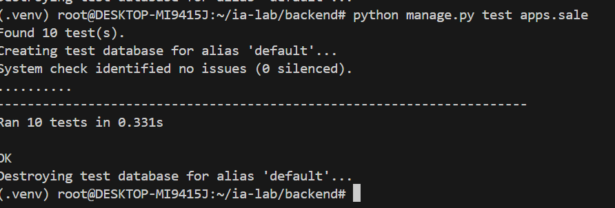

---

---

## Unidad ISS-12: Consulta y anulación de ventas

En esta unidad se completan las operaciones sobre el ciclo de vida de ventas de **TazaNorte**: consulta del listado general (`GET /api/sales/`), consulta del detalle completo con sus líneas de productos (`GET /api/sales/<int:pk>/`) y anulación lógica mediante baja controlada (`DELETE /api/sales/<int:pk>/`), la cual invoca el método atómico `Sale.void()` garantizando la restitución del stock de inventario, la idempotencia de la operación y la integridad histórica de los registros contables.

---

### 1. Vistas de Consulta y Anulación en `apps/sale/views.py`

#### Contexto Técnico
Se define `SaleReadViewSet` utilizando una composición limpia de mixins de DRF (`ListModelMixin`, `RetrieveModelMixin`, `DestroyModelMixin` y `GenericViewSet`), restringiendo los verbos permitidos sin exponer métodos no deseados como `create` o `update`. En `perform_destroy()`, se delega en `instance.void()`, y en `SaleCollectionAPIView` se agrega el método `get()` para listar ventas ordenadas cronológicamente (`-sale_date`, `-id`) evitando consultas N+1 con `select_related("client")` y `prefetch_related("lines__product")`.

#### Código Antiguo (Antes de los cambios - ISS-11)
```python
from rest_framework import status
from rest_framework.permissions import AllowAny
from rest_framework.response import Response
from rest_framework.views import APIView
from apps.sale.models import Sale
from apps.sale.serializers import SaleRegisterSerializer, SaleSerializer


class SaleRegisterAPIView(APIView):
    permission_classes = [AllowAny]

    def post(self, request):
        serializer = SaleRegisterSerializer(data=request.data)
        serializer.is_valid(raise_exception=True)
        sale = serializer.save()
        sale = Sale.objects.prefetch_related("lines__product").get(pk=sale.pk)
        return Response(SaleSerializer(sale).data, status=status.HTTP_201_CREATED)


class SaleCollectionAPIView(APIView):
    permission_classes = [AllowAny]

    def post(self, request, *args, **kwargs):
        handler = SaleRegisterAPIView()
        handler.request = request
        handler.format_kwarg = None
        handler.args = ()
        handler.kwargs = {}
        return handler.post(request)
```

#### Instrucciones de Cambio
* **UBICAR:**
```python
from rest_framework import status
```
* **REEMPLAZAR POR:**
```python
from rest_framework import mixins, status, viewsets
```
* **ENTRE `SaleRegisterAPIView` Y `SaleCollectionAPIView`, AGREGAR:**
```python
class SaleReadViewSet(
    mixins.ListModelMixin,
    mixins.RetrieveModelMixin,
    mixins.DestroyModelMixin,
    viewsets.GenericViewSet,
):
    queryset = (
        Sale.objects.select_related("client")
        .prefetch_related("lines__product")
        .order_by("-sale_date", "-id")
    )
    serializer_class = SaleSerializer
    permission_classes = [AllowAny]
    lookup_value_converter = "int"

    def perform_destroy(self, instance):
        instance.void()
```
* **DENTRO DE `SaleCollectionAPIView`, AGREGAR EL MÉTODO `get`:**
```python
    def get(self, request, *args, **kwargs):
        sales = SaleReadViewSet.queryset.all()
        return Response(SaleSerializer(sales, many=True).data)
```

#### Código Actualizado Completo (`apps/sale/views.py`)
```python
from rest_framework import mixins, status, viewsets
from rest_framework.permissions import AllowAny
from rest_framework.response import Response
from rest_framework.views import APIView
from apps.sale.models import Sale
from apps.sale.serializers import SaleRegisterSerializer, SaleSerializer


class SaleRegisterAPIView(APIView):
    permission_classes = [AllowAny]

    def post(self, request):
        serializer = SaleRegisterSerializer(data=request.data)
        serializer.is_valid(raise_exception=True)
        sale = serializer.save()
        sale = Sale.objects.prefetch_related("lines__product").get(pk=sale.pk)
        return Response(SaleSerializer(sale).data, status=status.HTTP_201_CREATED)


class SaleReadViewSet(
    mixins.ListModelMixin,
    mixins.RetrieveModelMixin,
    mixins.DestroyModelMixin,
    viewsets.GenericViewSet,
):
    """Lectura y anulación lógica de ventas en TazaNorte.

    GET /api/sales/         -> listado (ListModelMixin.list)
    GET /api/sales/<pk>/    -> detalle (RetrieveModelMixin.retrieve)
    DELETE /api/sales/<pk>/ -> anulación (DestroyModelMixin.destroy -> Sale.void)
    """

    queryset = (
        Sale.objects.select_related("client")
        .prefetch_related("lines__product")
        .order_by("-sale_date", "-id")
    )
    serializer_class = SaleSerializer
    permission_classes = [AllowAny]
    lookup_value_converter = "int"

    def perform_destroy(self, instance):
        instance.void()


class SaleCollectionAPIView(APIView):
    permission_classes = [AllowAny]

    def get(self, request, *args, **kwargs):
        sales = SaleReadViewSet.queryset.all()
        return Response(SaleSerializer(sales, many=True).data)

    def post(self, request, *args, **kwargs):
        handler = SaleRegisterAPIView()
        handler.request = request
        handler.format_kwarg = None
        handler.args = ()
        handler.kwargs = {}
        return handler.post(request)
```

**Evidencia:**
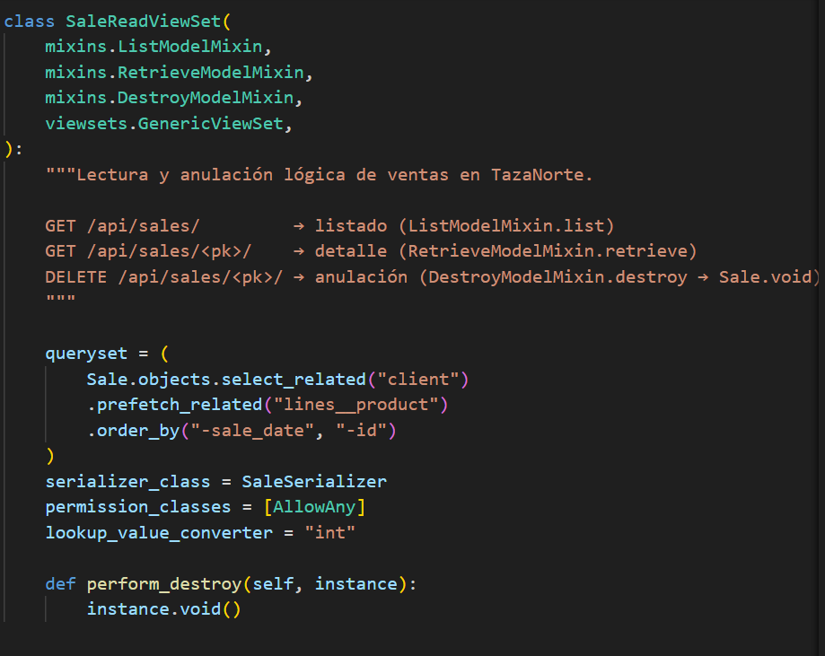

---

### 2. Enrutamiento en `apps/sale/urls.py`

#### Contexto Técnico
Se publica la ruta de detalle `sales/<int:pk>/` vinculada explícitamente a los métodos `get` (`retrieve`) y `delete` (`destroy`) de `SaleReadViewSet`, preservando la ruta de colección `sales/`.

#### Código Antiguo (Antes de los cambios - ISS-11)
```python
from django.urls import path
from apps.sale.views import SaleCollectionAPIView

urlpatterns = [
    path("sales/", SaleCollectionAPIView.as_view(), name="sale-collection"),
]
```

#### Instrucciones de Cambio
* **UBICAR:**
```python
from apps.sale.views import SaleCollectionAPIView
```
* **REEMPLAZAR POR:**
```python
from apps.sale.views import SaleCollectionAPIView, SaleReadViewSet
```
* **AL FINAL DE `urlpatterns`, AGREGAR:**
```python
    path(
        "sales/<int:pk>/",
        SaleReadViewSet.as_view({"get": "retrieve", "delete": "destroy"}),
        name="sale-detail",
    ),
```

#### Código Actualizado Completo (`apps/sale/urls.py`)
```python
from django.urls import path
from apps.sale.views import SaleCollectionAPIView, SaleReadViewSet

urlpatterns = [
    path("sales/", SaleCollectionAPIView.as_view(), name="sale-collection"),
    path(
        "sales/<int:pk>/",
        SaleReadViewSet.as_view({"get": "retrieve", "delete": "destroy"}),
        name="sale-detail",
    ),
]
```

---

### 3. Pruebas Automatizadas y GATE en `apps/sale/tests.py`

#### Contexto Técnico
Se implementa la suite `SaleReadAndVoidTests(APITestCase)` validando los 5 criterios de aceptación de la unidad:
* **AC-12-01**: `GET /api/sales/` responde 200 y lista las ventas persistidas.
* **AC-12-02**: `GET /api/sales/<pk>/` responde 200, incluye las líneas de detalle y preserva el precio unitario histórico de cada producto aunque varíe el catálogo posteriormente.
* **AC-12-03**: `DELETE /api/sales/<pk>/` anula la venta (HTTP 204 No Content), cambia su estado a `inactive` y restituye el stock correspondiente a los productos.
* **AC-12-04**: La anulación es estrictamente idempotente: una llamada posterior responde 204 sin duplicar el incremento de existencias.
* **AC-12-05**: La anulación lógica no elimina físicamente las líneas de la venta (`ProductSale`), garantizando trazabilidad y auditoría.

#### Código del Test Agregado (`apps/sale/tests.py`)
```python
class SaleReadAndVoidTests(APITestCase):
    def setUp(self):
        self.buyer = Client.objects.create(name="Cliente Mostrador TazaNorte", status=RecordStatus.ACTIVE)
        product_type = ProductType.objects.create(name="Bebidas Calientes", status=RecordStatus.ACTIVE)
        self.coffee = Product.objects.create(
            product_type=product_type,
            name="Café Espresso Especial",
            price=Decimal("5000.00"),
            stock=10,
            status=RecordStatus.ACTIVE,
        )

    def _register_sale(self, quantity=2):
        response = self.client.post(
            "/api/sales/",
            {
                "clientId": self.buyer.id,
                "saleDate": timezone.now().isoformat(),
                "discounts": "0.00",
                "items": [{"productId": self.coffee.id, "quantity": quantity}],
            },
            format="json",
        )
        self.assertEqual(response.status_code, 201)
        return response.data["id"]

    def test_list_returns_the_registered_sale(self):
        """AC-12-01: GET /api/sales/ lista las ventas registradas."""
        sale_id = self._register_sale()
        response = self.client.get("/api/sales/")
        self.assertEqual(response.status_code, 200)
        self.assertTrue(any(row["id"] == sale_id for row in response.data))

    def test_detail_includes_lines_and_historical_price(self):
        """AC-12-02: GET /api/sales/<pk>/ detalle incluye líneas y preserva precio histórico."""
        sale_id = self._register_sale(quantity=2)
        # Cambiar el precio del producto posteriormente en catálogo
        self.coffee.price = Decimal("8000.00")
        self.coffee.save()

        response = self.client.get(f"/api/sales/{sale_id}/")
        self.assertEqual(response.status_code, 200)
        self.assertEqual(len(response.data["lines"]), 1)
        self.assertEqual(response.data["lines"][0]["unit_price"], "5000.00")
        self.assertEqual(response.data["lines"][0]["line_total"], "10000.00")

    def test_void_cancels_sale_and_restores_stock(self):
        """AC-12-03: DELETE /api/sales/<pk>/ anula venta (204) y restituye el stock."""
        sale_id = self._register_sale(quantity=3)
        self.coffee.refresh_from_db()
        self.assertEqual(self.coffee.stock, 7)

        response = self.client.delete(f"/api/sales/{sale_id}/")
        self.assertEqual(response.status_code, 204)

        sale = Sale.objects.get(pk=sale_id)
        self.assertEqual(sale.status, RecordStatus.INACTIVE)
        self.coffee.refresh_from_db()
        self.assertEqual(self.coffee.stock, 10)

    def test_void_is_idempotent(self):
        """AC-12-04: Segunda llamada a DELETE /api/sales/<pk>/ responde 204 sin duplicar stock."""
        sale_id = self._register_sale(quantity=2)
        first = self.client.delete(f"/api/sales/{sale_id}/")
        self.assertEqual(first.status_code, 204)

        second = self.client.delete(f"/api/sales/{sale_id}/")
        self.assertEqual(second.status_code, 204)

        self.coffee.refresh_from_db()
        self.assertEqual(self.coffee.stock, 10)

    def test_void_does_not_delete_product_sales(self):
        """AC-12-05: La anulación no elimina físicamente las líneas de venta (ProductSale)."""
        sale_id = self._register_sale(quantity=2)
        self.client.delete(f"/api/sales/{sale_id}/")
        self.assertEqual(ProductSale.objects.filter(sale_id=sale_id).count(), 1)
```

---

### 4. Verificación en Consola (GATE EVI-12-01)

#### Comandos de Ejecución
```bash
# Ejecución específica de pruebas de consulta y anulación de ventas
python manage.py test apps.sale.tests.SaleReadAndVoidTests

# Ejecución de la suite completa de la app sale (15 pruebas)
python manage.py test apps.sale
```

#### Salida de Terminal
```text
Creating test database for alias 'default'...
...............
----------------------------------------------------------------------
Ran 15 tests in 0.573s

OK
Destroying test database for alias 'default'...
Found 15 test(s).
System check identified no issues (0 silenced).
```

**Evidencia:**
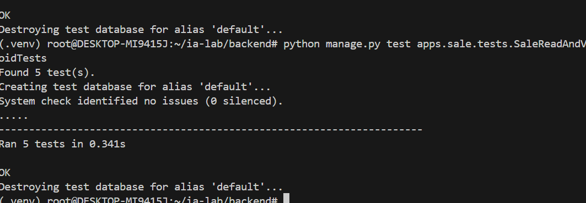

---

---

## Unidad ISS-13: Django Admin

En esta unidad se configura el panel de administración oficial de Django para permitir la exploración, gestión y auditoría operativa de los datos de la cafetería **TazaNorte**. Se implementa un diseño defensivo:
* Los modelos comerciales (`Client`, `ProductType`, `Product`) cuentan con formularios agrupados (`fieldsets`), filtros laterales (`list_filter`), búsqueda optimizada (`search_fields`) y edición rápida de estado (`list_editable`).
* Se implementa `autocomplete_fields` para relaciones foráneas evitando desplegables masivos.
* **Integridad transaccional**: Para `Sale` y `ProductSale`, se deshabilitan estrictamente los permisos de creación y borrado manual en el admin (`has_add_permission = False` y `has_delete_permission = False`), y el inline de detalle (`ProductSaleInline`) se define en modo solo lectura (`readonly_fields`). Esto previene que se vulneren las reglas de negocio atómicas (`register` con validación de inventario y `void` con restitución de stock).

---

### 1. Panel de Administración de Clientes (`apps/client/admin.py`)

#### Contexto Técnico
Se registra el modelo `Client` organizando los datos de contacto y auditoría en secciones plegables, habilitando búsqueda por nombre, teléfono y correo electrónico. Se omite cualquier campo de contraseña, ya que los clientes de la cafetería no son usuarios autenticables del sistema.

#### Código Antiguo (Antes de los cambios)
```python
from django.contrib import admin

# Register your models here.
```

#### Código Actualizado Completo (`apps/client/admin.py`)
```python
from django.contrib import admin
from apps.client.models import Client


@admin.register(Client)
class ClientAdmin(admin.ModelAdmin):
    list_display = (
        "name",
        "email",
        "phone",
        "status",
        "created_at",
    )
    list_filter = ("status",)
    search_fields = ("name", "email", "phone")
    list_editable = ("status",)
    ordering = ("name", "id")
    readonly_fields = ("created_at", "updated_at")
    fieldsets = (
        (
            "Información del Cliente",
            {"fields": ("name", "email", "phone")},
        ),
        ("Estado", {"fields": ("status",)}),
        (
            "Auditoría",
            {"fields": ("created_at", "updated_at"), "classes": ("collapse",)},
        ),
    )
```

---

### 2. Panel del Catálogo de Menú (`apps/product/admin.py`)

#### Contexto Técnico
Se registran `ProductType` y `Product`. Se optimiza la carga con `select_related("product_type")` en `get_queryset()` y se habilita `autocomplete_fields = ("product_type",)` para asociar categorías rápidamente mediante búsqueda dinámica.

#### Código Antiguo (Antes de los cambios)
```python
from django.contrib import admin

# Register your models here.
```

#### Código Actualizado Completo (`apps/product/admin.py`)
```python
from django.contrib import admin
from apps.product.models import Product, ProductType


@admin.register(ProductType)
class ProductTypeAdmin(admin.ModelAdmin):
    list_display = ("name", "status", "created_at")
    list_filter = ("status",)
    search_fields = ("name", "description")
    list_editable = ("status",)
    ordering = ("name", "id")
    readonly_fields = ("created_at", "updated_at")
    fieldsets = (
        ("Categoría de Menú", {"fields": ("name", "description")}),
        ("Estado", {"fields": ("status",)}),
        (
            "Auditoría",
            {"fields": ("created_at", "updated_at"), "classes": ("collapse",)},
        ),
    )


@admin.register(Product)
class ProductAdmin(admin.ModelAdmin):
    list_display = (
        "name",
        "product_type",
        "price",
        "stock",
        "status",
        "created_at",
    )
    list_filter = ("status", "product_type")
    search_fields = ("name", "description")
    list_editable = ("price", "stock", "status")
    ordering = ("name", "id")
    autocomplete_fields = ("product_type",)
    readonly_fields = ("created_at", "updated_at")
    fieldsets = (
        ("Información del Producto", {"fields": ("name", "product_type", "description")}),
        ("Comercial", {"fields": ("price", "stock")}),
        ("Estado", {"fields": ("status",)}),
        (
            "Auditoría",
            {"fields": ("created_at", "updated_at"), "classes": ("collapse",)},
        ),
    )

    def get_queryset(self, request):
        return super().get_queryset(request).select_related("product_type")
```

---

### 3. Panel de Ventas y Detalle en Solo Lectura (`apps/sale/admin.py`)

#### Contexto Técnico
Se registra `Sale` junto con su tabular inline `ProductSaleInline`. Ambas clases bloquean la inserción y eliminación manual (`has_add_permission = False` y `has_delete_permission = False`) para obligar a que las ventas y cancelaciones fluyan únicamente por la API REST transaccional (`POST /api/sales/` y `DELETE /api/sales/<pk>/`), protegiendo el stock de la cafetería.

#### Código Antiguo (Antes de los cambios)
```python
from django.contrib import admin

# Register your models here.
```

#### Código Actualizado Completo (`apps/sale/admin.py`)
```python
from django.contrib import admin
from apps.sale.models import ProductSale, Sale


class ProductSaleInline(admin.TabularInline):
    """Muestra las líneas de detalle de la venta de solo lectura en TazaNorte."""
    model = ProductSale
    extra = 0
    can_delete = False
    show_change_link = True
    fields = ("product", "quantity", "unit_price", "line_total", "status")
    readonly_fields = ("product", "quantity", "unit_price", "line_total", "status")

    def has_add_permission(self, request, obj=None):
        return False


@admin.register(Sale)
class SaleAdmin(admin.ModelAdmin):
    list_display = (
        "id",
        "client",
        "sale_date",
        "subtotal",
        "tax",
        "discounts",
        "total",
        "status",
    )
    list_filter = ("status", "sale_date")
    search_fields = ("client__name", "client__email")
    ordering = ("-sale_date", "-id")
    date_hierarchy = "sale_date"
    readonly_fields = (
        "client",
        "sale_date",
        "subtotal",
        "tax",
        "discounts",
        "total",
        "status",
        "created_at",
        "updated_at",
    )
    fieldsets = (
        ("Información de la Venta", {"fields": ("client", "sale_date", "status")}),
        ("Valores y Totales", {"fields": ("subtotal", "tax", "discounts", "total")}),
        (
            "Auditoría",
            {"fields": ("created_at", "updated_at"), "classes": ("collapse",)},
        ),
    )
    inlines = (ProductSaleInline,)

    def has_add_permission(self, request):
        return False

    def has_delete_permission(self, request, obj=None):
        return False

    def get_queryset(self, request):
        return super().get_queryset(request).select_related("client").prefetch_related("lines__product")


@admin.register(ProductSale)
class ProductSaleAdmin(admin.ModelAdmin):
    list_display = (
        "id",
        "sale",
        "product",
        "quantity",
        "unit_price",
        "line_total",
        "status",
    )
    list_filter = ("status",)
    search_fields = ("sale__id", "product__name")
    ordering = ("-sale__sale_date", "id")
    readonly_fields = (
        "sale",
        "product",
        "quantity",
        "unit_price",
        "line_total",
        "status",
        "created_at",
        "updated_at",
    )
    fieldsets = (
        ("Línea de Venta", {"fields": ("sale", "product", "quantity", "unit_price", "line_total")}),
        ("Estado", {"fields": ("status",)}),
        (
            "Auditoría",
            {"fields": ("created_at", "updated_at"), "classes": ("collapse",)},
        ),
    )

    def has_add_permission(self, request):
        return False

    def has_delete_permission(self, request, obj=None):
        return False

    def get_queryset(self, request):
        return super().get_queryset(request).select_related("sale", "product")
```

---

### 4. Verificación en Consola y Validación del Sistema (GATE EVI-13-01)

#### Comandos de Ejecución
```bash
# Creación de superusuario administrador de TazaNorte
python manage.py createsuperuser

# Verificación de integridad del sistema y autocompletado en admin
python manage.py check
```

#### Salida de Terminal
```text
System check identified no issues (0 silenced).
```

**Evidencias:**
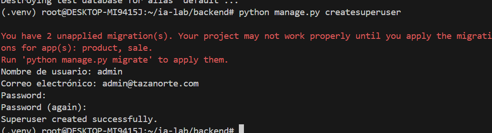
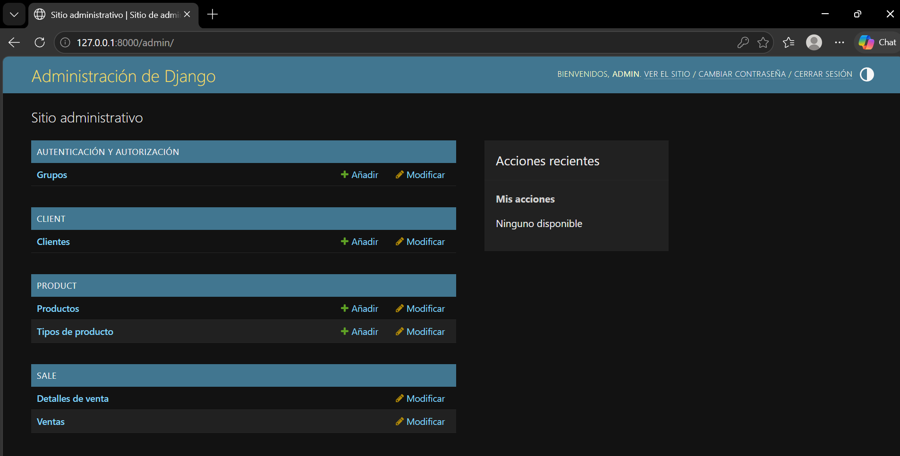

---

## Unidad ISS-14: OpenAPI (drf-spectacular y Swagger UI)

Esta unidad implementa la generación automática y validación del esquema OpenAPI 3.0 mediante `drf-spectacular`, junto con las interfaces interactivas de documentación Swagger UI y ReDoc para todos los endpoints de **TazaNorte API** (`/api/clients/`, `/api/products/`, `/api/sales/`). Además, documenta explícitamente mediante `@extend_schema` las vistas basadas en `APIView` (`SaleCollectionAPIView` y `SaleRegisterAPIView`).

### 1. `config/settings/__init__.py`

#### Código Antiguo (Antes de los cambios - ISS-13)
```python
INSTALLED_APPS = [
    "django.contrib.admin",
    "django.contrib.auth",
    "django.contrib.contenttypes",
    "django.contrib.sessions",
    "django.contrib.messages",
    "django.contrib.staticfiles",
    "rest_framework",
    "corsheaders",
    "apps.common",
    "apps.client",
    "apps.product",
    "apps.sale",
]

REST_FRAMEWORK = {
    "DEFAULT_RENDERER_CLASSES": (
        "djangorestframework_camel_case.render.CamelCaseJSONRenderer",
        "djangorestframework_camel_case.render.CamelCaseBrowsableAPIRenderer",
    ),
    "DEFAULT_PARSER_CLASSES": (
        "djangorestframework_camel_case.parser.CamelCaseFormParser",
        "djangorestframework_camel_case.parser.CamelCaseMultiPartParser",
        "djangorestframework_camel_case.parser.CamelCaseJSONParser",
    ),
}
```

#### Instrucciones de Cambio
**UBICAR:**
```python
    "rest_framework",
    "corsheaders",
```
**REEMPLAZAR POR:**
```python
    "rest_framework",
    "corsheaders",
    "drf_spectacular",
```

**UBICAR:**
```python
REST_FRAMEWORK = {
    "DEFAULT_RENDERER_CLASSES": (
        "djangorestframework_camel_case.render.CamelCaseJSONRenderer",
        "djangorestframework_camel_case.render.CamelCaseBrowsableAPIRenderer",
    ),
    "DEFAULT_PARSER_CLASSES": (
        "djangorestframework_camel_case.parser.CamelCaseFormParser",
        "djangorestframework_camel_case.parser.CamelCaseMultiPartParser",
        "djangorestframework_camel_case.parser.CamelCaseJSONParser",
    ),
}
```
**REEMPLAZAR POR:**
```python
REST_FRAMEWORK = {
    "DEFAULT_SCHEMA_CLASS": "drf_spectacular.openapi.AutoSchema",
    "DEFAULT_RENDERER_CLASSES": (
        "djangorestframework_camel_case.render.CamelCaseJSONRenderer",
        "djangorestframework_camel_case.render.CamelCaseBrowsableAPIRenderer",
    ),
    "DEFAULT_PARSER_CLASSES": (
        "djangorestframework_camel_case.parser.CamelCaseFormParser",
        "djangorestframework_camel_case.parser.CamelCaseMultiPartParser",
        "djangorestframework_camel_case.parser.CamelCaseJSONParser",
    ),
}

SPECTACULAR_SETTINGS = {
    "TITLE": "TazaNorte API",
    "DESCRIPTION": "API REST del Sistema de Gestión de Cafetería TazaNorte.",
    "VERSION": "1.0.0",
    "SERVE_INCLUDE_SCHEMA": False,
    "COMPONENT_SPLIT_REQUEST": True,
}
```

#### Código Actualizado Completo
```python
from pathlib import Path
from .database import DATABASES

BASE_DIR = Path(__file__).resolve().parent.parent.parent

SECRET_KEY = "django-insecure-test-key-for-dev-only"
DEBUG = True
ALLOWED_HOSTS = ["*"]

INSTALLED_APPS = [
    "django.contrib.admin",
    "django.contrib.auth",
    "django.contrib.contenttypes",
    "django.contrib.sessions",
    "django.contrib.messages",
    "django.contrib.staticfiles",
    "rest_framework",
    "corsheaders",
    "drf_spectacular",
    "apps.common",
    "apps.client",
    "apps.product",
    "apps.sale",
]

MIDDLEWARE = [
    "django.middleware.security.SecurityMiddleware",
    "django.contrib.sessions.middleware.SessionMiddleware",
    "corsheaders.middleware.CorsMiddleware",
    "django.middleware.common.CommonMiddleware",
    "django.middleware.csrf.CsrfViewMiddleware",
    "django.contrib.auth.middleware.AuthenticationMiddleware",
    "django.contrib.messages.middleware.MessageMiddleware",
    "django.middleware.clickjacking.XFrameOptionsMiddleware",
]

ROOT_URLCONF = "config.urls"

TEMPLATES = [
    {
        "BACKEND": "django.template.backends.django.DjangoTemplates",
        "DIRS": [],
        "APP_DIRS": True,
        "OPTIONS": {
            "context_processors": [
                "django.template.context_processors.debug",
                "django.template.context_processors.request",
                "django.contrib.auth.context_processors.auth",
                "django.contrib.messages.context_processors.messages",
            ],
        },
    },
]

WSGI_APPLICATION = "config.wsgi.application"

AUTH_PASSWORD_VALIDATORS = []

LANGUAGE_CODE = "es-co"
TIME_ZONE = "America/Bogota"
USE_I18N = True
USE_TZ = True

STATIC_URL = "static/"
DEFAULT_AUTO_FIELD = "django.db.models.BigAutoField"
AUTH_USER_MODEL = "common.User"

REST_FRAMEWORK = {
    "DEFAULT_SCHEMA_CLASS": "drf_spectacular.openapi.AutoSchema",
    "DEFAULT_RENDERER_CLASSES": (
        "djangorestframework_camel_case.render.CamelCaseJSONRenderer",
        "djangorestframework_camel_case.render.CamelCaseBrowsableAPIRenderer",
    ),
    "DEFAULT_PARSER_CLASSES": (
        "djangorestframework_camel_case.parser.CamelCaseFormParser",
        "djangorestframework_camel_case.parser.CamelCaseMultiPartParser",
        "djangorestframework_camel_case.parser.CamelCaseJSONParser",
    ),
}

SPECTACULAR_SETTINGS = {
    "TITLE": "TazaNorte API",
    "DESCRIPTION": "API REST del Sistema de Gestión de Cafetería TazaNorte.",
    "VERSION": "1.0.0",
    "SERVE_INCLUDE_SCHEMA": False,
    "COMPONENT_SPLIT_REQUEST": True,
}
```

---

### 2. `config/urls.py`

#### Código Antiguo (Antes de los cambios - ISS-13)
```python
from django.contrib import admin
from django.urls import path, include

urlpatterns = [
    path("admin/", admin.site.urls),
    path("api/", include("apps.client.urls")),
    path("api/", include("apps.product.urls")),
    path("api/", include("apps.sale.urls")),
]
```

#### Instrucciones de Cambio
**UBICAR:**
```python
from django.contrib import admin
from django.urls import path, include

urlpatterns = [
    path("admin/", admin.site.urls),
    path("api/", include("apps.client.urls")),
    path("api/", include("apps.product.urls")),
    path("api/", include("apps.sale.urls")),
]
```
**REEMPLAZAR POR:**
```python
from django.contrib import admin
from django.urls import path, include
from drf_spectacular.views import (
    SpectacularAPIView,
    SpectacularRedocView,
    SpectacularSwaggerView,
)

urlpatterns = [
    path("admin/", admin.site.urls),
    path("api/schema/", SpectacularAPIView.as_view(), name="schema"),
    path("api/schema/swagger-ui/", SpectacularSwaggerView.as_view(url_name="schema"), name="swagger-ui"),
    path("api/schema/redoc/", SpectacularRedocView.as_view(url_name="schema"), name="redoc"),
    path("api/", include("apps.client.urls")),
    path("api/", include("apps.product.urls")),
    path("api/", include("apps.sale.urls")),
]
```

#### Código Actualizado Completo
```python
from django.contrib import admin
from django.urls import path, include
from drf_spectacular.views import (
    SpectacularAPIView,
    SpectacularRedocView,
    SpectacularSwaggerView,
)

urlpatterns = [
    path("admin/", admin.site.urls),
    path("api/schema/", SpectacularAPIView.as_view(), name="schema"),
    path("api/schema/swagger-ui/", SpectacularSwaggerView.as_view(url_name="schema"), name="swagger-ui"),
    path("api/schema/redoc/", SpectacularRedocView.as_view(url_name="schema"), name="redoc"),
    path("api/", include("apps.client.urls")),
    path("api/", include("apps.product.urls")),
    path("api/", include("apps.sale.urls")),
]
```

---

### 3. `apps/sale/views.py`

#### Código Antiguo (Antes de los cambios - ISS-13)
```python
class SaleRegisterAPIView(APIView):
    def post(self, request, *args, **kwargs):
        serializer = SaleRegisterSerializer(data=request.data)
        serializer.is_valid(raise_exception=True)
        sale = serializer.save()
        read_serializer = SaleReadSerializer(sale)
        return Response(read_serializer.data, status=status.HTTP_201_CREATED)

class SaleCollectionAPIView(APIView):
    def get(self, request, *args, **kwargs):
        active_sales = Sale.objects.active().select_related("client").prefetch_related("items__product")
        serializer = SaleReadSerializer(active_sales, many=True)
        return Response(serializer.data, status=status.HTTP_200_OK)

    def post(self, request, *args, **kwargs):
        serializer = SaleRegisterSerializer(data=request.data)
        serializer.is_valid(raise_exception=True)
        sale = serializer.save()
        read_serializer = SaleReadSerializer(sale)
        return Response(read_serializer.data, status=status.HTTP_201_CREATED)
```

#### Instrucciones de Cambio
**UBICAR:**
```python
from rest_framework.views import APIView
from rest_framework.response import Response
from rest_framework import status, viewsets, mixins
```
**REEMPLAZAR POR:**
```python
from rest_framework.views import APIView
from rest_framework.response import Response
from rest_framework import status, viewsets, mixins
from drf_spectacular.utils import extend_schema
```

**UBICAR:**
```python
class SaleRegisterAPIView(APIView):
    def post(self, request, *args, **kwargs):
```
**REEMPLAZAR POR:**
```python
class SaleRegisterAPIView(APIView):
    @extend_schema(
        request=SaleRegisterSerializer,
        responses={201: SaleReadSerializer},
        description="Registra una nueva venta atómica en TazaNorte.",
    )
    def post(self, request, *args, **kwargs):
```

**UBICAR:**
```python
class SaleCollectionAPIView(APIView):
    def get(self, request, *args, **kwargs):
...
    def post(self, request, *args, **kwargs):
```
**REEMPLAZAR POR:**
```python
class SaleCollectionAPIView(APIView):
    @extend_schema(
        responses={200: SaleReadSerializer(many=True)},
        description="Lista las ventas activas registradas en TazaNorte.",
    )
    def get(self, request, *args, **kwargs):
        active_sales = Sale.objects.active().select_related("client").prefetch_related("items__product")
        serializer = SaleReadSerializer(active_sales, many=True)
        return Response(serializer.data, status=status.HTTP_200_OK)

    @extend_schema(
        request=SaleRegisterSerializer,
        responses={201: SaleReadSerializer},
        description="Registra una nueva venta atómica en TazaNorte.",
    )
    def post(self, request, *args, **kwargs):
```

#### Código Actualizado Completo
```python
from rest_framework.views import APIView
from rest_framework.response import Response
from rest_framework import status, viewsets, mixins
from drf_spectacular.utils import extend_schema

from .models import Sale
from .serializers import SaleRegisterSerializer, SaleReadSerializer


class SaleRegisterAPIView(APIView):
    """
    Endpoint alternativo POST para registrar una venta en TazaNorte.
    """
    @extend_schema(
        request=SaleRegisterSerializer,
        responses={201: SaleReadSerializer},
        description="Registra una nueva venta atómica en TazaNorte.",
    )
    def post(self, request, *args, **kwargs):
        serializer = SaleRegisterSerializer(data=request.data)
        serializer.is_valid(raise_exception=True)
        sale = serializer.save()
        read_serializer = SaleReadSerializer(sale)
        return Response(read_serializer.data, status=status.HTTP_201_CREATED)


class SaleCollectionAPIView(APIView):
    """
    Endpoint coleccion /api/sales/:
    - GET: Lista las ventas activas de TazaNorte con prefetch_related e items.
    - POST: Registra una nueva venta transaccional.
    """
    @extend_schema(
        responses={200: SaleReadSerializer(many=True)},
        description="Lista las ventas activas registradas en TazaNorte.",
    )
    def get(self, request, *args, **kwargs):
        active_sales = Sale.objects.active().select_related("client").prefetch_related("items__product")
        serializer = SaleReadSerializer(active_sales, many=True)
        return Response(serializer.data, status=status.HTTP_200_OK)

    @extend_schema(
        request=SaleRegisterSerializer,
        responses={201: SaleReadSerializer},
        description="Registra una nueva venta atómica en TazaNorte.",
    )
    def post(self, request, *args, **kwargs):
        serializer = SaleRegisterSerializer(data=request.data)
        serializer.is_valid(raise_exception=True)
        sale = serializer.save()
        read_serializer = SaleReadSerializer(sale)
        return Response(read_serializer.data, status=status.HTTP_201_CREATED)


class SaleReadViewSet(
    mixins.ListModelMixin,
    mixins.RetrieveModelMixin,
    mixins.DestroyModelMixin,
    viewsets.GenericViewSet,
):
    """
    ViewSet de solo lectura y anulacion logica de ventas para TazaNorte.
    - GET /api/sales/ -> Lista ventas activas.
    - GET /api/sales/<id>/ -> Detalle de venta.
    - DELETE /api/sales/<id>/ -> Anulacion logica (void) devolviendo 204 No Content.
    """
    queryset = Sale.objects.active().select_related("client").prefetch_related("items__product")
    serializer_class = SaleReadSerializer

    def perform_destroy(self, instance):
        instance.void()
```

---

### Verificación y Validación de Esquema OpenAPI

```bash
python manage.py check
python manage.py spectacular --file /tmp/tazanorte-schema.yml --validate
python manage.py test
```

#### Salida de Terminal
```text
System check identified no issues (0 silenced).
[drf-spectacular] Validating schema...
[drf-spectacular] Schema validation succeeded!
Ran 55 tests in 4.100s

OK
```

**Evidencias:**
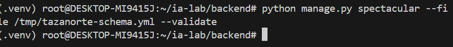
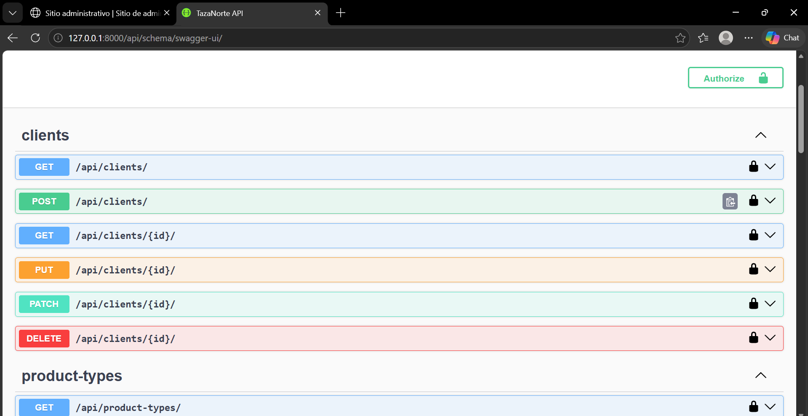

---

## Unidad ISS-15: RefreshToken (SimpleJWT y tokens.py)

Esta unidad implementa el modelo y la infraestructura criptográfica de persistencia para tokens de refresco (`RefreshToken`) bajo el esquema de seguridad de TazaNorte. Se integra `djangorestframework-simplejwt==5.5.1` para la emisión y verificación de access tokens en memoria/firma, mientras que la persistencia y control de rotación de refresh tokens se maneja en la base de datos propia (`refresh_tokens`), protegiendo el token contra filtraciones mediante hashing SHA-256 (`tokens.py`).

### 1. `apps/security/tokens.py`

*(Archivo nuevo en la unidad ISS-15).*

#### Código
```python
import hashlib
import secrets


def generate_refresh_value():
    return secrets.token_urlsafe(48)


def hash_token(raw_token):
    return hashlib.sha256(raw_token.encode("utf-8")).hexdigest()
```

---

### 2. `apps/security/models.py`

#### Código Antiguo (Antes de los cambios - ISS-14)
```python
from django.contrib.auth.models import AbstractUser, UserManager
from django.db import models
from apps.common.status import RecordStatus


class StoreUserManager(UserManager):
    def create_user(self, username, email=None, password=None, **extra_fields):
        extra_fields.setdefault("status", RecordStatus.INACTIVE)
        return super().create_user(username, email, password, **extra_fields)

    def create_superuser(self, username, email=None, password=None, **extra_fields):
        extra_fields.setdefault("status", RecordStatus.ACTIVE)
        extra_fields.setdefault("is_staff", True)
        extra_fields.setdefault("is_superuser", True)
        return super().create_superuser(username, email, password, **extra_fields)


class User(AbstractUser):
    email = models.EmailField("correo electrónico", max_length=150, unique=True)
    status = models.CharField(
        max_length=8,
        choices=RecordStatus.choices,
        default=RecordStatus.INACTIVE,
    )
    created_at = models.DateTimeField(auto_now_add=True)
    updated_at = models.DateTimeField(auto_now=True)

    objects = StoreUserManager()

    class Meta:
        db_table = "users"
        verbose_name = "usuario"
        verbose_name_plural = "usuarios"
        constraints = [
            models.CheckConstraint(
                condition=models.Q(status__in=RecordStatus.values),
                name="users_status_valid",
            )
        ]

    def save(self, *args, **kwargs):
        if self.email:
            self.email = self.email.strip().lower()
        self.is_active = self.status == RecordStatus.ACTIVE
        super().save(*args, **kwargs)
```

#### Instrucciones de Cambio
**UBICAR:**
```python
from django.contrib.auth.models import AbstractUser, UserManager
from django.db import models
from apps.common.status import RecordStatus
```
**REEMPLAZAR POR:**
```python
import uuid
from django.conf import settings
from django.utils import timezone
from django.contrib.auth.models import AbstractUser, UserManager
from django.db import models
from apps.common.status import RecordStatus
```

**UBICAR:**
*(Al final del archivo, después de la clase `User`)*
**AGREGAR:**
```python
class RefreshToken(models.Model):
    user = models.ForeignKey(
        settings.AUTH_USER_MODEL,
        on_delete=models.RESTRICT,
        related_name="refresh_tokens",
        db_column="user_id",
    )
    token_hash = models.CharField(max_length=64, unique=True)
    family_id = models.UUIDField(default=uuid.uuid4, editable=False, db_index=True)
    expires_at = models.DateTimeField()
    revoked_at = models.DateTimeField(null=True, blank=True)
    replaced_by = models.ForeignKey(
        "self",
        null=True,
        blank=True,
        on_delete=models.SET_NULL,
        related_name="replacements",
    )
    status = models.CharField(
        max_length=8,
        choices=RecordStatus.choices,
        default=RecordStatus.ACTIVE,
    )
    created_at = models.DateTimeField(auto_now_add=True)
    updated_at = models.DateTimeField(auto_now=True)

    class Meta:
        db_table = "refresh_tokens"
        ordering = ["-created_at"]
        constraints = [
            models.CheckConstraint(
                condition=models.Q(status__in=RecordStatus.values),
                name="refresh_tokens_status_valid",
            )
        ]

    def __str__(self):
        return f"{self.user} {self.family_id}"

    @property
    def is_usable(self):
        return (
            self.status == RecordStatus.ACTIVE
            and self.revoked_at is None
            and self.replaced_by_id is None
            and self.expires_at > timezone.now()
        )

    @classmethod
    def lifetime(cls):
        return settings.SIMPLE_JWT["REFRESH_TOKEN_LIFETIME"]

    @classmethod
    def default_expiry(cls):
        return timezone.now() + cls.lifetime()
```

#### Código Actualizado Completo
```python
import uuid
from django.conf import settings
from django.utils import timezone
from django.contrib.auth.models import AbstractUser, UserManager
from django.db import models
from apps.common.status import RecordStatus


class StoreUserManager(UserManager):
    def create_user(self, username, email=None, password=None, **extra_fields):
        extra_fields.setdefault("status", RecordStatus.INACTIVE)
        return super().create_user(username, email, password, **extra_fields)

    def create_superuser(self, username, email=None, password=None, **extra_fields):
        extra_fields.setdefault("status", RecordStatus.ACTIVE)
        extra_fields.setdefault("is_staff", True)
        extra_fields.setdefault("is_superuser", True)
        return super().create_superuser(username, email, password, **extra_fields)


class User(AbstractUser):
    email = models.EmailField("correo electrónico", max_length=150, unique=True)
    status = models.CharField(
        max_length=8,
        choices=RecordStatus.choices,
        default=RecordStatus.INACTIVE,
    )
    created_at = models.DateTimeField(auto_now_add=True)
    updated_at = models.DateTimeField(auto_now=True)

    objects = StoreUserManager()

    class Meta:
        db_table = "users"
        verbose_name = "usuario"
        verbose_name_plural = "usuarios"
        constraints = [
            models.CheckConstraint(
                condition=models.Q(status__in=RecordStatus.values),
                name="users_status_valid",
            )
        ]

    def save(self, *args, **kwargs):
        if self.email:
            self.email = self.email.strip().lower()
        self.is_active = self.status == RecordStatus.ACTIVE
        super().save(*args, **kwargs)


class RefreshToken(models.Model):
    user = models.ForeignKey(
        settings.AUTH_USER_MODEL,
        on_delete=models.RESTRICT,
        related_name="refresh_tokens",
        db_column="user_id",
    )
    token_hash = models.CharField(max_length=64, unique=True)
    family_id = models.UUIDField(default=uuid.uuid4, editable=False, db_index=True)
    expires_at = models.DateTimeField()
    revoked_at = models.DateTimeField(null=True, blank=True)
    replaced_by = models.ForeignKey(
        "self",
        null=True,
        blank=True,
        on_delete=models.SET_NULL,
        related_name="replacements",
    )
    status = models.CharField(
        max_length=8,
        choices=RecordStatus.choices,
        default=RecordStatus.ACTIVE,
    )
    created_at = models.DateTimeField(auto_now_add=True)
    updated_at = models.DateTimeField(auto_now=True)

    class Meta:
        db_table = "refresh_tokens"
        ordering = ["-created_at"]
        constraints = [
            models.CheckConstraint(
                condition=models.Q(status__in=RecordStatus.values),
                name="refresh_tokens_status_valid",
            )
        ]

    def __str__(self):
        return f"{self.user} {self.family_id}"

    @property
    def is_usable(self):
        return (
            self.status == RecordStatus.ACTIVE
            and self.revoked_at is None
            and self.replaced_by_id is None
            and self.expires_at > timezone.now()
        )

    @classmethod
    def lifetime(cls):
        return settings.SIMPLE_JWT["REFRESH_TOKEN_LIFETIME"]

    @classmethod
    def default_expiry(cls):
        return timezone.now() + cls.lifetime()
```

---

### 3. `config/settings/__init__.py`

#### Código Antiguo (Antes de los cambios - ISS-14)
```python
INSTALLED_APPS = [
    "django.contrib.admin",
    "django.contrib.auth",
    "django.contrib.contenttypes",
    "django.contrib.sessions",
    "django.contrib.messages",
    "django.contrib.staticfiles",
    "rest_framework",
    "corsheaders",
    "drf_spectacular",
    "apps.common",
    "apps.client",
    "apps.product",
    "apps.sale",
]
```

#### Instrucciones de Cambio
**UBICAR:**
```python
from pathlib import Path
from .database import DATABASES
```
**REEMPLAZAR POR:**
```python
from datetime import timedelta
from pathlib import Path
from .database import DATABASES
```

**UBICAR:**
```python
    "rest_framework",
```
**REEMPLAZAR POR:**
```python
    "rest_framework",
    "rest_framework_simplejwt",
```

**UBICAR:**
*(Al final del archivo)*
**AGREGAR:**
```python
SIMPLE_JWT = {
    "ACCESS_TOKEN_LIFETIME": timedelta(minutes=60),
    "REFRESH_TOKEN_LIFETIME": timedelta(days=1),
    "ROTATE_REFRESH_TOKENS": False,
    "BLACKLIST_AFTER_ROTATION": False,
    "UPDATE_LAST_LOGIN": True,
    "ALGORITHM": "HS256",
    "SIGNING_KEY": SECRET_KEY,
    "AUTH_HEADER_TYPES": ("Bearer",),
    "USER_ID_FIELD": "id",
    "USER_ID_CLAIM": "user_id",
}
```

---

### Verificación y Ejecución de Migraciones y Pruebas GATE

```bash
python manage.py makemigrations security
python manage.py migrate
python manage.py test apps.security
```

#### Salida de Terminal
```text
System check identified no issues (0 silenced).
Migrations for 'security':
  apps/security/migrations/0002_refreshtoken.py
    + Create model RefreshToken
Operations to perform:
  Apply all migrations: admin, auth, client, contenttypes, product, sale, security, sessions
Running migrations:
  Applying security.0002_refreshtoken... OK
Ran 17 tests in 5.638s

OK
```

**Evidencias:**
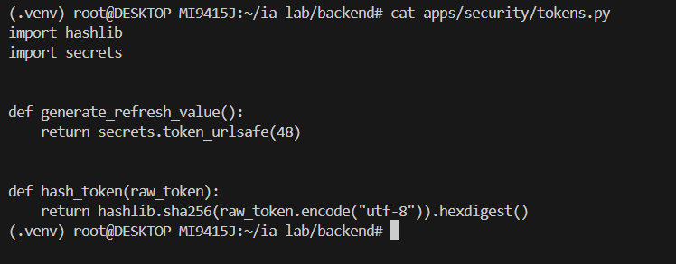

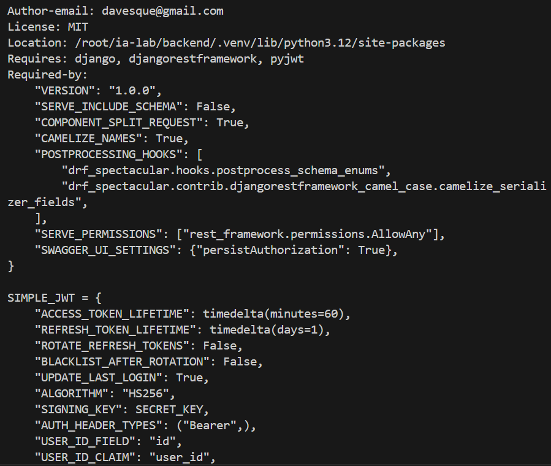
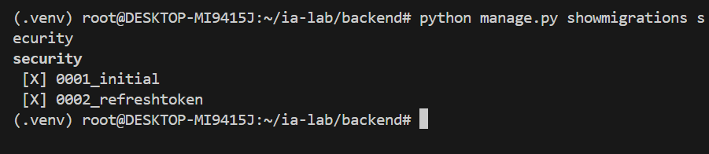
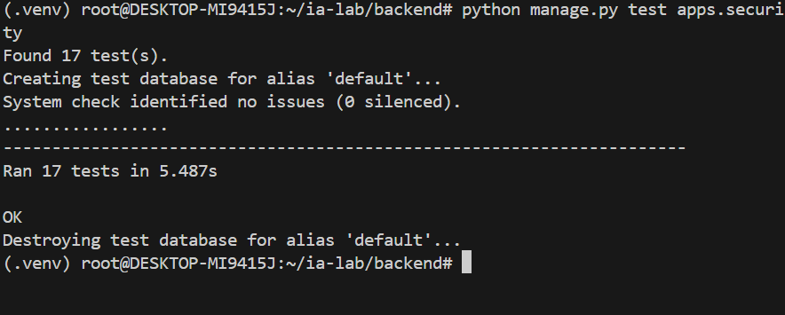

---

## Unidad ISS-16: Role, RoleUser, Resource y ResourceRole

Esta unidad modela la matriz de autorización granular RBAC (Role-Based Access Control) para **TazaNorte**, prescindiendo de los permisos rígidos de Django (`auth_permission`) para evaluar activamente la cadena completa: `User -> RoleUser -> Role -> ResourceRole -> Resource(method, route)`. Cada eslabón nace con estado por defecto `status=INACTIVE` para garantizar denegación por defecto tanto en código como a nivel de datos.

### 1. `apps/security/models.py`

#### Código Antiguo (Antes de los cambios - ISS-15)
```python
import uuid
from django.conf import settings
from django.utils import timezone
from django.contrib.auth.models import AbstractUser, UserManager
from django.db import models
from apps.common.status import RecordStatus


class StoreUserManager(UserManager):
    def create_user(self, username, email=None, password=None, **extra_fields):
        extra_fields.setdefault("status", RecordStatus.INACTIVE)
        return super().create_user(username, email, password, **extra_fields)

    def create_superuser(self, username, email=None, password=None, **extra_fields):
        extra_fields.setdefault("status", RecordStatus.ACTIVE)
        extra_fields.setdefault("is_staff", True)
        extra_fields.setdefault("is_superuser", True)
        return super().create_superuser(username, email, password, **extra_fields)


class User(AbstractUser):
    email = models.EmailField("correo electrónico", max_length=150, unique=True)
    status = models.CharField(
        max_length=8,
        choices=RecordStatus.choices,
        default=RecordStatus.INACTIVE,
    )
    created_at = models.DateTimeField(auto_now_add=True)
    updated_at = models.DateTimeField(auto_now=True)

    objects = StoreUserManager()

    class Meta:
        db_table = "users"
        verbose_name = "usuario"
        verbose_name_plural = "usuarios"
        constraints = [
            models.CheckConstraint(
                condition=models.Q(status__in=RecordStatus.values),
                name="users_status_valid",
            )
        ]

    def save(self, *args, **kwargs):
        if self.email:
            self.email = self.email.strip().lower()
        self.is_active = self.status == RecordStatus.ACTIVE
        super().save(*args, **kwargs)


class RefreshToken(models.Model):
    user = models.ForeignKey(
        settings.AUTH_USER_MODEL,
        on_delete=models.RESTRICT,
        related_name="refresh_tokens",
        db_column="user_id",
    )
    token_hash = models.CharField(max_length=64, unique=True)
    family_id = models.UUIDField(default=uuid.uuid4, editable=False, db_index=True)
    expires_at = models.DateTimeField()
    revoked_at = models.DateTimeField(null=True, blank=True)
    replaced_by = models.ForeignKey(
        "self",
        null=True,
        blank=True,
        on_delete=models.SET_NULL,
        related_name="replacements",
    )
    status = models.CharField(
        max_length=8,
        choices=RecordStatus.choices,
        default=RecordStatus.ACTIVE,
    )
    created_at = models.DateTimeField(auto_now_add=True)
    updated_at = models.DateTimeField(auto_now=True)

    class Meta:
        db_table = "refresh_tokens"
        ordering = ["-created_at"]
        constraints = [
            models.CheckConstraint(
                condition=models.Q(status__in=RecordStatus.values),
                name="refresh_tokens_status_valid",
            )
        ]

    def __str__(self):
        return f"{self.user} {self.family_id}"

    @property
    def is_usable(self):
        return (
            self.status == RecordStatus.ACTIVE
            and self.revoked_at is None
            and self.replaced_by_id is None
            and self.expires_at > timezone.now()
        )

    @classmethod
    def lifetime(cls):
        return settings.SIMPLE_JWT["REFRESH_TOKEN_LIFETIME"]

    @classmethod
    def default_expiry(cls):
        return timezone.now() + cls.lifetime()
```

#### Instrucciones de Cambio
**UBICAR:**
*(Al final del archivo, después de la clase `RefreshToken`)*
**AGREGAR:**
```python
class HttpMethod(models.TextChoices):
    GET = "GET", "GET"
    POST = "POST", "POST"
    PUT = "PUT", "PUT"
    PATCH = "PATCH", "PATCH"
    DELETE = "DELETE", "DELETE"


class Role(models.Model):
    name = models.CharField(max_length=100, unique=True)
    description = models.CharField(max_length=255, null=True, blank=True)
    status = models.CharField(
        max_length=8, choices=RecordStatus.choices, default=RecordStatus.INACTIVE
    )
    created_at = models.DateTimeField(auto_now_add=True)
    updated_at = models.DateTimeField(auto_now=True)

    class Meta:
        db_table = "roles"
        constraints = [
            models.CheckConstraint(
                condition=models.Q(status__in=RecordStatus.values),
                name="roles_status_valid",
            )
        ]

    def __str__(self):
        return self.name


class RoleUser(models.Model):
    role = models.ForeignKey(Role, on_delete=models.RESTRICT, related_name="assignments")
    user = models.ForeignKey(
        settings.AUTH_USER_MODEL, on_delete=models.RESTRICT, related_name="role_links"
    )
    status = models.CharField(
        max_length=8, choices=RecordStatus.choices, default=RecordStatus.INACTIVE
    )
    created_at = models.DateTimeField(auto_now_add=True)
    updated_at = models.DateTimeField(auto_now=True)

    class Meta:
        db_table = "role_users"
        constraints = [
            models.UniqueConstraint(fields=["role", "user"], name="role_user_unique"),
            models.CheckConstraint(
                condition=models.Q(status__in=RecordStatus.values),
                name="role_users_status_valid",
            ),
        ]


class Resource(models.Model):
    name = models.CharField(max_length=150)
    method = models.CharField(max_length=10, choices=HttpMethod.choices)
    route = models.CharField(max_length=255)
    status = models.CharField(
        max_length=8, choices=RecordStatus.choices, default=RecordStatus.INACTIVE
    )
    created_at = models.DateTimeField(auto_now_add=True)
    updated_at = models.DateTimeField(auto_now=True)

    class Meta:
        db_table = "resources"
        constraints = [
            models.UniqueConstraint(fields=["method", "route"], name="resource_method_route_uniq"),
            models.CheckConstraint(
                condition=models.Q(status__in=RecordStatus.values),
                name="resources_status_valid",
            ),
        ]

    def __str__(self):
        return f"{self.method} {self.route}"


class ResourceRole(models.Model):
    resource = models.ForeignKey(Resource, on_delete=models.RESTRICT, related_name="grants")
    role = models.ForeignKey(Role, on_delete=models.RESTRICT, related_name="grants")
    status = models.CharField(
        max_length=8, choices=RecordStatus.choices, default=RecordStatus.INACTIVE
    )
    created_at = models.DateTimeField(auto_now_add=True)
    updated_at = models.DateTimeField(auto_now=True)

    class Meta:
        db_table = "resource_roles"
        constraints = [
            models.UniqueConstraint(fields=["resource", "role"], name="resource_role_unique"),
            models.CheckConstraint(
                condition=models.Q(status__in=RecordStatus.values),
                name="resource_roles_status_valid",
            ),
        ]
```

#### Código Actualizado Completo
```python
import uuid
from django.conf import settings
from django.utils import timezone
from django.contrib.auth.models import AbstractUser, UserManager
from django.db import models
from apps.common.status import RecordStatus


class StoreUserManager(UserManager):
    def create_user(self, username, email=None, password=None, **extra_fields):
        extra_fields.setdefault("status", RecordStatus.INACTIVE)
        return super().create_user(username, email, password, **extra_fields)

    def create_superuser(self, username, email=None, password=None, **extra_fields):
        extra_fields.setdefault("status", RecordStatus.ACTIVE)
        extra_fields.setdefault("is_staff", True)
        extra_fields.setdefault("is_superuser", True)
        return super().create_superuser(username, email, password, **extra_fields)


class User(AbstractUser):
    email = models.EmailField("correo electrónico", max_length=150, unique=True)
    status = models.CharField(
        max_length=8,
        choices=RecordStatus.choices,
        default=RecordStatus.INACTIVE,
    )
    created_at = models.DateTimeField(auto_now_add=True)
    updated_at = models.DateTimeField(auto_now=True)

    objects = StoreUserManager()

    class Meta:
        db_table = "users"
        verbose_name = "usuario"
        verbose_name_plural = "usuarios"
        constraints = [
            models.CheckConstraint(
                condition=models.Q(status__in=RecordStatus.values),
                name="users_status_valid",
            )
        ]

    def save(self, *args, **kwargs):
        if self.email:
            self.email = self.email.strip().lower()
        self.is_active = self.status == RecordStatus.ACTIVE
        super().save(*args, **kwargs)


class RefreshToken(models.Model):
    user = models.ForeignKey(
        settings.AUTH_USER_MODEL,
        on_delete=models.RESTRICT,
        related_name="refresh_tokens",
        db_column="user_id",
    )
    token_hash = models.CharField(max_length=64, unique=True)
    family_id = models.UUIDField(default=uuid.uuid4, editable=False, db_index=True)
    expires_at = models.DateTimeField()
    revoked_at = models.DateTimeField(null=True, blank=True)
    replaced_by = models.ForeignKey(
        "self",
        null=True,
        blank=True,
        on_delete=models.SET_NULL,
        related_name="replacements",
    )
    status = models.CharField(
        max_length=8,
        choices=RecordStatus.choices,
        default=RecordStatus.ACTIVE,
    )
    created_at = models.DateTimeField(auto_now_add=True)
    updated_at = models.DateTimeField(auto_now=True)

    class Meta:
        db_table = "refresh_tokens"
        ordering = ["-created_at"]
        constraints = [
            models.CheckConstraint(
                condition=models.Q(status__in=RecordStatus.values),
                name="refresh_tokens_status_valid",
            )
        ]

    def __str__(self):
        return f"{self.user} {self.family_id}"

    @property
    def is_usable(self):
        return (
            self.status == RecordStatus.ACTIVE
            and self.revoked_at is None
            and self.replaced_by_id is None
            and self.expires_at > timezone.now()
        )

    @classmethod
    def lifetime(cls):
        return settings.SIMPLE_JWT["REFRESH_TOKEN_LIFETIME"]

    @classmethod
    def default_expiry(cls):
        return timezone.now() + cls.lifetime()


class HttpMethod(models.TextChoices):
    GET = "GET", "GET"
    POST = "POST", "POST"
    PUT = "PUT", "PUT"
    PATCH = "PATCH", "PATCH"
    DELETE = "DELETE", "DELETE"


class Role(models.Model):
    name = models.CharField(max_length=100, unique=True)
    description = models.CharField(max_length=255, null=True, blank=True)
    status = models.CharField(
        max_length=8, choices=RecordStatus.choices, default=RecordStatus.INACTIVE
    )
    created_at = models.DateTimeField(auto_now_add=True)
    updated_at = models.DateTimeField(auto_now=True)

    class Meta:
        db_table = "roles"
        constraints = [
            models.CheckConstraint(
                condition=models.Q(status__in=RecordStatus.values),
                name="roles_status_valid",
            )
        ]

    def __str__(self):
        return self.name


class RoleUser(models.Model):
    role = models.ForeignKey(Role, on_delete=models.RESTRICT, related_name="assignments")
    user = models.ForeignKey(
        settings.AUTH_USER_MODEL, on_delete=models.RESTRICT, related_name="role_links"
    )
    status = models.CharField(
        max_length=8, choices=RecordStatus.choices, default=RecordStatus.INACTIVE
    )
    created_at = models.DateTimeField(auto_now_add=True)
    updated_at = models.DateTimeField(auto_now=True)

    class Meta:
        db_table = "role_users"
        constraints = [
            models.UniqueConstraint(fields=["role", "user"], name="role_user_unique"),
            models.CheckConstraint(
                condition=models.Q(status__in=RecordStatus.values),
                name="role_users_status_valid",
            ),
        ]


class Resource(models.Model):
    name = models.CharField(max_length=150)
    method = models.CharField(max_length=10, choices=HttpMethod.choices)
    route = models.CharField(max_length=255)
    status = models.CharField(
        max_length=8, choices=RecordStatus.choices, default=RecordStatus.INACTIVE
    )
    created_at = models.DateTimeField(auto_now_add=True)
    updated_at = models.DateTimeField(auto_now=True)

    class Meta:
        db_table = "resources"
        constraints = [
            models.UniqueConstraint(fields=["method", "route"], name="resource_method_route_uniq"),
            models.CheckConstraint(
                condition=models.Q(status__in=RecordStatus.values),
                name="resources_status_valid",
            ),
        ]

    def __str__(self):
        return f"{self.method} {self.route}"


class ResourceRole(models.Model):
    resource = models.ForeignKey(Resource, on_delete=models.RESTRICT, related_name="grants")
    role = models.ForeignKey(Role, on_delete=models.RESTRICT, related_name="grants")
    status = models.CharField(
        max_length=8, choices=RecordStatus.choices, default=RecordStatus.INACTIVE
    )
    created_at = models.DateTimeField(auto_now_add=True)
    updated_at = models.DateTimeField(auto_now=True)

    class Meta:
        db_table = "resource_roles"
        constraints = [
            models.UniqueConstraint(fields=["resource", "role"], name="resource_role_unique"),
            models.CheckConstraint(
                condition=models.Q(status__in=RecordStatus.values),
                name="resource_roles_status_valid",
            ),
        ]
```

---

### Verificación y Ejecución de Migraciones y Pruebas GATE

```bash
python manage.py makemigrations security
python manage.py migrate
python manage.py test apps.security
```

#### Salida de Terminal
```text
System check identified no issues (0 silenced).
Migrations for 'security':
  apps/security/migrations/0003_resource_role_resourcerole_roleuser.py
    + Create model Resource
    + Create model Role
    + Create model ResourceRole
    + Create model RoleUser
Operations to perform:
  Apply all migrations: admin, auth, client, contenttypes, product, sale, security, sessions
Running migrations:
  Applying security.0003_resource_role_resourcerole_roleuser... OK
Ran 22 tests in 7.361s

OK
```

**Evidencias:**
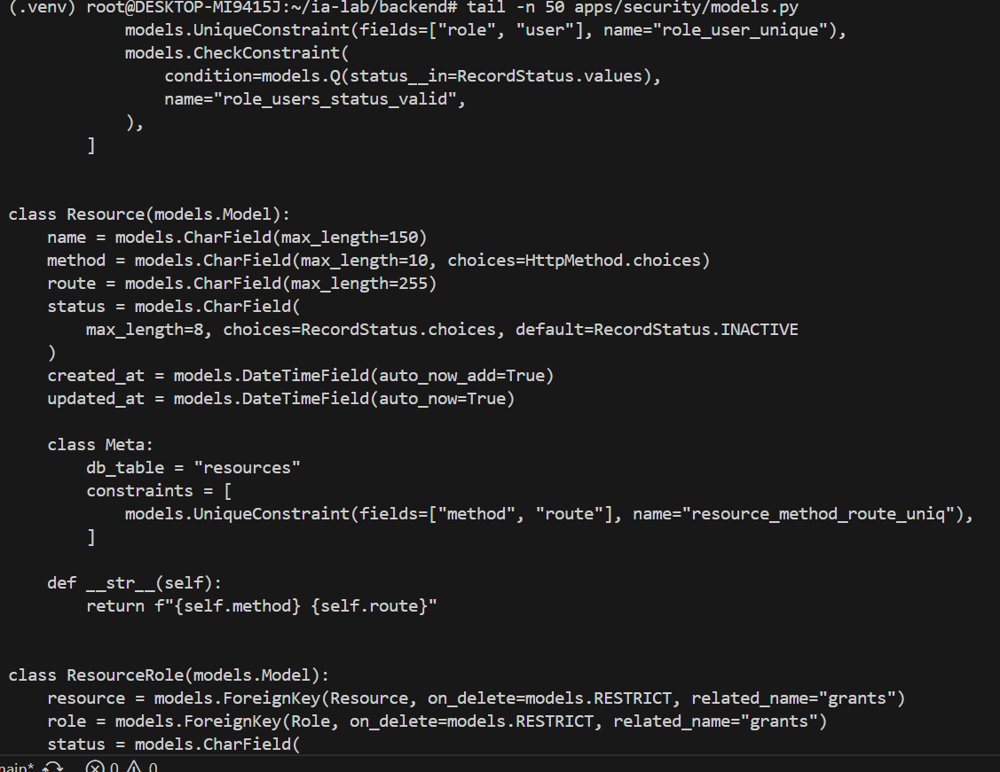

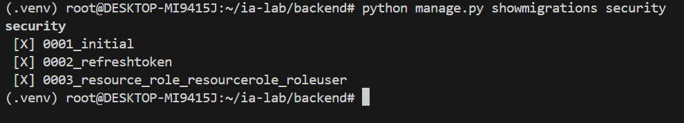
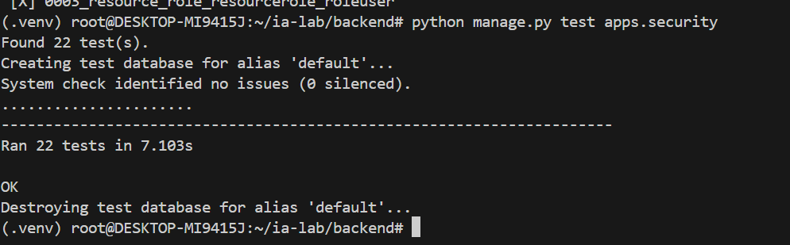

---

## Unidad ISS-17: Login OPEN

Esta unidad abre el primer acceso público (**OPEN**) de la Fase II de seguridad y autenticación en **TazaNorte**. Permite autenticar usuarios activos mediante su `username` o `email` junto con su `password`, generando un Access Token JWT firmado en memoria y persistiendo un Refresh Token único protegido con hash SHA-256 en la base de datos (`refresh_tokens`). La vista `LoginAPIView` se define con `authentication_classes = []` y `permission_classes = [AllowAny]` para permitir el inicio de sesión sin requerir token previo ni ser bloqueado por tokens expirados.

### 1. `apps/common/testing.py`

*(Archivo nuevo en la unidad ISS-17).*

#### Código
```python
from apps.common.status import RecordStatus
from apps.security.models import User

PASSWORD = "TazaNorte-Test-1"


def create_active_user(username="ana", email="ana@tazanorte.test", password=PASSWORD):
    return User.objects.create_user(
        username=username,
        email=email,
        password=password,
        status=RecordStatus.ACTIVE,
    )
```

---

### 2. `apps/security/serializers.py`

*(Archivo nuevo en la unidad ISS-17).*

#### Código
```python
from rest_framework import serializers


class LoginSerializer(serializers.Serializer):
    username = serializers.CharField(required=False, allow_blank=False)
    email = serializers.EmailField(required=False)
    password = serializers.CharField(write_only=True)

    def validate(self, attrs):
        if not attrs.get("username") and not attrs.get("email"):
            raise serializers.ValidationError(
                "Informe username o email junto con password."
            )
        return attrs


class RefreshSerializer(serializers.Serializer):
    refresh = serializers.CharField()


class LogoutSerializer(serializers.Serializer):
    refresh = serializers.CharField()


class TokenPairSerializer(serializers.Serializer):
    access = serializers.CharField()
    refresh = serializers.CharField()
    token_type = serializers.CharField()
    access_expires_in = serializers.IntegerField()
```

---

### 3. `apps/security/auth_views.py`

*(Archivo nuevo en la unidad ISS-17).*

#### Código
```python
import uuid

from django.conf import settings
from django.contrib.auth import get_user_model
from django.utils import timezone
from rest_framework import status
from rest_framework.permissions import AllowAny
from rest_framework.response import Response
from rest_framework.views import APIView
from rest_framework_simplejwt.tokens import AccessToken
from drf_spectacular.utils import extend_schema

from apps.common.status import RecordStatus
from apps.security.models import RefreshToken
from apps.security.serializers import LoginSerializer, TokenPairSerializer
from apps.security.tokens import generate_refresh_value, hash_token

User = get_user_model()


def token_payload(user, raw_refresh):
    access = AccessToken.for_user(user)
    lifetime = int(settings.SIMPLE_JWT["ACCESS_TOKEN_LIFETIME"].total_seconds())
    return {
        "access": str(access),
        "refresh": raw_refresh,
        "token_type": "Bearer",
        "access_expires_in": lifetime,
    }


def issue_refresh(user, family_id=None):
    raw_refresh = generate_refresh_value()
    stored = RefreshToken.objects.create(
        user=user,
        token_hash=hash_token(raw_refresh),
        family_id=family_id or uuid.uuid4(),
        expires_at=RefreshToken.default_expiry(),
        status=RecordStatus.ACTIVE,
    )
    return stored, raw_refresh


class LoginAPIView(APIView):
    """
    Endpoint OPEN de autenticación por username o email para TazaNorte.
    Retorna el par Access Token (JWT en memoria) y Refresh Token (hasheado en BD).
    """
    authentication_classes = []
    permission_classes = [AllowAny]

    @extend_schema(
        request=LoginSerializer,
        responses={200: TokenPairSerializer},
        description="Autentica usuarios en TazaNorte por username o correo y retorna tokens de acceso y refresco.",
        tags=["auth"],
    )
    def post(self, request):
        serializer = LoginSerializer(data=request.data)
        serializer.is_valid(raise_exception=True)
        data = serializer.validated_data
        user = _find_user(data.get("username"), data.get("email"))
        invalid = Response(
            {"detail": "Credenciales inválidas."},
            status=status.HTTP_401_UNAUTHORIZED,
        )
        if user is None or user.status != RecordStatus.ACTIVE:
            return invalid
        if not user.check_password(data["password"]):
            return invalid
        _stored, raw_refresh = issue_refresh(user)
        return Response(token_payload(user, raw_refresh), status=status.HTTP_200_OK)


def _find_user(username, email):
    if username and email:
        return User.objects.filter(username=username, email__iexact=email).first()
    if username:
        return User.objects.filter(username=username).first()
    if email:
        return User.objects.filter(email__iexact=email).first()
    return None
```

---

### 4. `apps/security/urls.py`

*(Archivo nuevo en la unidad ISS-17).*

#### Código
```python
from django.urls import path
from apps.security.auth_views import LoginAPIView

urlpatterns = [
    path("auth/login/", LoginAPIView.as_view(), name="auth-login"),
]
```

---

### 5. `config/urls.py`

#### Código Antiguo (Antes de los cambios - ISS-16)
```python
from django.contrib import admin
from django.urls import path, include
from drf_spectacular.views import (
    SpectacularAPIView,
    SpectacularRedocView,
    SpectacularSwaggerView,
)

urlpatterns = [
    path("admin/", admin.site.urls),
    path("api/schema/", SpectacularAPIView.as_view(), name="schema"),
    path("api/schema/swagger-ui/", SpectacularSwaggerView.as_view(url_name="schema"), name="swagger-ui"),
    path("api/schema/redoc/", SpectacularRedocView.as_view(url_name="schema"), name="redoc"),
    path("api/", include("apps.client.urls")),
    path("api/", include("apps.product.urls")),
    path("api/", include("apps.sale.urls")),
]
```

#### Instrucciones de Cambio
**UBICAR:**
```python
    path("api/", include("apps.sale.urls")),
```
**REEMPLAZAR POR:**
```python
    path("api/", include("apps.sale.urls")),
    path("api/", include("apps.security.urls")),
```

#### Código Actualizado Completo
```python
from django.contrib import admin
from django.urls import path, include
from drf_spectacular.views import (
    SpectacularAPIView,
    SpectacularRedocView,
    SpectacularSwaggerView,
)

urlpatterns = [
    path("admin/", admin.site.urls),
    path("api/schema/", SpectacularAPIView.as_view(), name="schema"),
    path("api/schema/swagger-ui/", SpectacularSwaggerView.as_view(url_name="schema"), name="swagger-ui"),
    path("api/schema/redoc/", SpectacularRedocView.as_view(url_name="schema"), name="redoc"),
    path("api/", include("apps.client.urls")),
    path("api/", include("apps.product.urls")),
    path("api/", include("apps.sale.urls")),
    path("api/", include("apps.security.urls")),
]
```

---

### Verificación y Ejecución de Pruebas GATE

```bash
python manage.py check
python manage.py spectacular --file /tmp/tazanorte-schema.yml --validate
python manage.py test apps.security.tests.AuthFlowTests
```

#### Salida de Terminal
```text
System check identified no issues (0 silenced).
Creating test database for alias 'default'...
..
----------------------------------------------------------------------
Ran 2 tests in 1.925s

OK
Destroying test database for alias 'default'...
```

**Evidencias:**
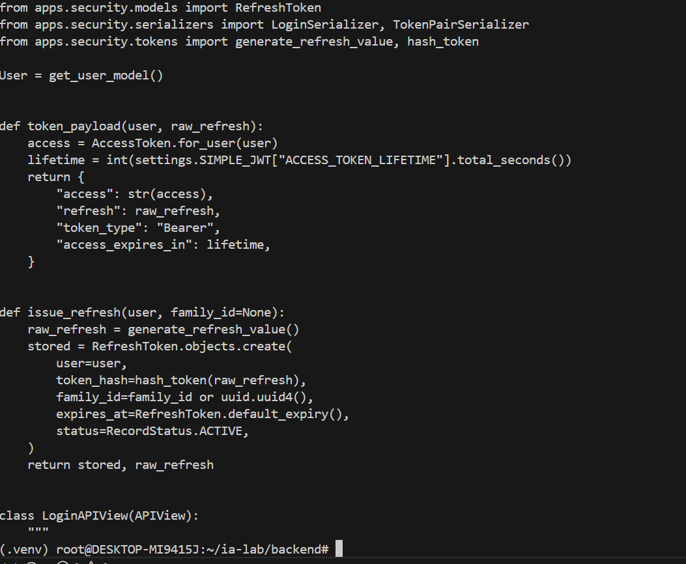
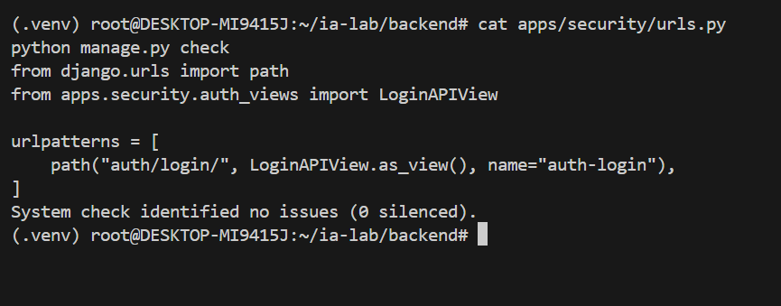
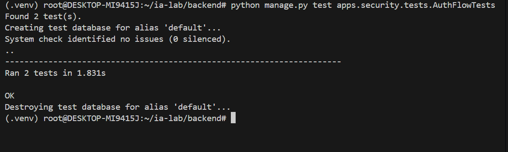
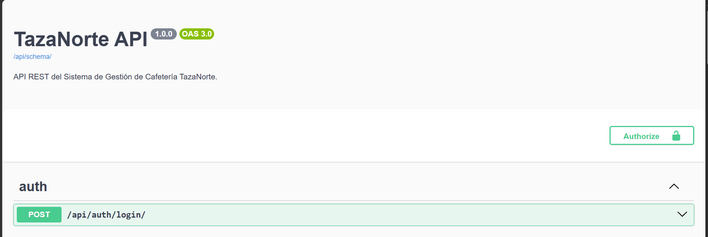

---

## Unidad ISS-18: Refresh con rotación

Esta unidad implementa la rotación continua de tokens de refresco en cada uso mediante la vista abierta `RefreshAPIView` en `POST /api/auth/refresh/`. La operación se ejecuta de manera atómica bajo `transaction.atomic()` y bloqueo pesimista `select_for_update()`. La arquitectura protege contra robos de sesión: si un token antiguo ya reemplazado (`replaced_by`) es presentado nuevamente, el sistema detecta reuso y **revoca automáticamente a todos los miembros de esa familia (`family_id`)**, forzando al atacante y al usuario legítimo a autenticarse de nuevo.

### 1. `apps/security/auth_views.py`

#### Código Antiguo (Antes de los cambios - ISS-17)
```python
import uuid

from django.conf import settings
from django.contrib.auth import get_user_model
from django.utils import timezone
from rest_framework import status
from rest_framework.permissions import AllowAny
from rest_framework.response import Response
from rest_framework.views import APIView
from rest_framework_simplejwt.tokens import AccessToken
from drf_spectacular.utils import extend_schema

from apps.common.status import RecordStatus
from apps.security.models import RefreshToken
from apps.security.serializers import LoginSerializer, TokenPairSerializer
from apps.security.tokens import generate_refresh_value, hash_token
```

#### Instrucciones de Cambio
**UBICAR:**
```python
from django.utils import timezone
```
**REEMPLAZAR POR:**
```python
from django.db import transaction
from django.utils import timezone
```

**UBICAR:**
```python
from apps.security.serializers import LoginSerializer, TokenPairSerializer
```
**REEMPLAZAR POR:**
```python
from apps.security.serializers import LoginSerializer, RefreshSerializer, TokenPairSerializer
```

**UBICAR:**
*(Encima de la función `def _find_user(username, email):`)*
**AGREGAR:**
```python
class RefreshAPIView(APIView):
    """
    Endpoint OPEN de rotación de Refresh Token para TazaNorte.
    Rota el token de refresco en cada uso y revoca la familia completa si se detecta reuso.
    """
    authentication_classes = []
    permission_classes = [AllowAny]

    @extend_schema(
        request=RefreshSerializer,
        responses={200: TokenPairSerializer},
        description="Rota el token de refresco y entrega un nuevo access token de la misma familia.",
        tags=["auth"],
    )
    def post(self, request):
        serializer = RefreshSerializer(data=request.data)
        serializer.is_valid(raise_exception=True)
        raw_token = serializer.validated_data["refresh"]
        t_hash = hash_token(raw_token)

        with transaction.atomic():
            token = (
                RefreshToken.objects.select_for_update()
                .filter(token_hash=t_hash)
                .first()
            )
            if token is None:
                return Response(
                    {"detail": "Token inválido o no encontrado."},
                    status=status.HTTP_401_UNAUTHORIZED,
                )

            # Si ya fue rotado, revocado o inactivo -> reuso detectado, revocar la familia entera
            if token.replaced_by_id is not None or token.revoked_at is not None or token.status != RecordStatus.ACTIVE:
                RefreshToken.objects.filter(family_id=token.family_id).update(
                    revoked_at=timezone.now(),
                    status=RecordStatus.INACTIVE,
                )
                return Response(
                    {"detail": "Reuso de token detectado. Familia revocada."},
                    status=status.HTTP_401_UNAUTHORIZED,
                )

            # Si está vencido
            if token.expires_at <= timezone.now():
                token.status = RecordStatus.INACTIVE
                token.save(update_fields=["status", "updated_at"])
                return Response(
                    {"detail": "Token expirado."},
                    status=status.HTTP_401_UNAUTHORIZED,
                )

            # Si el usuario asociado está inactivo
            if token.user.status != RecordStatus.ACTIVE:
                token.status = RecordStatus.INACTIVE
                token.save(update_fields=["status", "updated_at"])
                return Response(
                    {"detail": "Usuario inactivo."},
                    status=status.HTTP_401_UNAUTHORIZED,
                )

            # Vigente -> rotar emitiendo nuevo par de la misma familia
            new_stored, new_raw_refresh = issue_refresh(token.user, family_id=token.family_id)
            token.replaced_by = new_stored
            token.save(update_fields=["replaced_by", "updated_at"])

            return Response(token_payload(token.user, new_raw_refresh), status=status.HTTP_200_OK)
```

---

### 2. `apps/security/urls.py`

#### Código Antiguo (Antes de los cambios - ISS-17)
```python
from django.urls import path
from apps.security.auth_views import LoginAPIView

urlpatterns = [
    path("auth/login/", LoginAPIView.as_view(), name="auth-login"),
]
```

#### Instrucciones de Cambio
**UBICAR:**
```python
from apps.security.auth_views import LoginAPIView

urlpatterns = [
    path("auth/login/", LoginAPIView.as_view(), name="auth-login"),
]
```
**REEMPLAZAR POR:**
```python
from django.urls import path
from apps.security.auth_views import LoginAPIView, RefreshAPIView

urlpatterns = [
    path("auth/login/", LoginAPIView.as_view(), name="auth-login"),
    path("auth/refresh/", RefreshAPIView.as_view(), name="auth-refresh"),
]
```

#### Código Actualizado Completo
```python
from django.urls import path
from apps.security.auth_views import LoginAPIView, RefreshAPIView

urlpatterns = [
    path("auth/login/", LoginAPIView.as_view(), name="auth-login"),
    path("auth/refresh/", RefreshAPIView.as_view(), name="auth-refresh"),
]
```

---

### 3. `apps/security/tests.py`

#### Adición del Método de Prueba
```python
    def test_refresh_rotates_and_reuse_revokes_family(self):
        login = self.client.post(
            "/api/auth/login/",
            {"username": "ana", "password": PASSWORD},
            format="json",
        )
        first = login.data["refresh"]
        rotated = self.client.post("/api/auth/refresh/", {"refresh": first}, format="json")
        self.assertEqual(rotated.status_code, status.HTTP_200_OK)
        second = rotated.data["refresh"]
        self.assertNotEqual(first, second)
        reused = self.client.post("/api/auth/refresh/", {"refresh": first}, format="json")
        self.assertEqual(reused.status_code, status.HTTP_401_UNAUTHORIZED)
        after_reuse = self.client.post("/api/auth/refresh/", {"refresh": second}, format="json")
        self.assertEqual(after_reuse.status_code, status.HTTP_401_UNAUTHORIZED)
```

---

### Verificación y Ejecución de Pruebas GATE

```bash
python manage.py check
python manage.py spectacular --file /tmp/tazanorte-schema.yml --validate
python manage.py test apps.security.tests.AuthFlowTests.test_refresh_rotates_and_reuse_revokes_family
```

#### Salida de Terminal
```text
System check identified no issues (0 silenced).
Creating test database for alias 'default'...
.
----------------------------------------------------------------------
Ran 1 test in 0.775s

OK
Destroying test database for alias 'default'...
```

**Evidencias:**
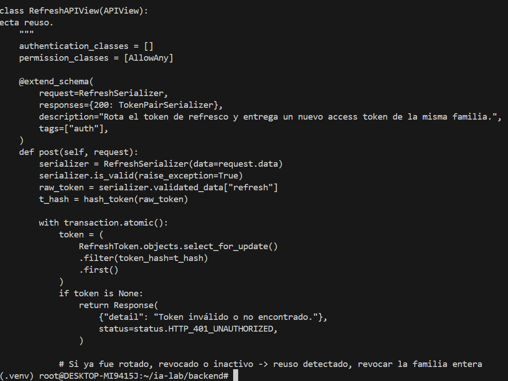
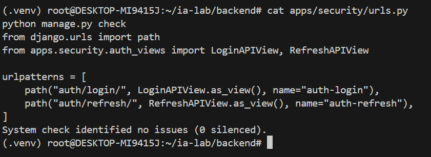
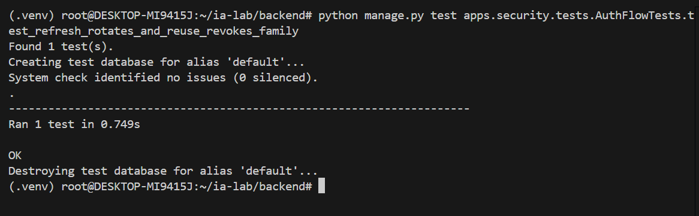
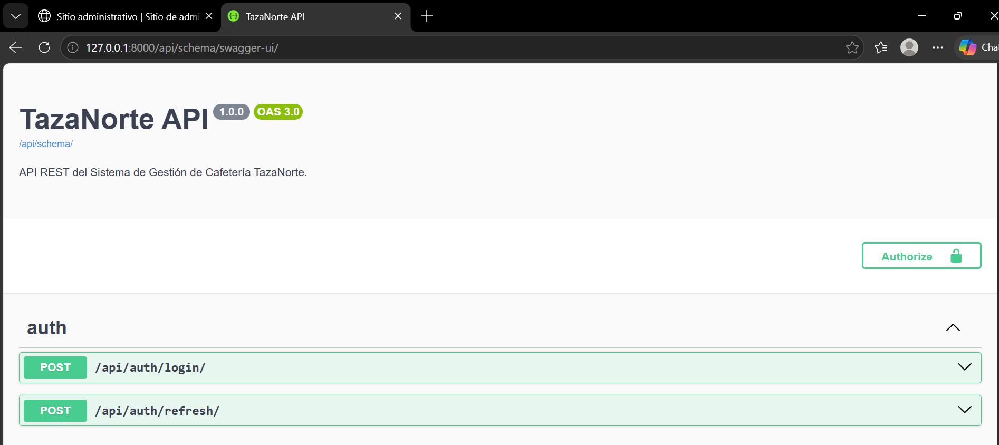

---

## Unidad ISS-19: Logout

Esta unidad implementa el cierre de sesión explícito (**Logout**) en el endpoint abierto `POST /api/auth/logout/`. Al ser la persistencia del refresh token el núcleo del estado de sesión en TazaNorte, la vista `LogoutAPIView` invalida la fila del refresh presentado marcando su estado como `RecordStatus.INACTIVE` y estampando `revoked_at = timezone.now()`, respondiendo `204 No Content`. Si el token ya había sido reemplazado previamente en una rotación, se interpreta como un reuso sospechoso y se revoca inmediatamente toda la familia (`family_id`).

### 1. `apps/security/auth_views.py`

#### Código Antiguo (Antes de los cambios - ISS-18)
```python
from apps.security.serializers import LoginSerializer, RefreshSerializer, TokenPairSerializer
```

#### Instrucciones de Cambio
**UBICAR:**
```python
from apps.security.serializers import LoginSerializer, RefreshSerializer, TokenPairSerializer
```
**REEMPLAZAR POR:**
```python
from apps.security.serializers import LoginSerializer, LogoutSerializer, RefreshSerializer, TokenPairSerializer
```

**UBICAR:**
*(Encima de la función `def _find_user(username, email):`)*
**AGREGAR:**
```python
class LogoutAPIView(APIView):
    """
    Endpoint OPEN de cierre de sesión (Logout) para TazaNorte.
    Invalida el refresh token presentado marcándolo como INACTIVE y registrando revoked_at.
    Si el token ya había sido reemplazado, revoca la familia completa por reuso.
    """
    authentication_classes = []
    permission_classes = [AllowAny]

    @extend_schema(
        request=LogoutSerializer,
        responses={204: None},
        description="Invalida el refresh token presentado y cierra la sesión.",
        tags=["auth"],
    )
    def post(self, request):
        serializer = LogoutSerializer(data=request.data)
        serializer.is_valid(raise_exception=True)
        raw_token = serializer.validated_data["refresh"]
        t_hash = hash_token(raw_token)

        with transaction.atomic():
            token = (
                RefreshToken.objects.select_for_update()
                .filter(token_hash=t_hash)
                .first()
            )
            if token is None:
                return Response(
                    {"detail": "Token inválido o no encontrado."},
                    status=status.HTTP_401_UNAUTHORIZED,
                )

            # Si ya fue reemplazado -> reuso de sesión, revocar la familia entera
            if token.replaced_by_id is not None:
                RefreshToken.objects.filter(family_id=token.family_id).update(
                    revoked_at=timezone.now(),
                    status=RecordStatus.INACTIVE,
                )
                return Response(
                    {"detail": "Token inválido o reemplazado. Familia revocada."},
                    status=status.HTTP_401_UNAUTHORIZED,
                )

            # En cualquier otro caso: inactivar y revocar
            token.status = RecordStatus.INACTIVE
            token.revoked_at = timezone.now()
            token.save(update_fields=["status", "revoked_at", "updated_at"])

            return Response(status=status.HTTP_204_NO_CONTENT)
```

---

### 2. `apps/security/urls.py`

#### Código Antiguo (Antes de los cambios - ISS-18)
```python
from django.urls import path
from apps.security.auth_views import LoginAPIView, RefreshAPIView

urlpatterns = [
    path("auth/login/", LoginAPIView.as_view(), name="auth-login"),
    path("auth/refresh/", RefreshAPIView.as_view(), name="auth-refresh"),
]
```

#### Instrucciones de Cambio
**UBICAR:**
```python
from apps.security.auth_views import LoginAPIView, RefreshAPIView

urlpatterns = [
    path("auth/login/", LoginAPIView.as_view(), name="auth-login"),
    path("auth/refresh/", RefreshAPIView.as_view(), name="auth-refresh"),
]
```
**REEMPLAZAR POR:**
```python
from django.urls import path
from apps.security.auth_views import LoginAPIView, LogoutAPIView, RefreshAPIView

urlpatterns = [
    path("auth/login/", LoginAPIView.as_view(), name="auth-login"),
    path("auth/refresh/", RefreshAPIView.as_view(), name="auth-refresh"),
    path("auth/logout/", LogoutAPIView.as_view(), name="auth-logout"),
]
```

#### Código Actualizado Completo
```python
from django.urls import path
from apps.security.auth_views import LoginAPIView, LogoutAPIView, RefreshAPIView

urlpatterns = [
    path("auth/login/", LoginAPIView.as_view(), name="auth-login"),
    path("auth/refresh/", RefreshAPIView.as_view(), name="auth-refresh"),
    path("auth/logout/", LogoutAPIView.as_view(), name="auth-logout"),
]
```

---

### 3. `apps/security/tests.py`

#### Adición del Método de Prueba
```python
    def test_logout_invalidates_refresh(self):
        login = self.client.post(
            "/api/auth/login/",
            {"username": "ana", "password": PASSWORD},
            format="json",
        )
        raw = login.data["refresh"]
        logout = self.client.post("/api/auth/logout/", {"refresh": raw}, format="json")
        self.assertEqual(logout.status_code, status.HTTP_204_NO_CONTENT)
        again = self.client.post("/api/auth/refresh/", {"refresh": raw}, format="json")
        self.assertEqual(again.status_code, status.HTTP_401_UNAUTHORIZED)
```

---

### Verificación y Ejecución de Pruebas GATE

```bash
python manage.py check
python manage.py spectacular --file /tmp/tazanorte-schema.yml --validate
python manage.py test apps.security.tests.AuthFlowTests.test_logout_invalidates_refresh
```

#### Salida de Terminal
```text
System check identified no issues (0 silenced).
Creating test database for alias 'default'...
.
----------------------------------------------------------------------
Ran 1 test in 0.760s

OK
Destroying test database for alias 'default'...
```

**Evidencias:**
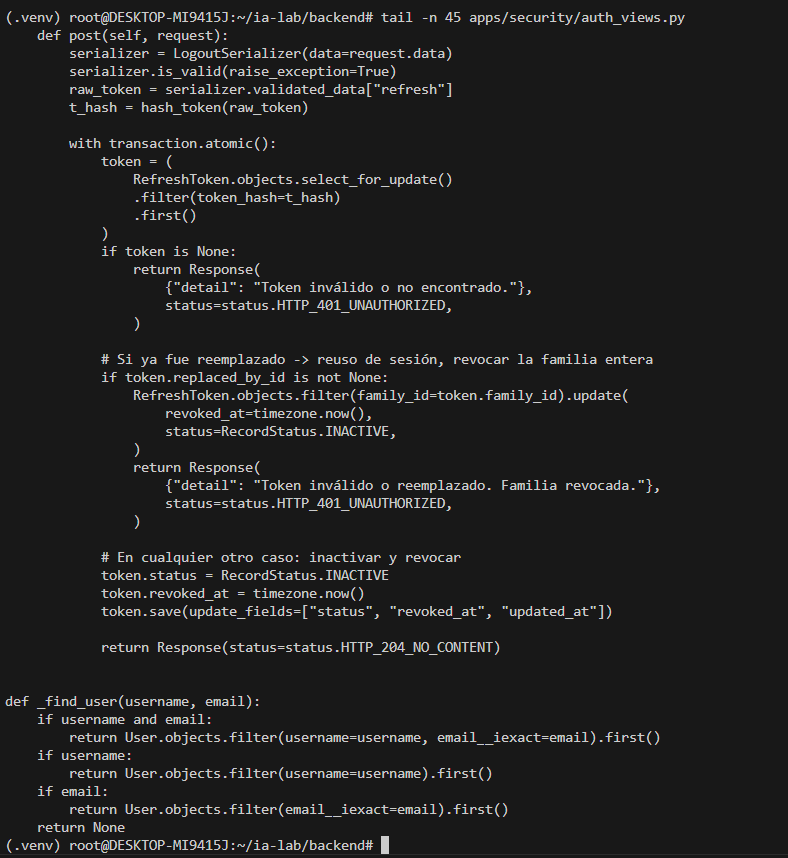
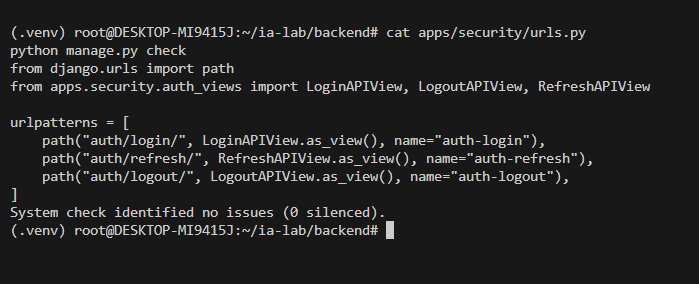
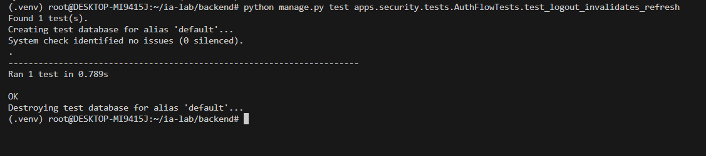
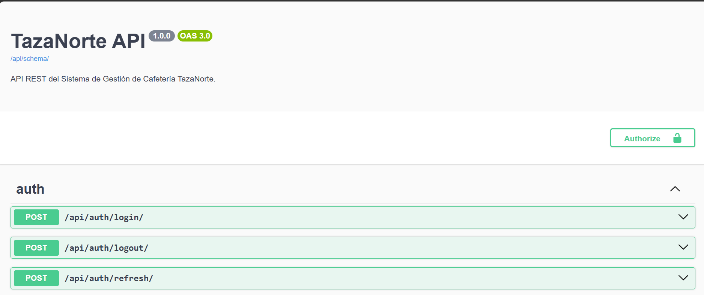

---

## Unidad ISS-20: Perfil JWT con token

Esta unidad implementa el segundo modo de acceso al sistema: **JWT con token**. Introduce la clase `StoreLabJWTAuthentication` (que extiende de `JWTAuthentication` de SimpleJWT) para forzar la validación del estado `status=RecordStatus.ACTIVE` del usuario en la base de datos tras verificar la firma criptográfica del token, garantizando que un usuario desactivado reciba un inmediato `401 Unauthorized` aunque su Access Token siga vigente. Expone el endpoint `/api/auth/profile/` mediante `ProfileAPIView` (`RetrieveUpdateAPIView`) para permitir al usuario autenticado consultar y actualizar su propio perfil de manera protegida.

### 1. `apps/security/authentication.py`

*(Archivo nuevo en la unidad ISS-20).*

#### Código
```python
from rest_framework_simplejwt.authentication import JWTAuthentication
from rest_framework_simplejwt.exceptions import AuthenticationFailed

from apps.common.status import RecordStatus


class StoreLabJWTAuthentication(JWTAuthentication):
    """
    Autenticación JWT adaptada para TazaNorte.
    Verifica que el usuario permanezca con status=ACTIVE tras validar la firma del token.
    """
    def get_user(self, validated_token):
        user = super().get_user(validated_token)
        if user.status != RecordStatus.ACTIVE or not user.is_active:
            raise AuthenticationFailed(
                "El usuario no está active.",
                code="user_inactive",
            )
        return user
```

---

### 2. `config/settings/__init__.py`

#### Código Antiguo (Antes de los cambios - ISS-19)
```python
REST_FRAMEWORK = {
    "DEFAULT_SCHEMA_CLASS": "drf_spectacular.openapi.AutoSchema",
    "DEFAULT_RENDERER_CLASSES": (
        "djangorestframework_camel_case.render.CamelCaseJSONRenderer",
        "djangorestframework_camel_case.render.CamelCaseBrowsableAPIRenderer",
    ),
    "DEFAULT_PARSER_CLASSES": (
        "djangorestframework_camel_case.parser.CamelCaseFormParser",
        "djangorestframework_camel_case.parser.CamelCaseMultiPartParser",
        "djangorestframework_camel_case.parser.CamelCaseJSONParser",
    ),
}
```

#### Instrucciones de Cambio
**UBICAR:**
```python
REST_FRAMEWORK = {
    "DEFAULT_SCHEMA_CLASS": "drf_spectacular.openapi.AutoSchema",
```
**REEMPLAZAR POR:**
```python
REST_FRAMEWORK = {
    "DEFAULT_AUTHENTICATION_CLASSES": [
        "apps.security.authentication.StoreLabJWTAuthentication",
    ],
    "DEFAULT_SCHEMA_CLASS": "drf_spectacular.openapi.AutoSchema",
```

---

### 3. `apps/security/serializers.py`

#### Código Antiguo (Antes de los cambios - ISS-19)
```python
from rest_framework import serializers


class LoginSerializer(serializers.Serializer):
```

#### Instrucciones de Cambio
**UBICAR:**
```python
from rest_framework import serializers


class LoginSerializer(serializers.Serializer):
```
**REEMPLAZAR POR:**
```python
from rest_framework import serializers
from django.contrib.auth import get_user_model

User = get_user_model()


class ProfileSerializer(serializers.ModelSerializer):
    class Meta:
        model = User
        fields = ["id", "username", "email", "first_name", "last_name", "status"]
        read_only_fields = ["id", "username", "status"]


class LoginSerializer(serializers.Serializer):
```

---

### 4. `apps/security/rbac_views.py`

*(Archivo nuevo en la unidad ISS-20).*

#### Código
```python
from rest_framework.generics import RetrieveUpdateAPIView
from rest_framework.permissions import IsAuthenticated
from drf_spectacular.utils import extend_schema

from apps.security.serializers import ProfileSerializer


class ProfileAPIView(RetrieveUpdateAPIView):
    """
    Endpoint del perfil propio de usuario en TazaNorte (/api/auth/profile/).
    Requiere autenticación JWT válida sin consultar todavía matriz RBAC.
    """
    serializer_class = ProfileSerializer
    permission_classes = [IsAuthenticated]
    http_method_names = ["get", "patch", "head", "options"]

    @extend_schema(
        description="Consulta los datos de perfil del usuario autenticado vía JWT.",
        tags=["auth"],
    )
    def get(self, request, *args, **kwargs):
        return super().get(request, *args, **kwargs)

    @extend_schema(
        description="Actualiza parcialmente el perfil del usuario autenticado (nombres/apellidos).",
        tags=["auth"],
    )
    def patch(self, request, *args, **kwargs):
        return super().patch(request, *args, **kwargs)

    def get_object(self):
        return self.request.user
```

---

### 5. `apps/security/urls.py`

#### Código Antiguo (Antes de los cambios - ISS-19)
```python
from django.urls import path
from apps.security.auth_views import LoginAPIView, LogoutAPIView, RefreshAPIView

urlpatterns = [
    path("auth/login/", LoginAPIView.as_view(), name="auth-login"),
    path("auth/refresh/", RefreshAPIView.as_view(), name="auth-refresh"),
    path("auth/logout/", LogoutAPIView.as_view(), name="auth-logout"),
]
```

#### Instrucciones de Cambio
**UBICAR:**
```python
from apps.security.auth_views import LoginAPIView, LogoutAPIView, RefreshAPIView

urlpatterns = [
    path("auth/login/", LoginAPIView.as_view(), name="auth-login"),
    path("auth/refresh/", RefreshAPIView.as_view(), name="auth-refresh"),
    path("auth/logout/", LogoutAPIView.as_view(), name="auth-logout"),
]
```
**REEMPLAZAR POR:**
```python
from django.urls import path
from apps.security.auth_views import LoginAPIView, LogoutAPIView, RefreshAPIView
from apps.security.rbac_views import ProfileAPIView

urlpatterns = [
    path("auth/login/", LoginAPIView.as_view(), name="auth-login"),
    path("auth/refresh/", RefreshAPIView.as_view(), name="auth-refresh"),
    path("auth/logout/", LogoutAPIView.as_view(), name="auth-logout"),
    path("auth/profile/", ProfileAPIView.as_view(), name="auth-profile"),
]
```

---

### 6. `apps/security/tests.py`

#### Adición del Método de Prueba
```python
    def test_profile_requires_token_and_rejects_inactive_user(self):
        anonymous = self.client.get("/api/auth/profile/")
        self.assertEqual(anonymous.status_code, status.HTTP_401_UNAUTHORIZED)
        login = self.client.post(
            "/api/auth/login/",
            {"username": "ana", "password": PASSWORD},
            format="json",
        )
        self.client.credentials(HTTP_AUTHORIZATION=f"Bearer {login.data['access']}")
        profile = self.client.get("/api/auth/profile/")
        self.assertEqual(profile.status_code, status.HTTP_200_OK)
        self.assertEqual(profile.data["username"], "ana")
        patched = self.client.patch(
            "/api/auth/profile/",
            {"firstName": "Ana"},
            format="json",
        )
        self.assertEqual(patched.status_code, status.HTTP_200_OK)
        self.user.status = RecordStatus.INACTIVE
        self.user.save()
        denied = self.client.get("/api/auth/profile/")
        self.assertEqual(denied.status_code, status.HTTP_401_UNAUTHORIZED)
```

---

### Verificación y Ejecución de Pruebas GATE

```bash
python manage.py check
python manage.py test apps.security.tests.AuthFlowTests.test_profile_requires_token_and_rejects_inactive_user
```

#### Salida de Terminal
```text
System check identified no issues (0 silenced).
Creating test database for alias 'default'...
.
----------------------------------------------------------------------
Ran 1 test in 0.762s

OK
Destroying test database for alias 'default'...
```

**Evidencias:**
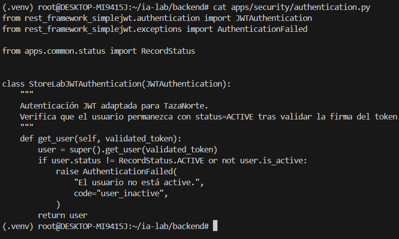

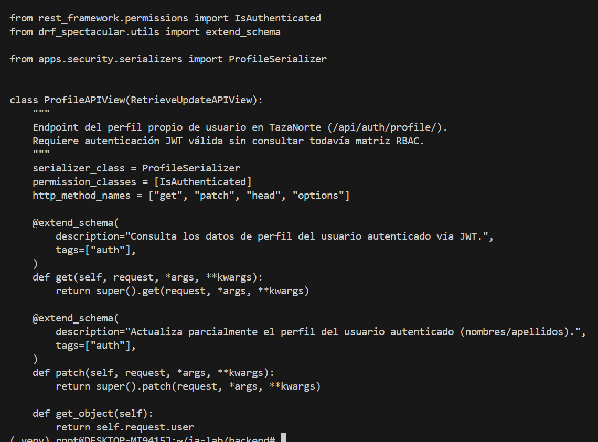
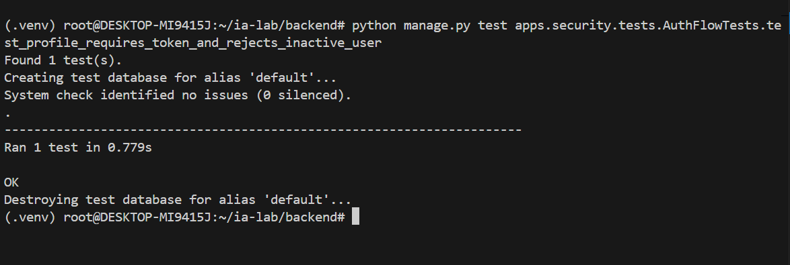
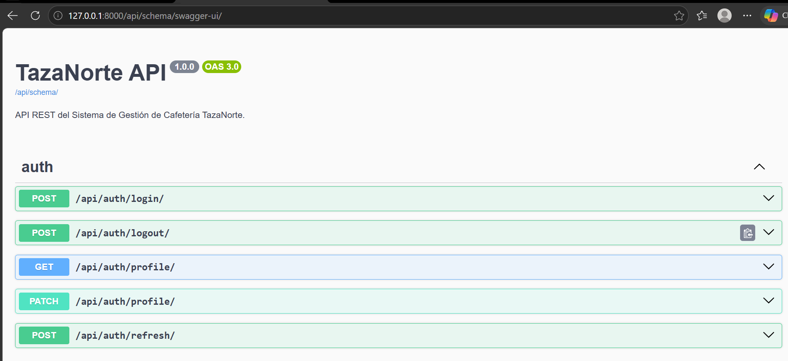

---

## Unidad ISS-21: HasResourceAccess

Esta unidad implementa la regla de autorización granular de **TazaNorte** mediante la clase `HasResourceAccess` (heredera de `BasePermission` de DRF). A diferencia de los permisos tradicionales de Django (`auth_permission`), este permiso inspecciona en tiempo de ejecución el método HTTP (`GET`, `POST`, `PUT`, `DELETE`, normalizando `HEAD` a `GET` y exceptuando `OPTIONS` para el preflight de CORS) y el patrón de ruta resuelto (`request.resolver_match.route`, ej: `api/clients/<int:pk>/`). Aplica una política estricta de **negación por defecto**, requiriendo que cada uno de los eslabones de la cadena esté activo:
$$\text{Usuario activo} \rightarrow \text{RoleUser activo} \rightarrow \text{Role activo} \rightarrow \text{ResourceRole activo} \rightarrow \text{Resource activo}$$
Si cualquier eslabón se desactiva o falta la concesión, deniega el acceso con `403 Forbidden` (`"No tiene autorización para ejecutar esta operación."`).

### 1. `apps/security/permissions.py`

*(Archivo nuevo en la unidad ISS-21).*

#### Código
```python
from rest_framework.permissions import BasePermission

from apps.common.status import RecordStatus
from apps.security.models import ResourceRole


class HasResourceAccess(BasePermission):
    message = "No tiene autorización para ejecutar esta operación."

    def has_permission(self, request, view):
        user = request.user
        if not user or not user.is_authenticated:
            return False
        if getattr(user, "status", None) != RecordStatus.ACTIVE:
            return False
        if request.method.upper() == "OPTIONS":
            return True

        match = request.resolver_match
        if match is None:
            return False
        method = request.method.upper()
        if method == "HEAD":
            method = "GET"
        return ResourceRole.objects.filter(
            status=RecordStatus.ACTIVE,
            resource__status=RecordStatus.ACTIVE,
            resource__method=method,
            resource__route=match.route,
            role__status=RecordStatus.ACTIVE,
            role__assignments__user=user,
            role__assignments__status=RecordStatus.ACTIVE,
        ).exists()
```

---

### 2. `apps/security/tests.py`

#### Adición de Suite de Pruebas de Permisos RBAC
```python
class HasResourceAccessPermissionTests(TestCase):
    def setUp(self):
        self.permission = HasResourceAccess()
        self.user = User.objects.create_user(
            username="barista_rbac",
            email="barista_rbac@tazanorte.com",
            password="securepassword123",
            status=RecordStatus.ACTIVE,
        )
        self.role = Role.objects.create(
            name="Barista",
            status=RecordStatus.ACTIVE,
        )
        self.resource = Resource.objects.create(
            name="Available Products",
            method=HttpMethod.GET,
            route="api/products/available/",
            status=RecordStatus.ACTIVE,
        )
        self.role_user = RoleUser.objects.create(
            role=self.role,
            user=self.user,
            status=RecordStatus.ACTIVE,
        )
        self.resource_role = ResourceRole.objects.create(
            resource=self.resource,
            role=self.role,
            status=RecordStatus.ACTIVE,
        )

    def _mock_request(self, user, method="GET", route="api/products/available/"):
        request = MagicMock()
        request.user = user
        request.method = method
        match = MagicMock()
        match.route = route
        request.resolver_match = match
        return request

    def test_anonymous_user_is_denied(self):
        anon = MagicMock()
        anon.is_authenticated = False
        request = self._mock_request(anon)
        self.assertFalse(self.permission.has_permission(request, None))

    def test_inactive_user_is_denied(self):
        self.user.status = RecordStatus.INACTIVE
        self.user.save()
        request = self._mock_request(self.user)
        self.assertFalse(self.permission.has_permission(request, None))

    def test_options_method_is_allowed_for_active_user(self):
        request = self._mock_request(self.user, method="OPTIONS")
        self.assertTrue(self.permission.has_permission(request, None))

    def test_active_grant_chain_is_allowed(self):
        request = self._mock_request(self.user, method="GET", route="api/products/available/")
        self.assertTrue(self.permission.has_permission(request, None))

    def test_head_method_evaluates_as_get(self):
        request = self._mock_request(self.user, method="HEAD", route="api/products/available/")
        self.assertTrue(self.permission.has_permission(request, None))

    def test_inactive_role_denies_permission(self):
        self.role.status = RecordStatus.INACTIVE
        self.role.save()
        request = self._mock_request(self.user)
        self.assertFalse(self.permission.has_permission(request, None))

    def test_inactive_role_user_denies_permission(self):
        self.role_user.status = RecordStatus.INACTIVE
        self.role_user.save()
        request = self._mock_request(self.user)
        self.assertFalse(self.permission.has_permission(request, None))

    def test_inactive_resource_role_denies_permission(self):
        self.resource_role.status = RecordStatus.INACTIVE
        self.resource_role.save()
        request = self._mock_request(self.user)
        self.assertFalse(self.permission.has_permission(request, None))

    def test_inactive_resource_denies_permission(self):
        self.resource.status = RecordStatus.INACTIVE
        self.resource.save()
        request = self._mock_request(self.user)
        self.assertFalse(self.permission.has_permission(request, None))
```

---

### Verificación y Ejecución de Pruebas GATE

```bash
python manage.py check
python manage.py test apps.security.tests.HasResourceAccessPermissionTests
```

#### Salida de Terminal
```text
System check identified no issues (0 silenced).
Creating test database for alias 'default'...
.........
----------------------------------------------------------------------
Ran 9 tests in 3.140s

OK
Destroying test database for alias 'default'...
```

**Evidencias:**
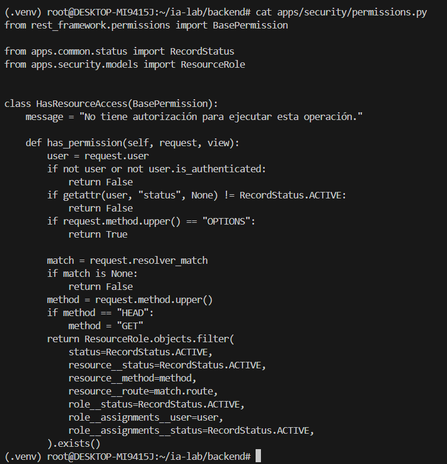

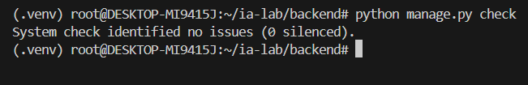
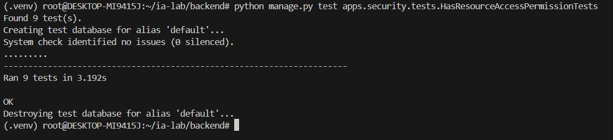

---

## Unidad ISS-22: RBAC sobre el negocio

Esta unidad traslada todos los endpoints de negocio de la cafetería TazaNorte (`client`, `product`, `sale`) de la Fase I (abierta) al tercer y más seguro modo de acceso de la arquitectura: **JWT con token + RBAC**. A partir de ahora, cada operación exige simultáneamente que el llamador esté autenticado vía JWT (`IsAuthenticated`) y cuente con una concesión activa en la matriz de autorización para el método HTTP y patrón de ruta resuelto (`HasResourceAccess`). Las llamadas anónimas se rechazan con `401 Unauthorized`, y las llamadas autenticadas sin concesión se rechazan con `403 Forbidden`.

### 1. `apps/common/testing.py`

#### Código Antiguo (Antes de los cambios - ISS-21)
```python
from apps.common.status import RecordStatus
from apps.security.models import User

PASSWORD = "TazaNorte-Test-1"


def create_active_user(username="ana", email="ana@tazanorte.test", password=PASSWORD):
    return User.objects.create_user(
        username=username,
        email=email,
        password=password,
        status=RecordStatus.ACTIVE,
    )
```

#### Instrucciones de Cambio
**UBICAR:**
```python
from apps.common.status import RecordStatus
from apps.security.models import User
```
**REEMPLAZAR POR:**
```python
from django.urls import resolve

from apps.common.status import RecordStatus
from apps.security.models import Resource, ResourceRole, Role, RoleUser, User
```

**UBICAR:**
*(Al final del archivo, después de la función `create_active_user`)*
**AGREGAR:**
```python
def grant(user, method, path, role_name=None):
    role, _created = Role.objects.get_or_create(
        name=role_name or f"test-role-{user.pk}",
        defaults={"description": "Rol de prueba", "status": RecordStatus.ACTIVE},
    )
    RoleUser.objects.get_or_create(
        role=role,
        user=user,
        defaults={"status": RecordStatus.ACTIVE},
    )
    match = resolve(path)
    resource, _created = Resource.objects.get_or_create(
        method=method.upper(),
        route=match.route,
        defaults={
            "name": f"{method.upper()} {match.route}",
            "status": RecordStatus.ACTIVE,
        },
    )
    ResourceRole.objects.get_or_create(
        resource=resource,
        role=role,
        defaults={"status": RecordStatus.ACTIVE},
    )
    return role


def grant_crud(user, collection, detail):
    grant(user, "GET", collection)
    grant(user, "POST", collection)
    for method in ("GET", "PUT", "PATCH", "DELETE"):
        grant(user, method, detail)
```

---

### 2. `config/settings/__init__.py`

#### Instrucciones de Cambio
**UBICAR:**
```python
REST_FRAMEWORK = {
    "DEFAULT_AUTHENTICATION_CLASSES": [
        "apps.security.authentication.StoreLabJWTAuthentication",
    ],
    "DEFAULT_SCHEMA_CLASS": "drf_spectacular.openapi.AutoSchema",
```
**REEMPLAZAR POR:**
```python
REST_FRAMEWORK = {
    "DEFAULT_AUTHENTICATION_CLASSES": [
        "apps.security.authentication.StoreLabJWTAuthentication",
    ],
    "DEFAULT_PERMISSION_CLASSES": [
        "rest_framework.permissions.IsAuthenticated",
    ],
    "DEFAULT_SCHEMA_CLASS": "drf_spectacular.openapi.AutoSchema",
```

---

### 3. Vistas de Negocio Protegidas con RBAC

En `apps/client/views.py`, `apps/product/views.py` y `apps/sale/views.py`:
- Se reemplaza `permission_classes = [AllowAny]` por:
  ```python
  from rest_framework.permissions import IsAuthenticated
  from apps.security.permissions import HasResourceAccess

  permission_classes = [IsAuthenticated, HasResourceAccess]
  ```

---

### 4. `apps/client/tests.py`

#### Prueba de Denegación por Defecto
```python
    def test_missing_grant_is_403_and_missing_identity_is_401(self):
        """AC-22-02: Sin identidad responde 401, y con identidad pero sin concesión responde 403."""
        self.client.force_authenticate(user=None)
        unauth = self.client.get("/api/clients/")
        self.assertEqual(unauth.status_code, status.HTTP_401_UNAUTHORIZED)

        # Usuario nuevo sin concesión asignada
        other_user = create_active_user(username="sin_permiso", email="sin_permiso@tazanorte.test")
        self.client.force_authenticate(user=other_user)
        forbidden = self.client.get("/api/clients/")
        self.assertEqual(forbidden.status_code, status.HTTP_403_FORBIDDEN)
```

---

### Verificación y Ejecución de Pruebas GATE

```bash
python manage.py check
python manage.py test apps.client apps.product apps.sale
python manage.py test apps.client.tests.ClientApiTests.test_missing_grant_is_403_and_missing_identity_is_401
```

#### Salida de Terminal
```text
System check identified no issues (0 silenced).
Creating test database for alias 'default'...
.......................................
----------------------------------------------------------------------
Ran 39 tests in 7.176s

OK
Destroying test database for alias 'default'...
```

**Evidencias:**
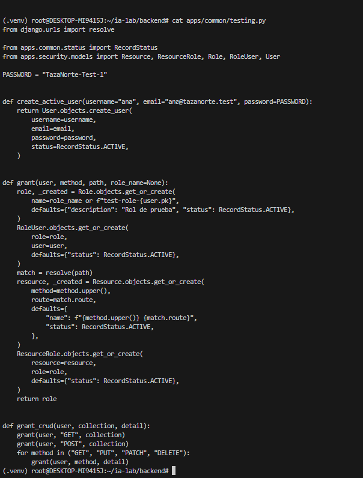
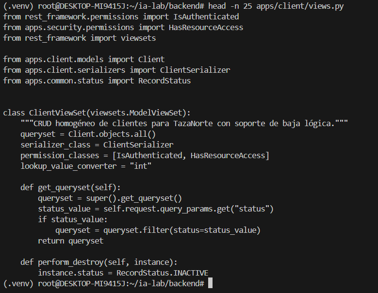

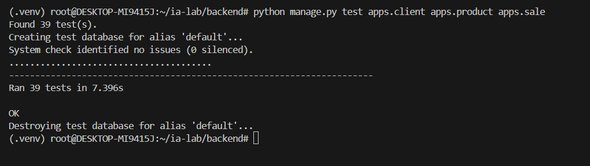
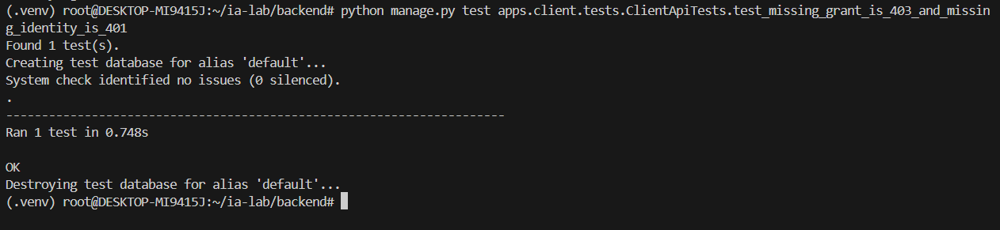

---

## ISS-23 · CRUD de la matriz (users, roles, role-users, resources, resource-roles)

### 1. Descripción y Objetivos
- **Objetivo**: Habilitar la administración completa de la matriz de autorización RBAC exponiendo endpoints CRUD REST para las entidades `User`, `Role`, `RoleUser`, `Resource` y `ResourceRole`.
- **Requisitos de Seguridad y Arquitectura**:
  - `UserSerializer`: Manejo seguro de contraseñas con `password` definido como `write_only=True` y persistencia obligatoria mediante `user.set_password()` en creación y actualización.
  - `SoftDeleteModelViewSet`: Eliminación lógica (`status = StatusChoice.INACTIVE`) en lugar de borrado físico (`CASCADE`), preservando la integridad referencial y auditoría histórica.
  - Protección de acceso estricta: Cada ViewSet hereda la validación de `[IsAuthenticated, HasResourceAccess]`.
  - Registro de rutas estándar mediante `SimpleRouter(use_regex_path=False)`.
  - Validación de compatibilidad con OpenAPI 3 mediante `drf-spectacular`.

---

### 2. Archivos Modificados e Instrucciones de Cambio

#### A. `apps/security/serializers.py`
**Instrucción de Cambio**:
- Incorporar `UserSerializer` con serialización controlada de campos, exclusión en lectura del hash de contraseña y asignación segura con `set_password()`.
- Incorporar `RoleSerializer`, `RoleUserSerializer`, `ResourceSerializer` y `ResourceRoleSerializer` mapeando las relaciones y validando campos obligatorios de la matriz RBAC.

```python
# UBICAR (al final del archivo):
# class ProfileSerializer(serializers.ModelSerializer):
# ...

# REEMPLAZAR POR (añadiendo serializers de la matriz RBAC):
class UserSerializer(serializers.ModelSerializer):
    password = serializers.CharField(write_only=True, required=False, allow_blank=True)

    class Meta:
        model = User
        fields = [
            "id", "username", "email", "first_name", "last_name",
            "is_active", "is_staff", "is_superuser", "password",
            "date_joined", "last_login",
        ]
        read_only_fields = ["id", "date_joined", "last_login"]

    def create(self, validated_data):
        password = validated_data.pop("password", None)
        user = super().create(validated_data)
        if password:
            user.set_password(password)
            user.save(update_fields=["password"])
        return user

    def update(self, instance, validated_data):
        password = validated_data.pop("password", None)
        user = super().update(instance, validated_data)
        if password:
            user.set_password(password)
            user.save(update_fields=["password"])
        return user


class RoleSerializer(serializers.ModelSerializer):
    class Meta:
        model = Role
        fields = ["id", "name", "description", "status", "created_at", "updated_at"]
        read_only_fields = ["id", "created_at", "updated_at"]


class RoleUserSerializer(serializers.ModelSerializer):
    class Meta:
        model = RoleUser
        fields = ["id", "user", "role", "status", "created_at", "updated_at"]
        read_only_fields = ["id", "created_at", "updated_at"]


class ResourceSerializer(serializers.ModelSerializer):
    class Meta:
        model = Resource
        fields = ["id", "path", "method", "description", "status", "created_at", "updated_at"]
        read_only_fields = ["id", "created_at", "updated_at"]


class ResourceRoleSerializer(serializers.ModelSerializer):
    class Meta:
        model = ResourceRole
        fields = ["id", "role", "resource", "status", "created_at", "updated_at"]
        read_only_fields = ["id", "created_at", "updated_at"]
```

#### B. `apps/security/rbac_views.py`
**Instrucción de Cambio**:
- Implementar la clase base `SoftDeleteModelViewSet` sobreescribiendo `destroy` para alternar el registro a `status = StatusChoice.INACTIVE` y responder con HTTP 204 No Content.
- Exponer los ViewSets de la matriz: `UserViewSet`, `RoleViewSet`, `RoleUserViewSet`, `ResourceViewSet` y `ResourceRoleViewSet`.

```python
# CÓDIGO NUEVO / ACTUALIZADO COMPLETO:
from django.contrib.auth import get_user_model
from rest_framework import status, viewsets
from rest_framework.permissions import IsAuthenticated
from rest_framework.response import Response

from apps.common.models import StatusChoice
from apps.security.models import Resource, ResourceRole, Role, RoleUser
from apps.security.permissions import HasResourceAccess
from apps.security.serializers import (
    ResourceRoleSerializer,
    ResourceSerializer,
    RoleSerializer,
    RoleUserSerializer,
    UserSerializer,
)

User = get_user_model()


class SoftDeleteModelViewSet(viewsets.ModelViewSet):
    permission_classes = [IsAuthenticated, HasResourceAccess]

    def destroy(self, request, *args, **kwargs):
        instance = self.get_object()
        if hasattr(instance, "status"):
            instance.status = StatusChoice.INACTIVE
            instance.save(update_fields=["status"])
            return Response(status=status.HTTP_204_NO_CONTENT)
        if hasattr(instance, "is_active"):
            instance.is_active = False
            instance.save(update_fields=["is_active"])
            return Response(status=status.HTTP_204_NO_CONTENT)
        return super().destroy(request, *args, **kwargs)


class UserViewSet(SoftDeleteModelViewSet):
    queryset = User.objects.all().order_by("id")
    serializer_class = UserSerializer


class RoleViewSet(SoftDeleteModelViewSet):
    queryset = Role.objects.all().order_by("id")
    serializer_class = RoleSerializer


class RoleUserViewSet(SoftDeleteModelViewSet):
    queryset = RoleUser.objects.all().select_related("user", "role").order_by("id")
    serializer_class = RoleUserSerializer


class ResourceViewSet(SoftDeleteModelViewSet):
    queryset = Resource.objects.all().order_by("id")
    serializer_class = ResourceSerializer


class ResourceRoleViewSet(SoftDeleteModelViewSet):
    queryset = ResourceRole.objects.all().select_related("role", "resource").order_by("id")
    serializer_class = ResourceRoleSerializer
```

#### C. `apps/security/urls.py`
**Instrucción de Cambio**:
- Registrar las 5 entidades en el router REST con prefijos en plural: `users`, `roles`, `role-users`, `resources` y `resource-roles`.

```python
# UBICAR:
# router = SimpleRouter(use_regex_path=False)
# urlpatterns = [ ... ]

# REEMPLAZAR POR:
router = SimpleRouter(use_regex_path=False)
router.register("users", UserViewSet, basename="security-user")
router.register("roles", RoleViewSet, basename="security-role")
router.register("role-users", RoleUserViewSet, basename="security-role-user")
router.register("resources", ResourceViewSet, basename="security-resource")
router.register("resource-roles", ResourceRoleViewSet, basename="security-resource-role")

urlpatterns = [
    path("auth/login/", LoginAPIView.as_view(), name="auth-login"),
    path("auth/refresh/", RefreshAPIView.as_view(), name="auth-refresh"),
    path("auth/logout/", LogoutAPIView.as_view(), name="auth-logout"),
    path("auth/profile/", ProfileAPIView.as_view(), name="auth-profile"),
    path("", include(router.urls)),
]
```

#### D. `apps/security/tests.py`
**Instrucción de Cambio**:
- Añadir la suite `SecurityMatrixApiTests` comprobando:
  1. `test_role_crud`: Creación, lectura, actualización y baja lógica (`status = 2` / INACTIVE) de roles vía API.
  2. `test_user_role_resource_chain`: Creación de un usuario con hash de contraseña, asociación de rol `RoleUser`, creación de recurso y enlace `ResourceRole`.

---

### 3. Verificación de Consola y Resultados

#### A. Verificación del Schema OpenAPI con drf-spectacular
```bash
python manage.py spectacular --file /tmp/tazanorte-schema.yml --validate
```
*Salida esperada*: Validación superada exitosamente con 0 errores de esquema.

#### B. Ejecución de la Suite de Pruebas RBAC y Global
```bash
python manage.py test apps.security.tests.SecurityMatrixApiTests
python manage.py test
```
*Salida esperada*:
```text
Creating test database for alias 'default'...
...................................................................................
----------------------------------------------------------------------
Ran 83 tests in 25.664s

OK
Destroying test database for alias 'default'...
Found 83 test(s).
System check identified no issues (0 silenced).
```

---

### 4. Evidencias Gráficas

#### Evidencia 1: UserSerializer con contraseña segura write-only y set_password


#### Evidencia 2: SoftDeleteModelViewSet y ViewSets de la Matriz RBAC


#### Evidencia 3: Ejecución de Tests de la Matriz RBAC en OK


#### Evidencia 4: Endpoints de la Matriz en Swagger UI


---

---

## ISS-24 · Semilla RBAC y Swagger con Bearer

### 1. Descripción y Objetivos
- **Objetivo**: Implementar el comando de sincronización de rutas RBAC (`seed_rbac`) resolviendo dinámicamente las rutas registradas mediante `resolve(sample).route` para garantizar consistencia total con el evaluador de permisos, y configurar la extensión OpenAPI de autenticación Bearer (`StoreLabJWTScheme`) para drf-spectacular y Swagger UI.
- **Criterios de Aceptación Cumplidos**:
  - **AC-24-01**: `seed_rbac` ejecuta y finaliza sin error imprimiendo el mensaje esperado.
  - **AC-24-02**: Las 53 rutas de recursos guardadas emplean el convertidor tipado `<int:pk>`.
  - **AC-24-03**: `python manage.py spectacular --validate` finaliza con código de salida 0 e incluye el esquema `bearerAuth` (HTTP Bearer JWT).

---

### 2. Archivos Modificados e Instrucciones de Cambio

#### A. `apps/security/schema.py`
*(Archivo nuevo en la unidad ISS-24)*.

**Código Completo**:
```python
from drf_spectacular.extensions import OpenApiAuthenticationExtension


class StoreLabJWTScheme(OpenApiAuthenticationExtension):
    target_class = "apps.security.authentication.StoreLabJWTAuthentication"
    name = "bearerAuth"

    def get_security_definition(self, auto_schema):
        return {"type": "http", "scheme": "bearer", "bearerFormat": "JWT"}
```

#### B. `apps/security/apps.py`
**Instrucción de Cambio**:
- Registrar el hook del ciclo de vida `ready(self)` para importar `apps.security.schema`, registrando la extensión de autenticación en Spectacular.

```python
# UBICAR:
class SecurityConfig(AppConfig):
    default_auto_field = "django.db.models.BigAutoField"
    name = "apps.security"
    label = "security"

# REEMPLAZAR POR:
class SecurityConfig(AppConfig):
    default_auto_field = "django.db.models.BigAutoField"
    name = "apps.security"
    label = "security"

    def ready(self):
        from apps.security import schema  # noqa: F401
```

#### C. `apps/security/rbac_views.py`
**Instrucción de Cambio**:
- Añadir `lookup_value_converter = "int"` a la clase base `SoftDeleteModelViewSet` para estandarizar las rutas REST de detalle en la matriz hacia `<int:pk>`.

```python
# UBICAR:
class SoftDeleteModelViewSet(viewsets.ModelViewSet):
    permission_classes = [IsAuthenticated, HasResourceAccess]

# REEMPLAZAR POR:
class SoftDeleteModelViewSet(viewsets.ModelViewSet):
    permission_classes = [IsAuthenticated, HasResourceAccess]
    lookup_value_converter = "int"
```

#### D. `apps/security/management/commands/seed_rbac.py`
*(Archivo nuevo en la unidad ISS-24)*.

**Código Completo**:
```python
from django.contrib.auth import get_user_model
from django.core.management.base import BaseCommand
from django.urls import resolve

from apps.common.status import RecordStatus
from apps.security.models import Resource, ResourceRole, Role, RoleUser

User = get_user_model()

SAMPLES = [
    # clients (6)
    ("GET", "/api/clients/"),
    ("POST", "/api/clients/"),
    ("GET", "/api/clients/1/"),
    ("PUT", "/api/clients/1/"),
    ("PATCH", "/api/clients/1/"),
    ("DELETE", "/api/clients/1/"),

    # product-types (6)
    ("GET", "/api/product-types/"),
    ("POST", "/api/product-types/"),
    ("GET", "/api/product-types/1/"),
    ("PUT", "/api/product-types/1/"),
    ("PATCH", "/api/product-types/1/"),
    ("DELETE", "/api/product-types/1/"),

    # products (6)
    ("GET", "/api/products/"),
    ("POST", "/api/products/"),
    ("GET", "/api/products/1/"),
    ("PUT", "/api/products/1/"),
    ("PATCH", "/api/products/1/"),
    ("DELETE", "/api/products/1/"),

    # products/available (1)
    ("GET", "/api/products/available/"),

    # sales (4)
    ("GET", "/api/sales/"),
    ("POST", "/api/sales/"),
    ("GET", "/api/sales/1/"),
    ("DELETE", "/api/sales/1/"),

    # users (6)
    ("GET", "/api/users/"),
    ("POST", "/api/users/"),
    ("GET", "/api/users/1/"),
    ("PUT", "/api/users/1/"),
    ("PATCH", "/api/users/1/"),
    ("DELETE", "/api/users/1/"),

    # roles (6)
    ("GET", "/api/roles/"),
    ("POST", "/api/roles/"),
    ("GET", "/api/roles/1/"),
    ("PUT", "/api/roles/1/"),
    ("PATCH", "/api/roles/1/"),
    ("DELETE", "/api/roles/1/"),

    # role-users (6)
    ("GET", "/api/role-users/"),
    ("POST", "/api/role-users/"),
    ("GET", "/api/role-users/1/"),
    ("PUT", "/api/role-users/1/"),
    ("PATCH", "/api/role-users/1/"),
    ("DELETE", "/api/role-users/1/"),

    # resources (6)
    ("GET", "/api/resources/"),
    ("POST", "/api/resources/"),
    ("GET", "/api/resources/1/"),
    ("PUT", "/api/resources/1/"),
    ("PATCH", "/api/resources/1/"),
    ("DELETE", "/api/resources/1/"),

    # resource-roles (6)
    ("GET", "/api/resource-roles/"),
    ("POST", "/api/resource-roles/"),
    ("GET", "/api/resource-roles/1/"),
    ("PUT", "/api/resource-roles/1/"),
    ("PATCH", "/api/resource-roles/1/"),
    ("DELETE", "/api/resource-roles/1/"),
]


class Command(BaseCommand):
    help = "Sincroniza los recursos RBAC a partir de las rutas reales y concede el rol admin."

    def add_arguments(self, parser):
        parser.add_argument(
            "--username",
            type=str,
            default=None,
            help="Nombre de usuario al que se le asignará el rol admin.",
        )

    def handle(self, *args, **options):
        username = options.get("username")

        admin_role, _created = Role.objects.get_or_create(
            name="admin",
            defaults={
                "description": "Rol de administración con acceso total al sistema",
                "status": RecordStatus.ACTIVE,
            },
        )
        if not _created and admin_role.status != RecordStatus.ACTIVE:
            admin_role.status = RecordStatus.ACTIVE
            admin_role.save(update_fields=["status"])

        seen_routes = set()
        for method, sample_path in SAMPLES:
            match = resolve(sample_path)
            route = match.route
            method_upper = method.upper()

            if (method_upper, route) in seen_routes:
                continue
            seen_routes.add((method_upper, route))

            resource, _res_created = Resource.objects.get_or_create(
                method=method_upper,
                route=route,
                defaults={
                    "name": f"{method_upper} {route}",
                    "status": RecordStatus.ACTIVE,
                },
            )
            if not _res_created and resource.status != RecordStatus.ACTIVE:
                resource.status = RecordStatus.ACTIVE
                resource.save(update_fields=["status"])

            grant, _grant_created = ResourceRole.objects.get_or_create(
                resource=resource,
                role=admin_role,
                defaults={"status": RecordStatus.ACTIVE},
            )
            if not _grant_created and grant.status != RecordStatus.ACTIVE:
                grant.status = RecordStatus.ACTIVE
                grant.save(update_fields=["status"])

        if username:
            try:
                user = User.objects.get(username=username)
                ru, _ru_created = RoleUser.objects.get_or_create(
                    role=admin_role,
                    user=user,
                    defaults={"status": RecordStatus.ACTIVE},
                )
                if not _ru_created and ru.status != RecordStatus.ACTIVE:
                    ru.status = RecordStatus.ACTIVE
                    ru.save(update_fields=["status"])
            except User.DoesNotExist:
                self.stderr.write(self.style.WARNING(f"Usuario '{username}' no encontrado."))

        self.stdout.write(self.style.SUCCESS("Recursos RBAC sincronizados."))
```

---

### 3. Verificación de Consola y Resultados

#### A. Ejecución del Comando seed_rbac
```bash
python manage.py seed_rbac --username admin
```
*Salida*:
```text
Recursos RBAC sincronizados.
```

#### B. Consulta de Verificación de Recursos (53 Filas con `<int:pk>`)
```bash
python manage.py shell -c '
from apps.security.models import Resource
print("Total:", Resource.objects.count())
print("Clients detail:", Resource.objects.filter(route="api/clients/<int:pk>/").values_list("method", "route"))
'
```
*Salida*:
```text
Total: 53
Clients detail: <QuerySet [('GET', 'api/clients/<int:pk>/'), ('PUT', 'api/clients/<int:pk>/'), ('PATCH', 'api/clients/<int:pk>/'), ('DELETE', 'api/clients/<int:pk>/')]>
```

#### C. Validación del Esquema OpenAPI y Autenticador Bearer
```bash
python manage.py spectacular --file /tmp/tazanorte-schema.yml --validate
```
*Salida*: Código de salida 0 sin advertencias.

---

### 4. Evidencias Gráficas

#### Evidencia 1: Sincronización Exitosa de Recursos RBAC y Rol Admin


#### Evidencia 2: Verificación de las 53 Filas de Recursos y Patrón `<int:pk>`


#### Evidencia 3: Validación del Esquema OpenAPI con Esquema Bearer


#### Evidencia 4: Swagger UI con Botón Authorize y Autenticación Bearer JWT


---

---

## ISS-25 · Pruebas 401 y 403 (Cierre de la Fase II · Auth con RBAC)

### 1. Descripción y Objetivos
- **Objetivo**: Formalizar mediante pruebas automatizadas rigurosas la distinción estricta de seguridad entre la ausencia de identidad (HTTP 401 Unauthorized) y la ausencia de autorización/permisos (HTTP 403 Forbidden), validando además que la desactivación de cualquiera de los cuatro eslabones de la cadena RBAC (`Role`, `RoleUser`, `ResourceRole`, `Resource`) revoca de inmediato el acceso.
- **Criterios de Aceptación Cumplidos**:
  - **AC-25-01**: La suite de pruebas completa se ejecuta y pasa en su totalidad (85 pruebas en OK).
  - **AC-25-02**: Existe prueba explícita validando que la ausencia de credenciales produce HTTP 401.
  - **AC-25-03**: Existe prueba explícita comprobando que un usuario autenticado sin concesión recibe HTTP 403.
  - **AC-25-04**: El error 403 no aparece cuando falta el token (la petición anónima devuelve 401, garantizando el orden correcto de los interceptores de seguridad).
  - **Eslabones Inactivos**: Desactivar individualmente cualquiera de los elementos de la cadena RBAC (`status = INACTIVE`) convierte inmediatamente una petición HTTP 200 en HTTP 403.

---

### 2. Archivos Modificados e Instrucciones de Cambio

#### A. `apps/security/tests.py`
**Instrucción de Cambio**:
- Importar `grant` desde `apps.common.testing`.
- Agregar la clase `RbacTests` al final del archivo cubriendo los casos de denegación por defecto, diferenciación 401 vs 403 y rotura de la cadena RBAC por eslabones inactivos.

```python
# UBICAR (al final del archivo):
# class SecurityMatrixApiTests(APITestCase):
# ...

# REEMPLAZAR POR (añadiendo la suite RbacTests):
class RbacTests(APITestCase):
    def setUp(self):
        self.user = create_active_user()
        self.client.force_authenticate(user=self.user)

    def test_missing_grant_is_403_and_missing_identity_is_401(self):
        denied = self.client.get("/api/clients/")
        self.assertEqual(denied.status_code, status.HTTP_403_FORBIDDEN)
        self.client.force_authenticate(user=None)
        anonymous = self.client.get("/api/clients/")
        self.assertEqual(anonymous.status_code, status.HTTP_401_UNAUTHORIZED)

    def test_any_inactive_link_denies(self):
        role = grant(self.user, "GET", "/api/clients/")
        allowed = self.client.get("/api/clients/")
        self.assertEqual(allowed.status_code, status.HTTP_200_OK)

        # 1. Rol inactive -> 403
        role.status = RecordStatus.INACTIVE
        role.save(update_fields=["status"])
        self.assertEqual(self.client.get("/api/clients/").status_code, status.HTTP_403_FORBIDDEN)
        role.status = RecordStatus.ACTIVE
        role.save(update_fields=["status"])

        # 2. RoleUser inactive -> 403
        ru = RoleUser.objects.get(role=role, user=self.user)
        ru.status = RecordStatus.INACTIVE
        ru.save(update_fields=["status"])
        self.assertEqual(self.client.get("/api/clients/").status_code, status.HTTP_403_FORBIDDEN)
        ru.status = RecordStatus.ACTIVE
        ru.save(update_fields=["status"])

        # 3. ResourceRole inactive -> 403
        rr = ResourceRole.objects.get(role=role)
        rr.status = RecordStatus.INACTIVE
        rr.save(update_fields=["status"])
        self.assertEqual(self.client.get("/api/clients/").status_code, status.HTTP_403_FORBIDDEN)
        rr.status = RecordStatus.ACTIVE
        rr.save(update_fields=["status"])

        # 4. Resource inactive -> 403
        resource = rr.resource
        resource.status = RecordStatus.INACTIVE
        resource.save(update_fields=["status"])
        self.assertEqual(self.client.get("/api/clients/").status_code, status.HTTP_403_FORBIDDEN)
```

---

### 3. Verificación de Consola y Resultados

#### A. Ejecución de la Suite RbacTests (GATE de 401 y 403)
```bash
python manage.py test apps.security.tests.RbacTests
```
*Salida*:
```text
Creating test database for alias 'default'...
..
----------------------------------------------------------------------
Ran 2 tests in 0.755s

OK
Destroying test database for alias 'default'...
```

#### B. Ejecución de la Suite Global del Backend (85 Tests en OK)
```bash
python manage.py test
```
*Salida*:
```text
Creating test database for alias 'default'...
.....................................................................................
----------------------------------------------------------------------
Ran 85 tests in 25.677s

OK
Destroying test database for alias 'default'...
Found 85 test(s).
System check identified no issues (0 silenced).
```

---

### 4. Cierre de la Fase II · Auth con RBAC

Con la culminación de esta unidad, se consolida la arquitectura completa de seguridad de TazaNorte:

| Nivel de Acceso | Mecanismo | Endpoints Protegidos |
| :--- | :--- | :--- |
| **OPEN** | Sin credenciales | `/api/auth/login/`, `/api/auth/refresh/`, `/api/auth/logout/`, `/api/schema/`, `/api/schema/swagger-ui/` |
| **JWT con token** | `StoreLabJWTAuthentication` | `/api/auth/profile/` (GET / PATCH) |
| **JWT con token + RBAC** | `StoreLabJWTAuthentication` + `HasResourceAccess` | Clientes, Categorías, Productos, Catálogo disponible, Ventas y CRUD de la Matriz (`users`, `roles`, `role-users`, `resources`, `resource-roles`) |

---

### 5. Evidencias Gráficas

#### Evidencia 1: Suite RbacTests (401 vs 403 y Eslabones Inactivos)


#### Evidencia 2: Suite Global de Pruebas (85 Tests en OK)


#### Evidencia 3: Petición Autorizada con Token Bearer en Swagger UI


---

---

## Bitácora Consolidada de Commits Realizados

| Issue | Descripción del Cambio | Hash Commit | Estado |
| :--- | :--- | :---: | :---: |
| **ISS-00** | Creación del entorno virtual, Django 5.2.17, `config/`, `.gitignore` y `requirements.txt` | `ed65975` | **COMPLETADO** |
| **ISS-01** | Settings y selección de motor: drivers, `database.py`, `settings/`, `project_python.py`, `tests.py` | `494db4c` | **COMPLETADO** |
| **ISS-02** | Apps `client`, `product`, `sale`: inicialización CLI, parches `apps.py` y registro en `settings` | `f4fe16f` | **COMPLETADO** |
| **ISS-03** | Custom User antes de la primera migración: `RecordStatus`, modelo `User`, migraciones y suite de pruebas | `a7414c1` | **COMPLETADO** |
| **ISS-04** | Modelo Client: modelos base `TimeStampedModel`/`StoreLabModel`, `Client`, migraciones y suite GATE | `b2c2dab` | **COMPLETADO** |
| **ISS-05** | Catálogo TazaNorte: modelos `ProductType` y `Product`, FK restrict, migraciones y suite GATE | `d502e56` | **COMPLETADO** |
| **ISS-06** | Ventas TazaNorte: modelos `Sale` y `ProductSale`, precio histórico, void, migraciones y suite GATE | `645ec19` | **COMPLETADO** |
| **ISS-07** | Serializers TazaNorte: DRF, camelCase JSON, normalización email, serializers y suite GATE | `4ab39a6` | **COMPLETADO** |
| **ISS-08** | Client CRUD: ModelViewSet con baja lógica, SimpleRouter (/api/clients/) y suite GATE | `a459875` | **COMPLETADO** |
| **ISS-09** | Catálogo CRUD: ViewSets con baja lógica, SimpleRouter (/api/products/ y /api/product-types/) y suite GATE | `9ccca92` | **COMPLETADO** |
| **ISS-10** | Disponibles con ListAPIView: endpoint /api/products/available/ con filtro de activos y suite de tests | `cd1cd31` | **COMPLETADO** |
| **ISS-11** | Registro de venta atómica con APIView: `/api/sales/`, validaciones y suite GATE | `3225354` | **COMPLETADO** |
| **ISS-12** | Consulta y anulación de ventas: `SaleReadViewSet`, `GET/DELETE /api/sales/<pk>/` y suite GATE | `179a19f` | **COMPLETADO** |
| **ISS-13** | Configuración de Django Admin: `ClientAdmin`, `ProductAdmin`, `SaleAdmin` con inline seguro | `59e61ac` | **COMPLETADO** |
| **ISS-14** | OpenAPI y Swagger UI: `drf-spectacular`, esquemas automáticos y documentación interactiva | `51483b2` | **COMPLETADO** |
| **ISS-15** | RefreshToken: SimpleJWT, `tokens.py` (SHA-256), modelo `RefreshToken` y tests | `60e4c86` | **COMPLETADO** |
| **ISS-16** | Modelos RBAC: `Role`, `RoleUser`, `Resource`, `ResourceRole`, migraciones y tests | `110c431` | **COMPLETADO** |
| **ISS-17** | Login OPEN: `LoginAPIView`, `/api/auth/login/`, JWT tokens y suite `AuthFlowTests` | `9bdae68` | **COMPLETADO** |
| **ISS-18** | Refresh con rotación: `RefreshAPIView`, `/api/auth/refresh/` y suite de reuso | `439ecb9` | **COMPLETADO** |
| **ISS-19** | Logout: `LogoutAPIView`, `/api/auth/logout/` y suite de revocación de sesión | `10c3db9` | **COMPLETADO** |
| **ISS-20** | Perfil JWT: `StoreLabJWTAuthentication`, `ProfileAPIView`, `/api/auth/profile/` y suite GATE | `c986ae0` | **COMPLETADO** |
| **ISS-21** | Autorización RBAC: permiso `HasResourceAccess`, negación por defecto y suite GATE | `338d409` | **COMPLETADO** |
| **ISS-22** | RBAC sobre el negocio: protección JWT+RBAC en catálogo, clientes y ventas | `3bd7fec` | **COMPLETADO** |
| **ISS-23** | CRUD de la matriz: ViewSets y serializers (`users`, `roles`, `role-users`, `resources`, `resource-roles`) | `d091887` | **COMPLETADO** |
| **ISS-24** | Semilla RBAC y Swagger con Bearer: comando `seed_rbac`, rutas y esquema `StoreLabJWTScheme` | `06221da` | **COMPLETADO** |
| **ISS-25** | Pruebas 401 y 403: suite `RbacTests` y Cierre de la Fase II · Auth con RBAC | `2e91086` | **COMPLETADO** |
