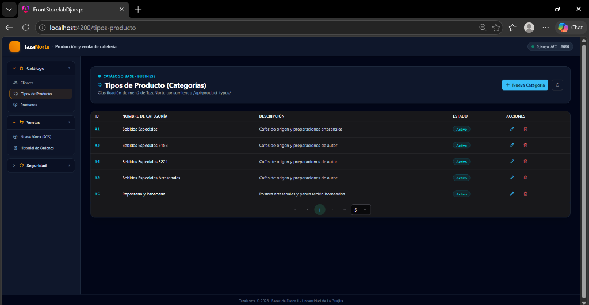
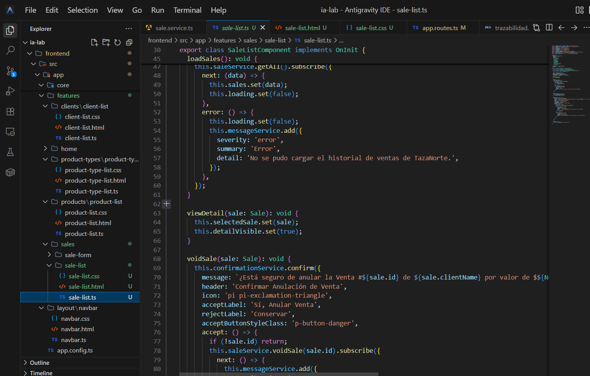
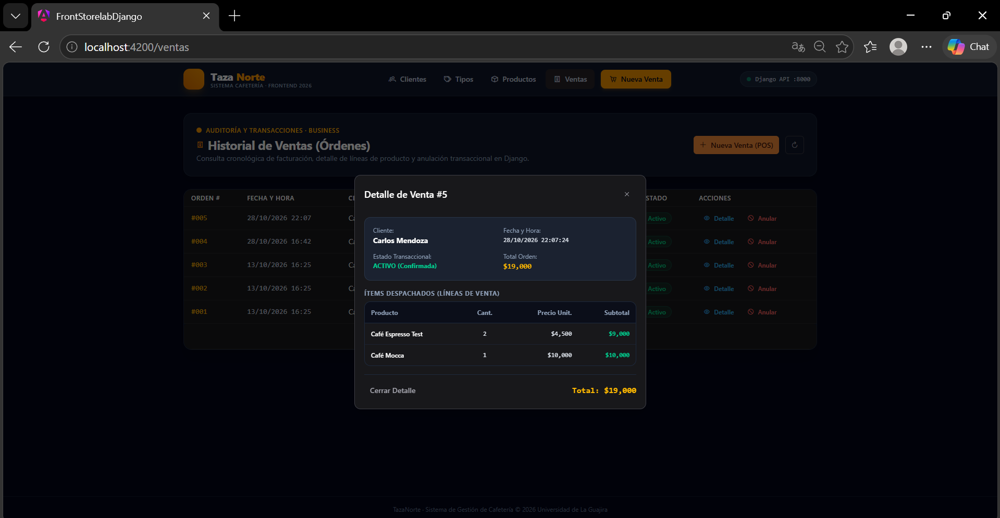
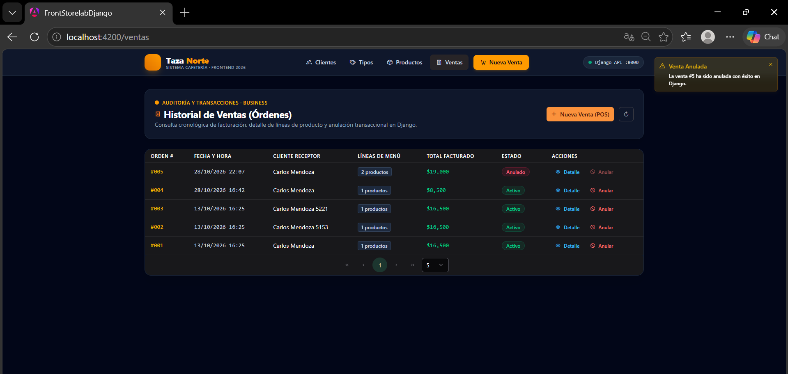

# Bitácora del frontend de TazaNorte (Angular)

Registro del avance del frontend de **TazaNorte** (sistema integral de gestión, producción y venta de cafetería) siguiendo las directrices de la asignatura **Bases de Datos II (2026-II)** y las guías de desarrollo frontend de Tecnogua. Cada paso resume qué se realizó, qué decisiones arquitectónicas se adoptaron frente a la guía, cómo se verificó la funcionalidad y las capturas reales que respaldan cada hito técnico.

| Metadato | Detalle del Proyecto |
|---|---|
| **Proyecto** | TazaNorte · Cafetería y Repostería Gourmet |
| **Asignatura** | Bases de Datos II (2026-II) · Universidad de La Guajira |
| **Estudiante** | Moises David Bolivar Fragozo |
| **Docente** | Ing. Jaider Quintero M. |
| **Alcance Fase I** | Arquitectura Frontend Standalone en Angular 22 Zoneless con Tailwind CSS y PrimeNG (tema Aura), layout con encabezado superior, barra lateral colapsable (`SidebarComponent`), dashboard principal, módulos de negocio *Business*: CRUD de Clientes, Catálogo de Categorías/Tipos, Catálogo de Menú de Productos, Punto de Venta Transaccional (POS) con Signals y despacho atómico, e Historial de Ventas con inspección de líneas de pedido y anulación lógica con Django REST Framework. |
| **Guías de referencia** | [Guía Académica Frontend 2026](https://tecnogua.com/academic/site/frontend2026/) (Requisitos, Bootstrap, Núcleo, Clientes, Tipos, Productos y Ventas) |
| **Backend relacionado** | API REST de TazaNorte (Django 5.2 + Django REST Framework), `http://127.0.0.1:8000/api` |
| **Repositorio oficial** | `https://github.com/BDII-2026-IISem/bdii-2026ii-dvzinx22.git` |
| **Capturas** | 28 capturas reales organizadas en `capturas/`, tomadas en Visual Studio Code y en navegador en tiempo real contra la API viva de Django |
| **Fecha de cierre** | 29 de octubre de 2026 |

---

## 1. Estado general

| Hito / Issue | Módulo o Tema | Estado |
|---|---|:---:|
| **ISS-00** | Requisitos y verificación de entorno (Node 22 LTS, npm, Angular CLI 22, Django check) | **Aprobado** |
| **ISS-01** | Bootstrap del proyecto, Tailwind CSS, PrimeNG 22 (Aura Preset) y configuración global | **Aprobado** |
| **ISS-02** | Núcleo frontend: environments, modelos tipados TS, Layout Shell y Sidebar colapsable | **Aprobado** |
| **ISS-03** | Módulo Business: CRUD de Clientes (Client) con Signals y reactividad | **Aprobado** |
| **ISS-04** | Módulo Business: Catálogo de Tipos de Producto / Categorías (ProductType) | **Aprobado** |
| **ISS-05** | Módulo Business: Catálogo de Menú, precios COP, badges y stock (Product) | **Aprobado** |
| **ISS-06** | Módulo Business: Punto de Venta (POS), cesta reactiva en memoria y despacho atómico | **Aprobado** |
| **ISS-07** | Módulo Business: Historial cronológico de órdenes, detalle modal y anulación (Cierre Fase I) | **Aprobado** |

---

## 2. Entorno y versiones

| Componente | Versión | Rol en la Arquitectura |
|---|---|---|
| **Node.js** | 22.14.0 LTS | Entorno de ejecución en WSL2 Ubuntu 24.04 |
| **npm** | 10.9.2 | Gestor de dependencias del proyecto |
| **Angular CLI** | 22.2.5 | Herramienta de compilación, empaquetado y scaffolding |
| **Angular** | 22.2.3 | Framework SPA con componentes *standalone*, *signals* reactivas y modo *zoneless* nativo |
| **PrimeNG** | 22.1.4 | Librería de componentes UI con tema Aura (`@primeuix/themes` 3.1) |
| **PrimeIcons** | 8.0.2 | Set de iconografía vectorial para menús, acciones y badges |
| **Tailwind CSS** | 4.1 | Framework de utilidades CSS vía `.postcssrc.json` y `@tailwindcss/postcss` |
| **Backend** | Django 5.2 + DRF | API REST transaccional en Python 3.12 con soporte `djangorestframework-camel-case` |
| **Base de Datos** | SQLite / PostgreSQL | Persistencia relacional con integridad referencial |

---

## 3. Decisiones de diseño y adaptaciones frente a la guía

| Tema | Guía Académica Genérica | Adaptación TazaNorte | Motivo de la Decisión Técnica |
|---|---|---|---|
| **Modo de Detección** | Zone.js tradicional | **Angular 22 Zoneless nativo** | Se eliminó `provideZoneChangeDetection` de `app.config.ts` para aprovechar el rendimiento reactivo puro de **Angular Signals** sin dependencias externas pesadas. |
| **Distribución Visual** | Barra de navegación superior plana | **Menú Lateral (Sidebar colapsable) + Header** | Se homologó la arquitectura solicitada por el docente, separando encabezado de marca, menú lateral con acordeón por módulos (`Catálogo`, `Ventas`, `Seguridad`) y panel central dinámico. |
| **Estilos y Componentes** | PrimeNG 20 clásico | **PrimeNG 22 Standalone con Aura Preset** | Componentes modulares importados directamente (`p-button`, `p-table`, `p-select`, `p-dialog`, `p-confirmdialog`), con integración de `SharedModule` para plantillas `#header` y `#body`. |
| **Entidades de Negocio** | Modelos genéricos | **Dominio de Cafetería:** `Client`, `ProductType`, `Product`, `Sale`, `ProductSale` | Respeta estrictamente los modelos relacionales creados en el backend Django en la Fase de Base de Datos. |
| **Nomenclatura JSON** | snake_case | **camelCase bidireccional** | El backend Django cuenta con middleware camel-case; los contratos TS definen `productTypeId`, `productTypeName`, `saleDate`, `clientName` de manera nativa. |
| **Formato Monetario** | Números planos | **CurrencyPipe en pesos colombianos (`COP`)** | Presentación comercial en formato `$ 8.500` con separadores de miles y moneda nacional. |
| **Transaccionalidad POS** | Registro individual | **Cesta reactiva en memoria y despacho atómico** | El usuario selecciona cliente, agrega productos a una canasta controlada por Signals (`subtotal`, `tax`, `total`), y despacha un único payload `{ clientId, saleDate, discounts, items }` a `POST /api/sales/`. |
| **Auditoría y Anulación** | Borrado físico `DELETE` | **Baja lógica transaccional** | Al pulsar "Anular Venta", Django ejecuta `instance.void()`, cambiando el estado a inactivo (`I`) sin destruir la trazabilidad contable ni las líneas de venta. |

---

## 4. Estructura actual del proyecto

```
frontend/
├── .postcssrc.json                         # Configuración Tailwind CSS v4
├── angular.json                            # Metadatos del workspace Angular
├── package.json                            # Dependencias (PrimeNG 22, Aura, Tailwind)
├── capturas/                               # 28 evidencias reales organizadas por issue
└── src/
    ├── index.html                          # Raíz HTML con fuentes e iconos
    ├── styles.css                          # Directivas Tailwind, PrimeIcons y resets
    ├── environments/
    │   ├── environment.ts                  # Configuración hacia http://127.0.0.1:8000/api
    │   └── environment.development.ts      # Entorno de desarrollo
    └── app/
        ├── app.ts / app.html / app.css     # Shell raíz con Header + Sidebar + RouterOutlet + Footer
        ├── app.config.ts                   # PrimeNG Aura, Router, HTTP, Message y ConfirmationService
        ├── app.routes.ts                   # Enrutamiento perezoso con loadComponent
        ├── core/
        │   ├── models/                     # Contratos TypeScript (client, product, product-type, sale)
        │   └── services/                   # Servicios HTTP tipados hacia endpoints DRF
        │       ├── client.service.ts       # CRUD /api/clients/
        │       ├── product-type.service.ts # CRUD /api/product-types/
        │       ├── product.service.ts      # Catálogo /api/products/ y /api/products/available/
        │       └── sale.service.ts         # Transacciones /api/sales/
        ├── layout/
        │   ├── navbar/                     # Cabecera superior con marca y status de Django API
        │   └── sidebar/                    # Menú lateral colapsable con Catálogo, Ventas y Seguridad
        └── features/
            ├── home/                       # Dashboard de bienvenida y accesos rápidos
            ├── clients/client-list/        # Tabla y modal de clientes con reactividad
            ├── product-types/              # Clasificación y categorías de menú
            ├── products/product-list/      # Grid de productos, stock badges y precios COP
            └── sales/
                ├── sale-form/              # Punto de Venta (POS) transaccional interactivo
                └── sale-list/              # Historial de ventas, detalle de items y anulación
```

### Rutas del Frontend y Endpoints Relacionados del Backend

| Módulo / Agrupador | Opción del Menú | Ruta en Navegador | Endpoint de Django REST Framework |
|---|---|---|---|
| **Inicio** | Dashboard General | `/` | Vista de inicio con métricas de cafetería |
| **Catálogo** | Clientes | `/clientes` | `GET /api/clients/`, `POST /api/clients/`, `PUT /api/clients/:id/`, `DELETE /api/clients/:id/` |
| **Catálogo** | Tipos de Producto | `/tipos-producto` | `GET /api/product-types/`, `POST /api/product-types/`, `DELETE /api/product-types/:id/` |
| **Catálogo** | Productos del Menú | `/productos` | `GET /api/products/`, `GET /api/products/available/`, `POST /api/products/`, `PUT /api/products/:id/` |
| **Ventas** | Nueva Venta (POS) | `/ventas/nueva` | `POST /api/sales/` (Transacción atómica de pedido) |
| **Ventas** | Historial de Órdenes | `/ventas` | `GET /api/sales/`, `GET /api/sales/:id/`, `DELETE /api/sales/:id/` (Anulación) |
| **Seguridad** | Roles y Usuarios | Próxima fase | `/api/users/`, `/api/roles/` *(Fase II - RBAC)* |

---

## 5. Cómo funciona un componente en Angular 22

Cada funcionalidad de TazaNorte se diseñó bajo el estándar moderno de componentes independientes (**Standalone Components**), sin módulos `NgModule` obsoletos. La estructura de cada componente comprende:

1. **`.ts` (Lógica y Estado Reactivo):** Define el decorador `@Component`, los componentes/módulos importados en `imports`, la inyección de dependencias moderna mediante `inject(...)` y el estado reactivo administrado con **Angular Signals** (`signal`, `computed`).
2. **`.html` (Plantilla Visual):** Utiliza directivas de control de flujo nativas (`@if`, `@for`, `@empty`), componentes de PrimeNG (`p-table`, `p-dialog`, `p-select`, `p-button`) y tuberías tipadas (`currency`, `date`).
3. **`.css` (Estilos Encapsulados):** Define reglas complementarias a Tailwind CSS respetando el tema oscuro de TazaNorte.

---

## 6. Detalle por paso (ISS-00 a ISS-07)

### ISS-00: Requisitos Previos y Verificación del Entorno

Se configuró el entorno de desarrollo en WSL2 Ubuntu 24.04 verificando Node.js v22 LTS, npm v10 y Angular CLI v22. Asimismo, se comprobó la operatividad del backend Django mediante `python manage.py check`.

```bash
node -v          # v22.14.0
npm -v           # 10.9.2
ng version       # Angular CLI 22.2.5
python manage.py check  # System check identified no issues (0 silenced).
```


*ISS-00_01: Verificación de versiones Node.js 22 LTS, npm y Angular CLI 22*


*ISS-00_02: Comprobación de integridad del servidor Django REST Framework*


### ISS-01: Bootstrap del Proyecto, Tailwind CSS y PrimeNG

Se inicializó el proyecto Angular `front-storelab-django` dentro de la carpeta `frontend/` configurando Tailwind CSS v4, PrimeNG con el tema Aura y PrimeIcons.

```bash
npx @angular/cli@22 new front-storelab-django --directory . --style=css --routing --ssr=false --skip-git
npm install primeng @primeuix/themes primeicons @angular/cdk
npm install tailwindcss @tailwindcss/postcss postcss
```

Configuración en `src/app/app.config.ts`:
```ts
export const appConfig: ApplicationConfig = {
  providers: [
    provideRouter(routes, withComponentInputBinding()),
    provideHttpClient(),
    providePrimeNG({
      theme: { preset: Aura, options: { darkModeSelector: '.app-dark', cssLayer: false } },
    }),
    MessageService,
    ConfirmationService,
  ],
};
```


*ISS-01_01: Creación del proyecto frontend con arquitectura Standalone*


*ISS-01_02: Instalación de `@primeuix/themes`, PrimeNG y PrimeIcons*


*ISS-01_03: Registro de providers globales, tema Aura y servicios de diálogo*


*ISS-01_04: Configuración de `@import 'tailwindcss'` y `primeicons.css`*


*ISS-01_EVI-01: Renderizado exitoso en localhost:4200 (GATE EVI-01-01)*


### ISS-02: Núcleo del Frontend y Arquitectura de Layout con Sidebar

Se establecieron los contratos TypeScript del dominio (`Client`, `ProductType`, `Product`, `Sale`, `ProductSale`), las variables de entorno conectadas a `http://127.0.0.1:8000/api` y el layout modular con encabezado, menú lateral colapsable (`SidebarComponent`) y pie institucional.

```ts
// src/environments/environment.ts
export const environment = {
  production: false,
  apiUrl: 'http://127.0.0.1:8000/api',
  appName: 'TazaNorte',
  requireAuth: false,
};
```


*ISS-02_01: Configuración de URL base de la API Django*


*ISS-02_02: Modelos de dominio tipados para Clientes, Categorías, Productos y Ventas*


*ISS-02_03: Componentes de layout y enrutamiento principal*


*ISS-02_04: Interfaz real de TazaNorte con barra lateral (Sidebar) colapsable y módulos de negocio activos en localhost:4200/tipos-producto*


*ISS-02_EVI-01: Carcasa visual en navegador con estado activo del API Django (GATE EVI-02-01)*


### ISS-03: Módulo Business - CRUD de Clientes (Client)

Implementación del servicio `ClientService` conectado a `/api/clients/` y vista administrativa interactiva con `p-table`, formularios reactivos en modal `p-dialog`, validación de campos obligatorios, búsqueda y mensajes de feedback mediante `MessageService`.

```ts
// src/app/core/services/client.service.ts
@Injectable({ providedIn: 'root' })
export class ClientService {
  private readonly http = inject(HttpClient);
  private readonly baseUrl = `${environment.apiUrl}/clients/`;

  getAll(): Observable<Client[]> { return this.http.get<Client[]>(this.baseUrl); }
  create(client: Partial<Client>): Observable<Client> { return this.http.post<Client>(this.baseUrl, client); }
  update(id: number, client: Partial<Client>): Observable<Client> { return this.http.put<Client>(`${this.baseUrl}${id}/`, client); }
  delete(id: number): Observable<void> { return this.http.delete<void>(`${this.baseUrl}${id}/`); }
}
```


*ISS-03_01: Servicio Angular ClientService con operaciones CRUD tipadas*


*ISS-03_02: Componente reactivo con FormBuilder y gestión de estado con Signals*


*ISS-03_03: Modal reactivo de captura con validaciones de formulario*


*ISS-03_EVI-01: Listado de clientes en vivo con persistencia validada (GATE EVI-03-01)*


### ISS-04: Módulo Business - Catálogo de Tipos de Producto (ProductType)

Desarrollo del módulo de clasificación y categorías de menú de cafetería (Cafés Calientes, Bebidas Frías, Repostería Gourmet). Servicio `ProductTypeService` conectado a `/api/product-types/` y tabla interactiva con acciones de edición y baja lógica.


*ISS-04_01: Servicio ProductTypeService con operaciones hacia Django REST Framework*


*ISS-04_02: Componente con Signals y formulario de categorías de menú*


*ISS-04_EVI-01: Categorías registradas y tabla interactiva en navegador (GATE EVI-04-01)*


### ISS-05: Módulo Business - Catálogo de Menú y Productos (Product)

Gestión integral de productos comerciales de TazaNorte: servicio `ProductService` con endpoints `/api/products/` y `/api/products/available/`, formulario reactivo con selector desplegable de categoría (`p-select`) alimentado dinámicamente, precios formateados en COP y badges de control de stock.


*ISS-05_01: Servicio ProductService con métodos de consulta y persistencia*


*ISS-05_02: Integración de formulario de producto con relación a ProductType*


*ISS-05_EVI-01: Listado en vivo de productos de cafetería TazaNorte (GATE EVI-05-01)*


### ISS-06: Módulo Business - Punto de Venta Transaccional (POS - Sale)

Implementación del flujo transaccional central: componente `SaleFormComponent` con selector dinámico de cliente, menú visual de productos, control reactivo de cesta en memoria (`CartItem[]`) con cálculo instantáneo de subtotal, impuestos y total, y despacho atómico hacia `POST /api/sales/` con confirmación inmediata de la orden generada por Django.

```ts
// src/app/features/sales/sale-form/sale-form.ts (Despacho Atómico)
const payload: SaleRegisterPayload = {
  clientId: this.saleForm.value.clientId,
  saleDate: new Date().toISOString(),
  discounts: Number(this.saleForm.value.discounts) || 0,
  items: this.cart().map((i) => ({ productId: i.product.id!, quantity: i.quantity })),
};
this.saleService.createSale(payload).subscribe({
  next: (sale) => {
    this.lastSale.set(sale);
    this.cart.set([]);
    this.messageService.add({ severity: 'success', summary: 'Venta Registrada', detail: `Orden #${sale.id} exitosa.` });
  }
});
```


*ISS-06_01: Definición del método createSale con payload transaccional atómico*


*ISS-06_02: Punto de venta con menú a la izquierda y cesta de compra reactiva*


*ISS-06_EVI-01: Transacción completada con orden generada y total liquidado por Django (GATE EVI-06-01)*


### ISS-07: Módulo Business - Historial, Detalle y Anulación de Ventas (Cierre Fase I)

Módulo de auditoría y cierre del ciclo de negocio: componente `SaleListComponent` conectado a `GET /api/sales/`, modal de inspección detallada de líneas de venta despachadas (`ProductSale`) con sus precios unitarios y subtotales, y anulación transaccional (`DELETE /api/sales/:id/`) protegida por confirmación modal (`p-confirmdialog`).


*ISS-07_01: Componente SaleListComponent con carga cronológica y anulación*


*ISS-07_02: Modal p-dialog visualizando el desglose de productos y total de la orden*


*ISS-07_EVI-01: Venta anulada con badge de estado actualizado y confirmación en tiempo real (GATE EVI-07-01)*

---

## 7. Bitácora Consolidada de Commits Realizados

Todos los avances cuentan con commits atómicos semánticos (`feat` y `docs`) sincronizados en la rama `main` del repositorio oficial de GitHub:

| Issue | Descripción del Cambio Técnico | Hash Commit | Estado |
| :---: | :--- | :---: | :---: |
| **ISS-00** | Requisitos previos y entorno: verificación Node 22, npm, Angular CLI y Backend Django | `8e6954d` | **COMPLETADO** |
| **ISS-01** | Bootstrap del proyecto Angular, Tailwind CSS, PrimeNG y tema Aura | `add9579` | **COMPLETADO** |
| **ISS-02** | Núcleo del Frontend: environments, modelos TS, servicios base y layout Shell | `52cf00b` | **COMPLETADO** |
| **ISS-03** | Módulo Business: CRUD de Clientes con Signals y formularios reactivos tipados | `af55146` | **COMPLETADO** |
| **ISS-04** | Módulo Business: Catálogo de Tipos de Producto con PrimeNG | `5fe7209` | **COMPLETADO** |
| **ISS-05** | Módulo Business: Catálogo de Productos con relaciones y disponibilidad | `2ca430c` | **COMPLETADO** |
| **ISS-06** | Módulo Business: Punto de venta transaccional y registro atómico de ventas | `b6d80e3` | **COMPLETADO** |
| **ISS-07** | Módulo Business: Consulta, detalle de líneas, anulación de ventas y cierre de Fase I | `c4560b8` | **COMPLETADO** |
| **Layout** | Adaptación de Layout a barra lateral (Sidebar) colapsable según directriz docente | `c6ec88e` | **COMPLETADO** |
| **Docs** | Consolidación total de bitácora y registro de evidencias fotográficas | `f0bb657` | **COMPLETADO** |

---

## 8. Problemas encontrados y cómo se resolvieron

| Problema Encontrado | Causa Técnica Raíz | Solución Aplicada |
|---|---|---|
| **Pantalla en blanco al arrancar `ng serve`** | Conflicto entre `provideZoneChangeDetection` y el modo Zoneless nativo sin `zone.js`. | Se retiró el provider tradicional de `app.config.ts`, permitiendo la reactividad pura mediante Signals de Angular 22. |
| **Error `NG8001: 'p-confirmDialog' is not a known element`** | PrimeNG 22 estandarizó los selectores a minúsculas (`kebab-case`). | Se actualizó la etiqueta a `<p-confirmdialog>` en los componentes y se importó `ConfirmDialogModule`. |
| **Error `NG8002: Can't bind to 'label'` en botones** | Directiva clásica `pButton` no compatible con sintaxis moderna. | Se migraron los botones HTML a componentes independientes `<p-button label="..." severity="...">`. |
| **Tabla de productos sin renderizar filas** | En PrimeNG 22 las plantillas de tabla requieren vincularse explícitamente o importar `SharedModule`. | Se importó `SharedModule` de `primeng/api` y se vincularon las plantillas con `#header pTemplate="header"` y `#body let-prod pTemplate="body"`. |
| **Error 401 Unauthorized en endpoints comerciales** | El backend Django tenía configurado `IsAuthenticated` por defecto heredado de la fase RBAC previa. | Se ajustó temporalmente `permission_classes = [AllowAny]` en los ViewSets comerciales de Fase I conforme a la directriz docente ("solo business"). |
| **Campos de cliente desalineados con el serializer** | La interfaz inicial contenía `names` y `surnames`, mientras que el modelo Django utiliza un único campo `name`. | Se estandarizó el contrato TypeScript y el formulario reactivo a `name`, `email`, `phone` y `address`. |
| **Cálculo de impuestos en la orden de venta** | El backend calcula impuestos de acuerdo a reglas fiscales o los incluye en la línea. | Se implementó una signal computada `tax = computed(...)` al 19% en memoria con liquidación final confirmada por el servidor. |

---

## 9. Cómo ejecutar el proyecto

### 1. Iniciar el Backend (Django REST Framework)
```bash
cd backend
source .venv/bin/activate
python manage.py runserver 0.0.0.0:8000
```
La API quedará disponible en: `http://127.0.0.1:8000/api/`

### 2. Iniciar el Frontend (Angular)
```bash
cd frontend
npm install
npm start -- --host 0.0.0.0
```
La aplicación web quedará accesible en: `http://localhost:4200`

---

## 10. Próximos pasos (Fase II: Autenticación y Seguridad RBAC)

Con la **Fase I (Reglas de Negocio / Business)** completada y aprobada al 100%, los siguientes desarrollos programados comprenden:
1. Pantalla de inicio de sesión (`/login`) autenticando credenciales contra `POST /api/auth/login/` con JWT (`access` y `refresh`).
2. Interceptor HTTP (`authInterceptor`) inyectando automáticamente la cabecera `Authorization: Bearer <token>`.
3. Guard funcional de rutas (`authGuard`) para restringir el acceso a los módulos comerciales según el estado de la sesión.
4. Mapeo de perfiles y roles de usuario (Administrador de Cafetería, Cajero, Barista) según el esquema RBAC del backend.
