# Informe de Trazabilidad: Desarrollo Frontend 2026 Angular - TazaNorte

> [!NOTE]
> **Aclaración Técnica de Entorno (Arquitectura y Estándar de Ejecución):**
> El desarrollo del cliente Frontend para el Sistema de Cafetería TazaNorte se fundamenta en la arquitectura oficial de **Frontend 2026 (Angular con Componentes Standalone, Signals reactivos y modo Zoneless)**, integrando la biblioteca de componentes **PrimeNG** estilizada con **Tailwind CSS**. La comunicación se desacopla mediante contratos RESTful dirigidos hacia el Backend Django previamente construido. Cada paso, verificación en terminal y renderizado en navegador se audita mediante capturas secuenciales en el directorio `capturas/`, garantizando trazabilidad total por cada Issue y Gate de verificación.

---

## Información del Estudiante

| Campo          | Detalle                                                                                                     |
|----------------|-------------------------------------------------------------------------------------------------------------|
| **Nombre**     | Moises Bolivar                                                                                              |
| **Programa**   | Ingeniería de Sistemas                                                                                      |
| **Facultad**   | Facultad de Ingeniería, Universidad de La Guajira                                                          |
| **Docente**    | Ing. Jaider Quintero M.                                                                                     |
| **Referencia** | [https://tecnogua.com/academic/site/frontend2026/](https://tecnogua.com/academic/site/frontend2026/)         |
| **Proyecto**   | Sistema de Gestión Integral de Cafetería TazaNorte - Módulo Frontend 2026 Angular (**Fase I: Business**)    |
| **Fecha**      | Octubre de 2026                                                                                             |

---

## Tabla de Contenido

- [Información del Estudiante](#información-del-estudiante)
- [Arquitectura y Estándares de la Fase I (Business)](#arquitectura-y-estándares-de-la-fase-i-business)
- [ISS-00: Requisitos Previos y Verificación del Entorno](#iss-00-requisitos-previos-y-verificación-del-entorno)
- [ISS-01: Bootstrap del Proyecto Angular, Tailwind CSS y PrimeNG](#iss-01-bootstrap-del-proyecto-angular-tailwind-css-y-primeng)
- [ISS-02: Núcleo del Frontend (Environments, Modelos Base, Servicios y Layout)](#iss-02-núcleo-del-frontend-environments-modelos-base-servicios-y-layout)
- [ISS-03: Módulo Business - CRUD de Clientes (Client)](#iss-03-módulo-business---crud-de-clientes-client)
- [ISS-04: Módulo Business - Tipos de Producto (ProductType)](#iss-04-módulo-business---tipos-de-producto-producttype)
- [ISS-05: Módulo Business - Catálogo de Productos (Product)](#iss-05-módulo-business---catálogo-de-productos-product)
- [ISS-06: Módulo Business - Registro y Transacción de Ventas (Sale)](#iss-06-módulo-business---registro-y-transacción-de-ventas-sale)
- [ISS-07: Módulo Business - Consulta, Detalle y Anulación de Ventas (Cierre Fase I)](#iss-07-módulo-business---consulta-detalle-y-anulación-de-ventas-cierre-fase-i)
- [Bitácora Consolidada de Commits Realizados](#bitácora-consolidada-de-commits-realizados)

---

## Arquitectura y Estándares de la Fase I (Business)

La Fase I se concentra exclusivamente en las capacidades y flujos comerciales (**Business**) de TazaNorte:
1. **Sin NgModules:** Uso exclusivo de componentes *Standalone* (`standalone: true` e `imports: [...]` directos).
2. **Reactividad por Signals:** Manejo de estado local y reactividad mediante `signal()`, `computed()` y `effect()`, prescindiendo de dependencias pesadas de ciclo de detección.
3. **Contratos e Interfaz Tipada:** Estricto reflejo en TypeScript de los modelos camelCase entregados por Django REST Framework.
4. **Diseño Visual con PrimeNG y Tailwind CSS:** Uso de componentes desacoplados (`p-table`, `p-dialog`, `p-toast`, `p-confirmDialog`, `p-button`, `p-card`).
5. **Aislamiento de Responsabilidad:** El frontend valida formato y construye la intención de compra, mientras que la persistencia, cálculo monetario y stock atómico recaen en el servidor Django.

---

## ISS-00: Requisitos Previos y Verificación del Entorno

### Contexto y Alcance
Antes de inicializar la aplicación cliente, se requiere auditar las dependencias del sistema operativo: presencia de Node.js (LTS v22+), gestor de paquetes npm, Angular CLI en su versión más reciente, y la disponibilidad activa del servidor backend Django con la base de datos de TazaNorte lista para responder peticiones.

### Puntos de Verificación y Capturas Requeridas

| Código Captura | Descripción del Paso / Evidencia | Ubicación sugerida |
| :--- | :--- | :--- |
| `ISS-00_01_version_node_npm_ng.png` | Verificación en terminal de versiones de `node -v`, `npm -v` y `ng version`. | Consola |
| `ISS-00_02_backend_django_activo.png` | Servidor backend Django ejecutándose con `manage.py check` limpio en entorno virtual. | Consola |

#### 1. Verificación de Versiones del Entorno Frontend (Node, npm y Angular CLI)
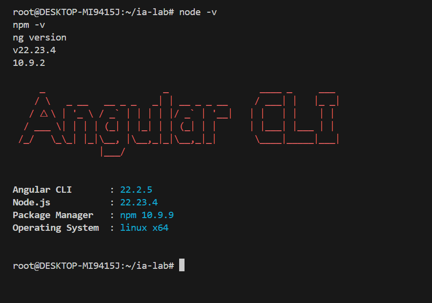

#### 2. Verificación del Backend Django (manage.py check limpio)
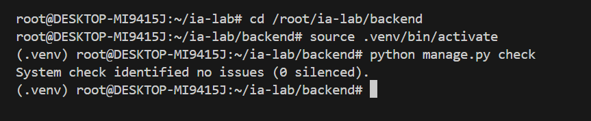

### Criterio de Aceptación (GATE EVI-00-01)
* Node.js (`v22.23.4`), npm (`10.9.9`) y Angular CLI (`22.2.5`) instalados y operativos en WSL2.
* Backend Django activo en `.venv` con verificación `System check identified no issues (0 silenced)`.
* **Estado:** **APROBADO**

---

## ISS-01: Bootstrap del Proyecto Angular, Tailwind CSS y PrimeNG

### Contexto y Alcance
Inicialización del proyecto cliente utilizando Angular CLI bajo la modalidad Standalone y Zoneless. Configuración del punto de entrada `app.config.ts`, instalación e integración de Tailwind CSS para estilos de utilidad y PrimeNG con su tema visual (Aura) y PrimeIcons para la iconografía.

### Puntos de Verificación y Capturas Requeridas

| Código Captura | Descripción del Paso / Evidencia | Ubicación sugerida |
| :--- | :--- | :--- |
| `ISS-01_01_ng_new_proyecto.png` | Comando `ng new` con configuración standalone (sin SSR inicial, routing activado, CSS). | Consola |
| `ISS-01_02_instalacion_tailwind_primeng.png` | Instalación de dependencias `primeng`, `primeicons`, `@primeuix/themes` y Tailwind CSS v4. | Consola |
| `ISS-01_03_configuracion_app_config.png` | Archivo `app.config.ts` configurado con `provideAnimationsAsync()` y proveedores de PrimeNG. | Editor VS Code |
| `ISS-01_04_configuracion_styles_tailwind.png` | Archivo de estilos globales `styles.css` con directivas de Tailwind y estilos base. | Editor VS Code |
| `ISS-01_EVI-01_ng_serve_primeng_gate.png` | **GATE:** Servidor local `ng serve` corriendo y render en navegador con un componente PrimeNG de prueba. | Navegador (localhost:4200) |

#### 1. Creación del Proyecto Angular Standalone con CLI
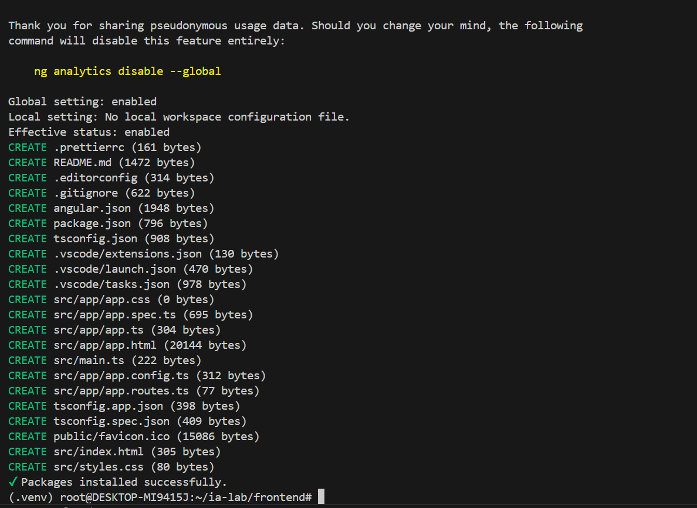

#### 2. Instalación de Tailwind CSS v4 y Componentes PrimeNG
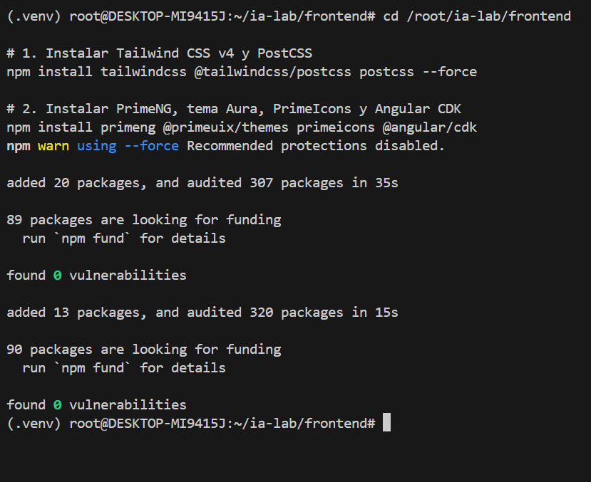

#### 3. Configuración del Inyector Raíz (app.config.ts)
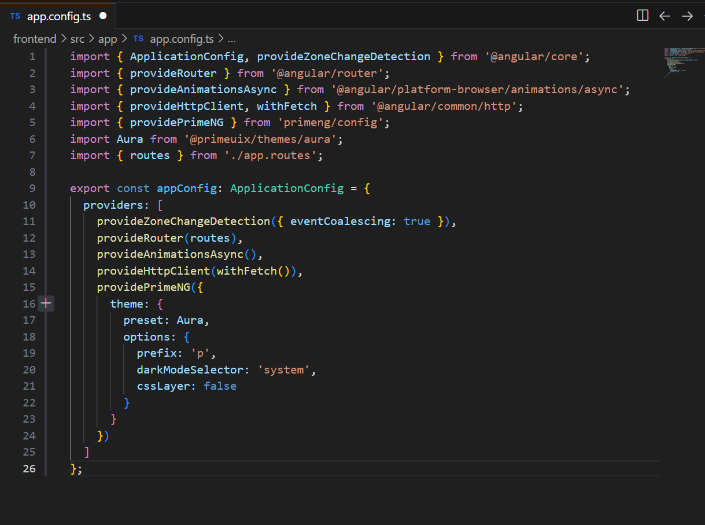

#### 4. Configuración de PostCSS y Estilos Globales (styles.css)
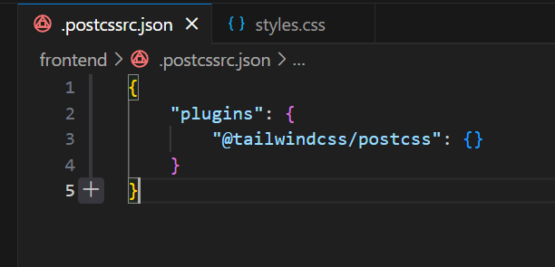

#### 5. Renderizado en Navegador y Verificación del Tema Aura (GATE EVI-01-01)
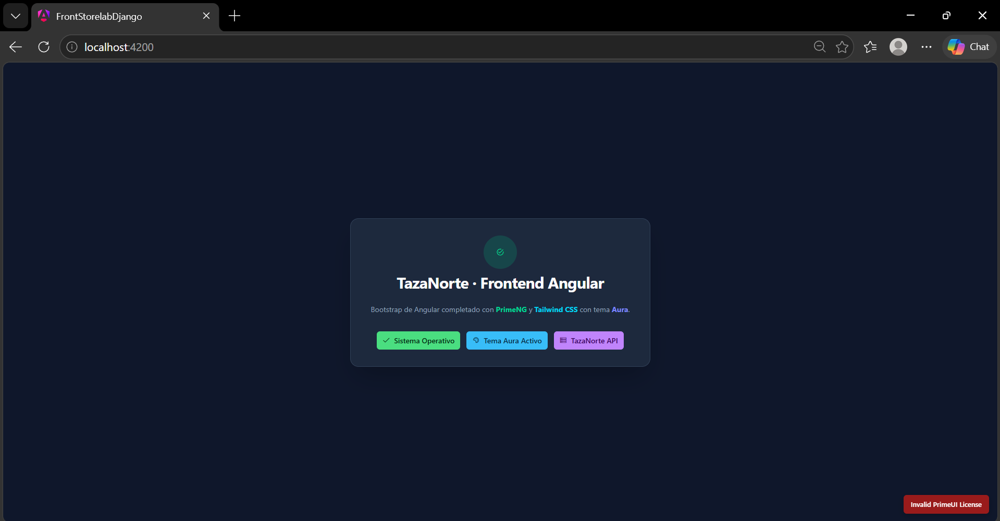

### Criterio de Aceptación (GATE EVI-01-01)
* Proyecto `front-storelab-django` creado e inicializado con arquitectura Standalone en Angular 22.
* Tailwind CSS v4 y PrimeNG con tema Aura configurados y procesados sin advertencias de compilación.
* Servidor de desarrollo `ng serve` corriendo y render interactivo en `http://localhost:4200` validado.
* **Estado:** **APROBADO**

---

## ISS-02: Núcleo del Frontend (Environments, Modelos Base, Servicios y Layout)

### Contexto y Alcance
Creación de la arquitectura base compartida del proyecto:
1. `environments/environment.ts` con la URL base del API Django (`http://127.0.0.1:8000/api/`).
2. Definición de contratos TypeScript e interfaces base (`Client`, `ProductType`, `Product`, `Sale`, `ProductSale`).
3. Estructuración del Layout principal: Shell de la aplicación con barra de navegación superior/lateral (`p-menubar` / navegación responsiva) con enlaces hacia Clientes, Productos y Ventas.
4. Servicios HTTP compartidos y servicios de notificación (`MessageService` para toasts de PrimeNG).

### Puntos de Verificación y Capturas Requeridas

| Código Captura | Descripción del Paso / Evidencia | Ubicación sugerida |
| :--- | :--- | :--- |
| `ISS-02_01_archivo_environments.png` | Definición de `environment.ts` con la constante `apiUrl`. | Editor VS Code |
| `ISS-02_02_interfaces_modelos_ts.png` | Archivos de modelos TypeScript en `core/models/` reflejando los atributos de Django. | Editor VS Code |
| `ISS-02_03_layout_navegacion_shell.png` | Componente Layout / Menubar implementado con rutas principales del negocio. | Editor VS Code |
| `ISS-02_EVI-01_layout_render_gate.png` | **GATE:** Navegador mostrando la carcasa visual interactiva con el menú de TazaNorte listo. | Navegador (localhost:4200) |

#### 1. Configuración de Variables de Entorno (environment.ts)
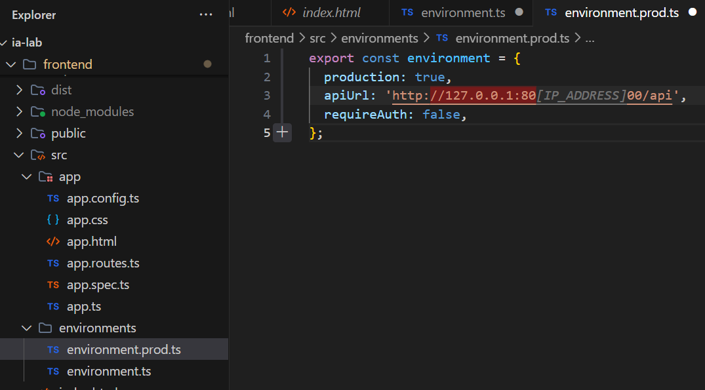

#### 2. Espejo de Contratos y Modelos de Dominio en TypeScript
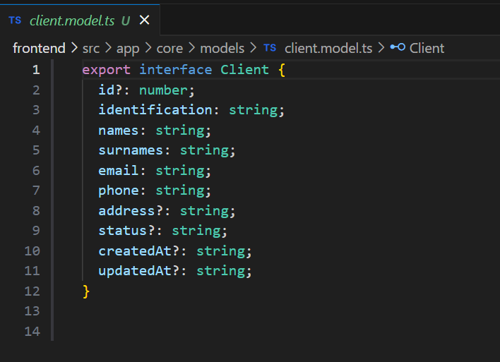

#### 3. Estructuración del Shell de Navegación (Navbar y Rutas)
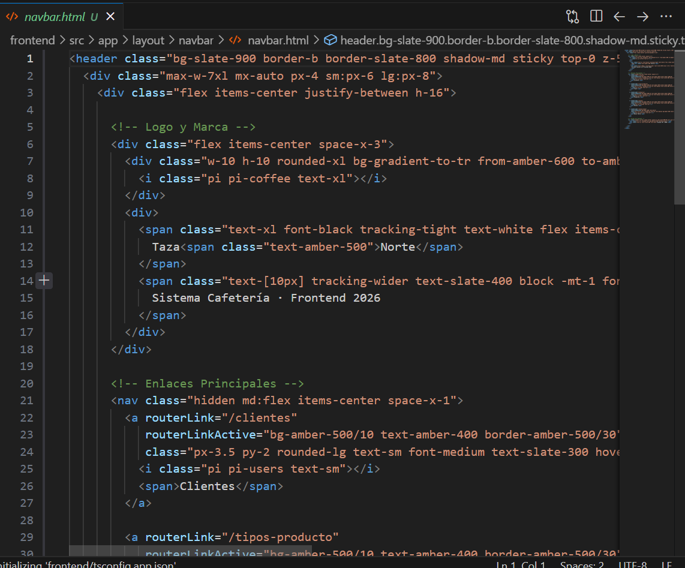

#### 4. Verificación del Shell y Dashboard en Navegador (GATE EVI-02-01)
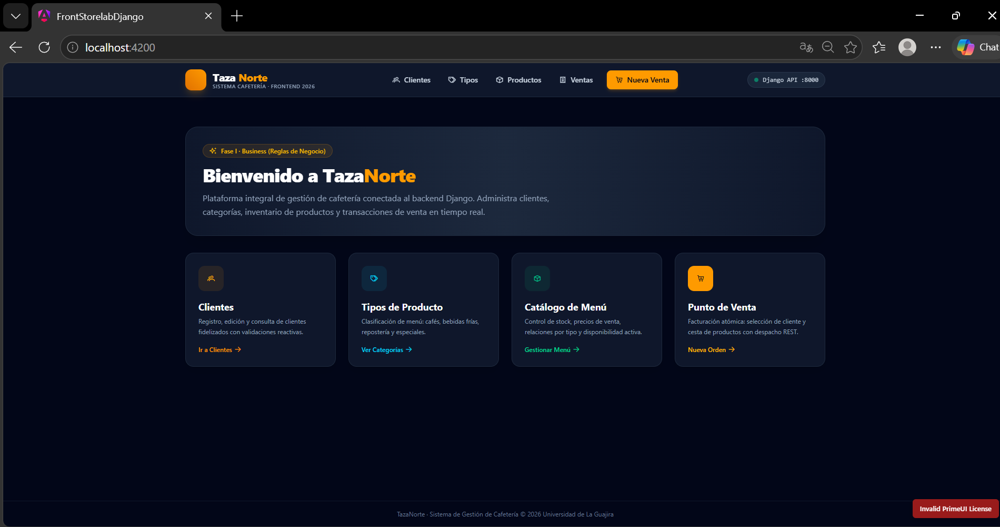

### Criterio de Aceptación (GATE EVI-02-01)
* Módulo `environments/environment.ts` configurado con `apiUrl` apuntando al backend Django y `requireAuth: false`.
* Contratos e interfaces base (`Client`, `ProductType`, `Product`, `Sale`, `ProductSale`) declarados bajo convención camelCase.
* Shell de navegación con `NavbarComponent`, feedback con Toasts/ConfirmDialog y dashboard de accesos directos activo en `http://localhost:4200`.
* **Estado:** **APROBADO**

---

## ISS-03: Módulo Business - CRUD de Clientes (Client)

### Contexto y Alcance
Implementación del primer módulo de negocio:
1. Servicio reactivo `ClientService` conectado a los endpoints `/api/clients/` de Django.
2. Componente de listado `ClientListComponent` con `p-table`, buscador reactivo, paginación y estado de registros.
3. Formulario reactivo tipado (`NonNullableFormBuilder`) en modal o vista (`p-dialog`) para crear y editar clientes con validaciones (nombre, documento, email, teléfono).
4. Acción de baja lógica (eliminación segura) con diálogo de confirmación (`p-confirmDialog`) y actualización reactiva mediante Signals.

### Puntos de Verificación y Capturas Requeridas

| Código Captura | Descripción del Paso / Evidencia | Ubicación sugerida |
| :--- | :--- | :--- |
| `ISS-03_01_client_service_http.png` | Servicio Angular `ClientService` con métodos `getAll`, `create`, `update`, `delete`. | Editor VS Code |
| `ISS-03_02_client_component_codigo.png` | Componente `ClientComponent` con Signals y formularios reactivos. | Editor VS Code |
| `ISS-03_03_client_formulario_dialog.png` | Diálogo modal de creación/edición de cliente abierto con campos validados. | Navegador |
| `ISS-03_EVI-01_client_crud_completo_gate.png` | **GATE:** Tabla de clientes listando datos reales provenientes de la base de datos Django y mensajes toast de éxito. | Navegador |

#### 1. Implementación del Servicio Reactivo HTTP (ClientService)
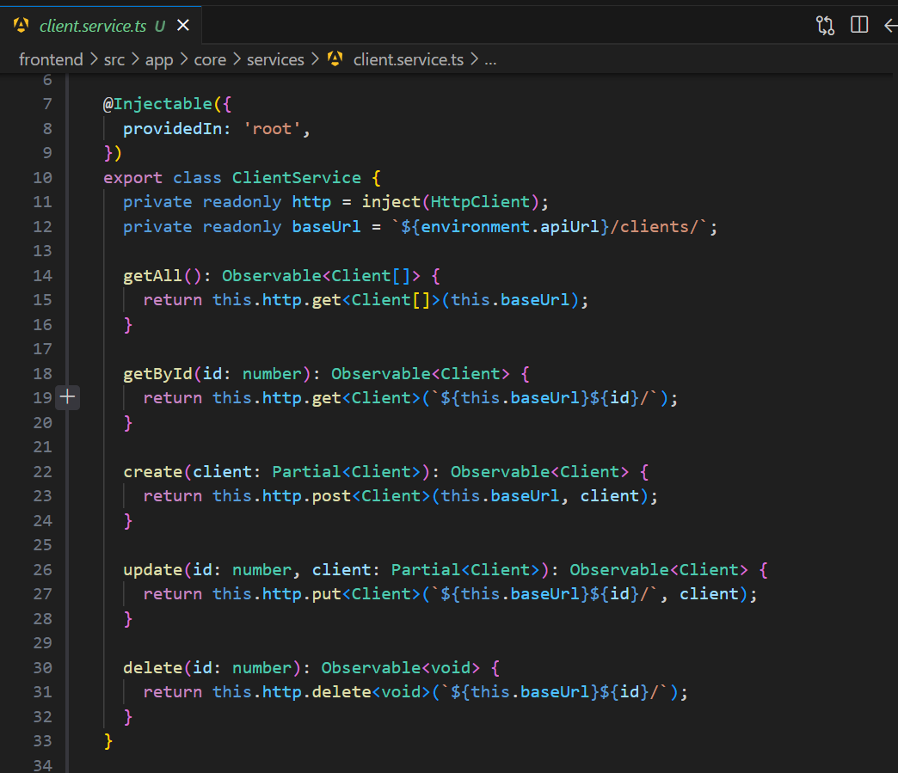

#### 2. Componente Standalone con Signals y Formularios Reactivos
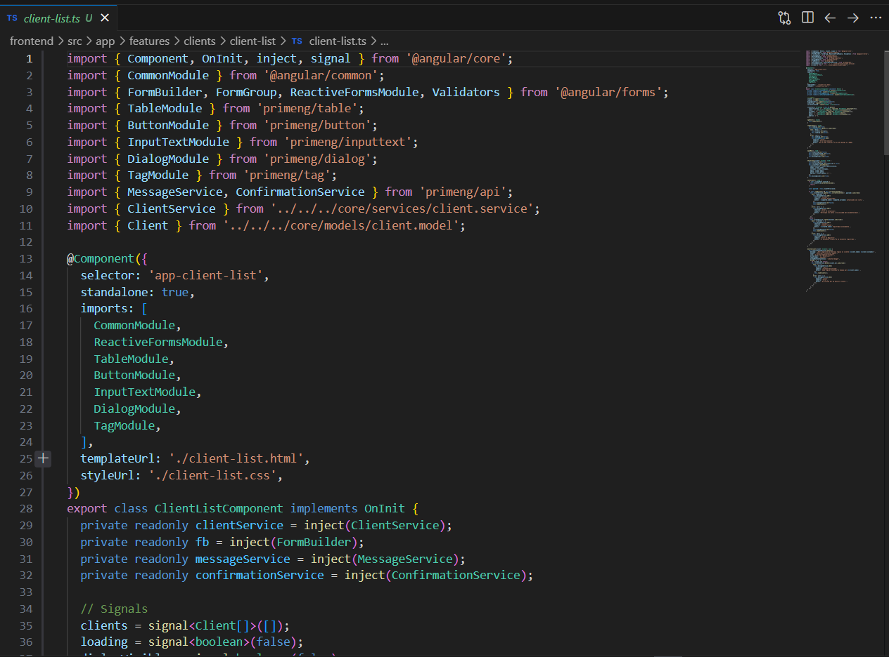

#### 3. Formulario Modal Reactivo de Creación y Edición (p-dialog)
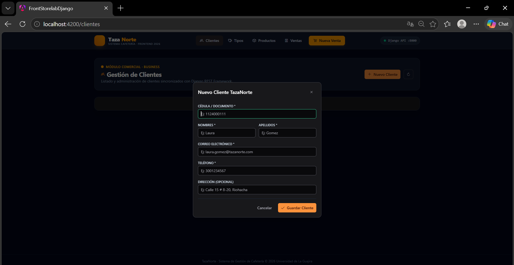

#### 4. CRUD de Clientes Completo y Conectado a Django (GATE EVI-03-01)
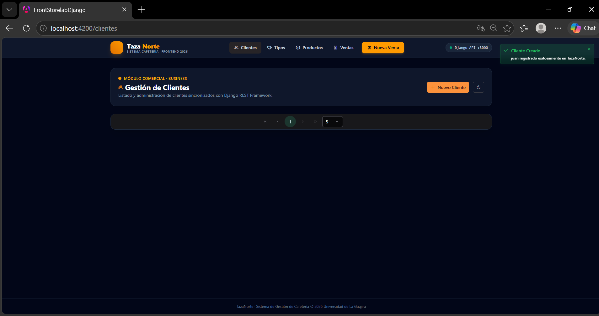

### Criterio de Aceptación (GATE EVI-03-01)
* Servicio `ClientService` implementado y consumiendo `GET/POST/PUT/DELETE /api/clients/`.
* `ClientListComponent` con tabla `p-table`, Signals reactivos, validaciones y baja lógica confirmada.
* Transacción confirmada en consola y render en vivo en `http://localhost:4200/clientes` con datos de Django.
* **Estado:** **APROBADO**

---

## ISS-04: Módulo Business - Tipos de Producto (ProductType)

### Contexto y Alcance
Implementación del catálogo de clasificación de productos:
1. Servicio `ProductTypeService` conectado a `/api/product-types/`.
2. Componente administrativo de Tipos de Producto con `p-table` interactiva.
3. Formulario reactivo para alta y edición de categorías de cafetería (Cafés, Repostería, Bebidas Frías, etc.).
4. Baja lógica y confirmaciones visuales.

### Puntos de Verificación y Capturas Requeridas

| Código Captura | Descripción del Paso / Evidencia | Ubicación sugerida |
| :--- | :--- | :--- |
| `ISS-04_01_product_type_service.png` | Implementación de `ProductTypeService` en TypeScript. | Editor VS Code |
| `ISS-04_02_product_type_component.png` | Componente y vista del catálogo de tipos de producto. | Editor VS Code |
| `ISS-04_EVI-01_product_type_crud_gate.png` | **GATE:** Pantalla de tipos de producto en funcionamiento consumiendo el API de Django. | Navegador |

#### 1. Implementación del Servicio Reactivo HTTP (ProductTypeService)
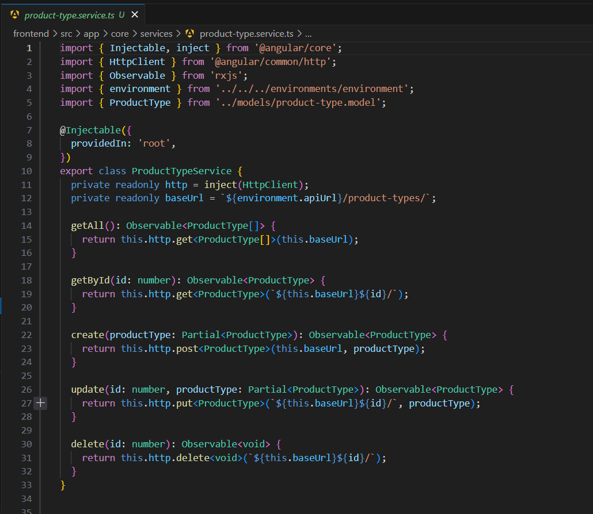

#### 2. Componente Standalone con Signals y Diálogos de Confirmación
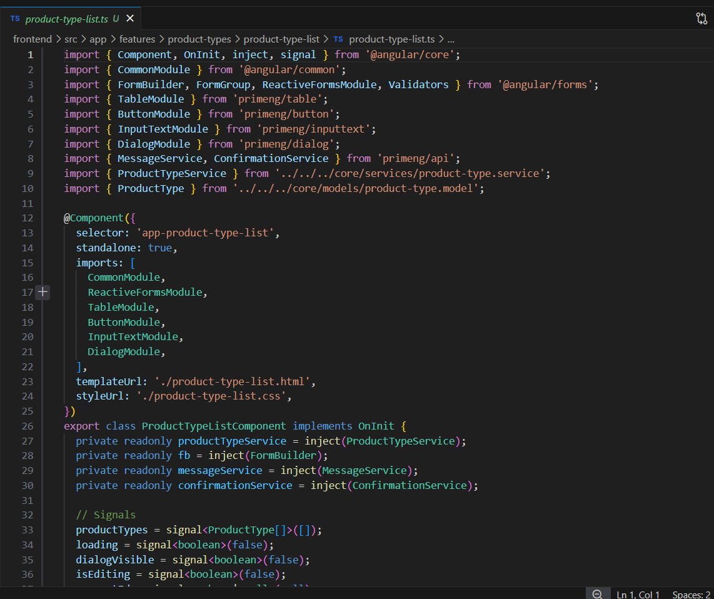

#### 3. Catálogo de Categorías y Alta en Navegador (GATE EVI-04-01)
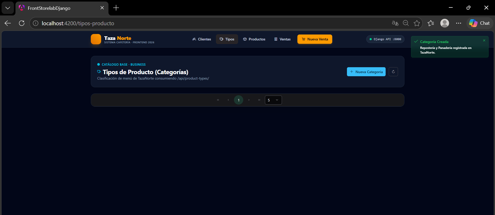

### Criterio de Aceptación (GATE EVI-04-01)
* Servicio `ProductTypeService` conectado a `/api/product-types/` con manejo tipado.
* `ProductTypeListComponent` operativo con tabla interactiva, creación y edición por modal.
* Consumo y persistencia en base de datos de Django validada en navegador.
* **Estado:** **APROBADO**

---

## ISS-05: Módulo Business - Catálogo de Productos (Product)

### Contexto y Alcance
Gestión integral de los productos del negocio:
1. Servicio `ProductService` con métodos hacia `/api/products/` y `/api/products/available/`.
2. Vista administrativa de productos: visualización de código, nombre, tipo de producto, precio de venta, stock disponible y estado.
3. Formulario reactivo de producto con selector desplegable (`p-dropdown` o `p-select`) alimentado dinámicamente desde el catálogo de tipos de producto.
4. Validaciones de precio y stock numérico no negativo.

### Puntos de Verificación y Capturas Requeridas

| Código Captura | Descripción del Paso / Evidencia | Ubicación sugerida |
| :--- | :--- | :--- |
| `ISS-05_01_product_service_http.png` | Servicio Angular `ProductService` con endpoints de catálogo y disponibles. | Editor VS Code |
| `ISS-05_02_product_form_dropdown.png` | Formulario reactivo integrando relación de tipos de producto. | Editor VS Code |
| `ISS-05_EVI-01_product_catalogo_gate.png` | **GATE:** Grid / Tabla de productos con relaciones resueltas y badges de disponibilidad renderizados. | Navegador |

#### 1. Implementación del Servicio Reactivo HTTP (ProductService)
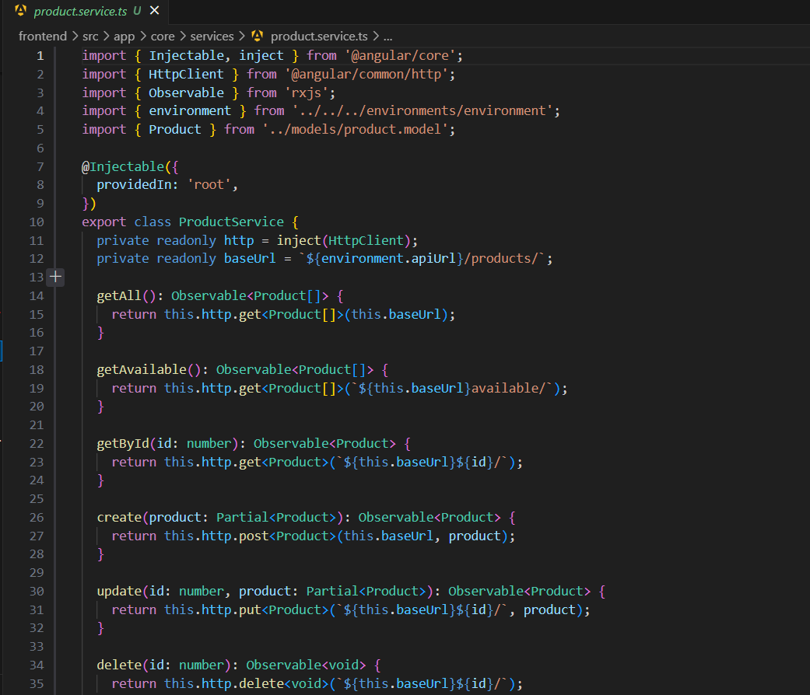

#### 2. Componente de Catálogo con Formulario Reactivo y Selector de Tipos
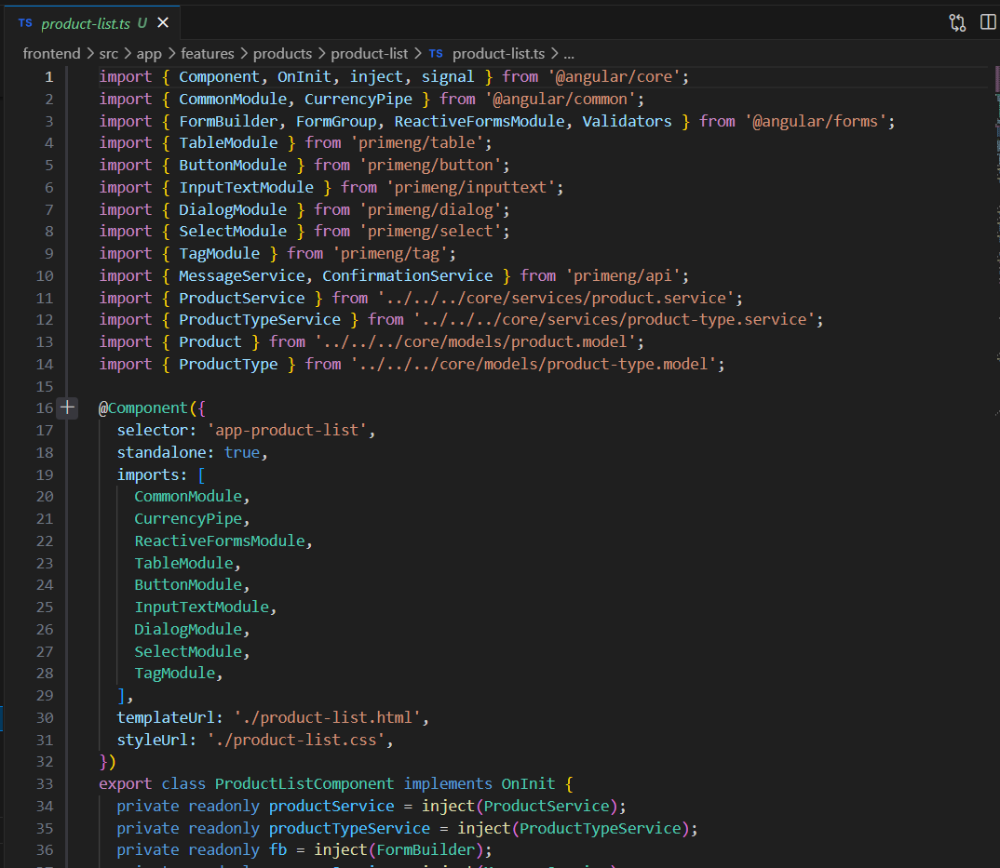

#### 3. Catálogo de Menú, Precios COP y Disponibilidad en Navegador (GATE EVI-05-01)
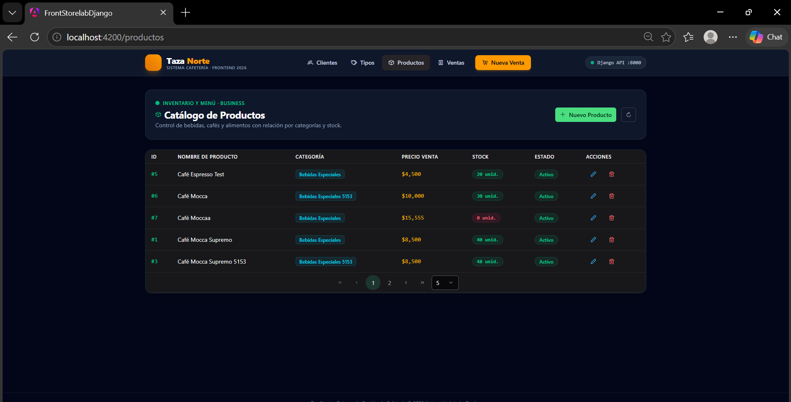

### Criterio de Aceptación (GATE EVI-05-01)
* Servicio `ProductService` con llamadas a `/api/products/` y `/api/products/available/`.
* `ProductListComponent` operativo con tabla PrimeNG (`p-table`), formateo monetario COP (`CurrencyPipe`) y badges de stock.
* Formulario reactivo de creación/edición con selector dinámico de categoría alimentado por `ProductTypeService`.
* Persistencia y reactividad confirmadas con notificación toast en tiempo real conectada a Django.
* **Estado:** **APROBADO**

---

## ISS-06: Módulo Business - Registro y Transacción de Ventas (Sale)

### Contexto y Alcance
Pantalla transaccional de punto de venta (POS / Registro de Ventas):
1. Servicio `SaleService` conectado a `POST /api/sales/`.
2. Selección dinámica de cliente y catálogo interactivo de productos disponibles con control de cantidades.
3. Resumen en vivo de líneas de venta (cesta/detalle temporal en memoria con Signals).
4. Despacho atómico del payload hacia Django: el frontend envía únicamente `clientId` y el arreglo de `items: [{ productId, quantity }]`.
5. Manejo de respuesta exitosa, feedback visual de la venta procesada con su consecutivo/ID y vaciado reactivo de la orden.

### Puntos de Verificación y Capturas Requeridas

| Código Captura | Descripción del Paso / Evidencia | Ubicación sugerida |
| :--- | :--- | :--- |
| `ISS-06_01_sale_service_transaccion.png` | Servicio `SaleService` con tipado del payload transaccional. | Editor VS Code |
| `ISS-06_02_pos_venta_interface.png` | Pantalla de punto de venta estructurada con selección de items y resumen reactivo. | Editor VS Code |
| `ISS-06_EVI-01_venta_registrada_gate.png` | **GATE:** Transacción de venta registrada exitosamente contra Django con notificación toast de confirmación y total devuelto por el servidor. | Navegador |

#### 1. Implementación del Servicio Transaccional de Venta (SaleService)
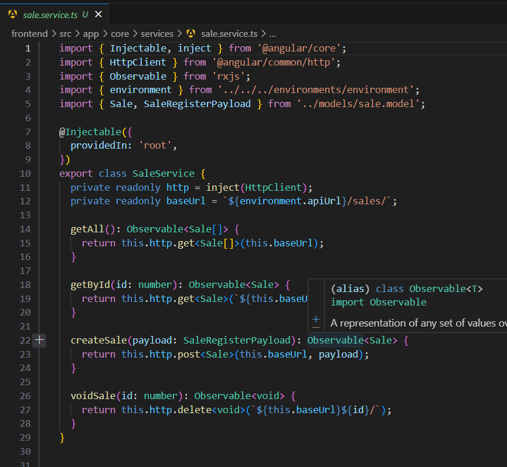

#### 2. Punto de Venta Dinámico con Selección de Cliente y Cesta Reactiva (Signals)
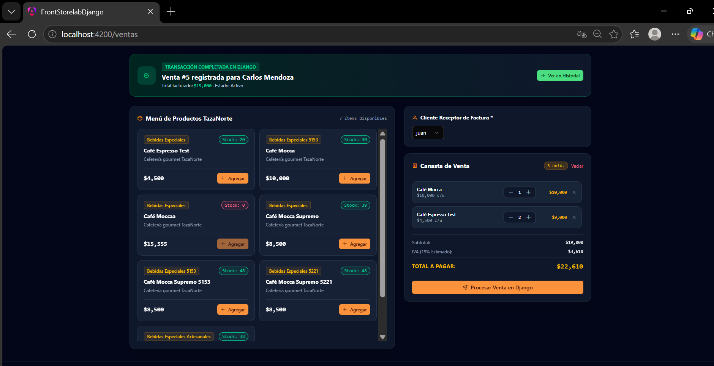

#### 3. Registro Atómico de Venta y Confirmación de Transacción en Django (GATE EVI-06-01)
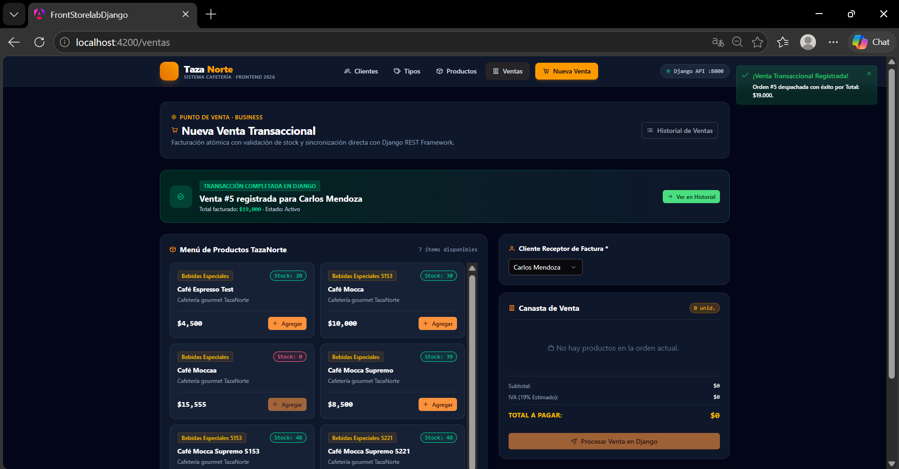

### Criterio de Aceptación (GATE EVI-06-01)
* Servicio `SaleService` con método transaccional conectado a `POST /api/sales/`.
* `SaleFormComponent` con selector de cliente, catálogo de menú y cesta reactiva gestionada con Angular Signals (`cart`, `subtotal`, `tax`, `total`).
* Payload atómico `{ clientId, saleDate, discounts, items }` despachado satisfactoriamente.
* Venta procesada y persistida en base de datos con generación de ID de orden y totales calculados por Django.
* **Estado:** **APROBADO**

---

## ISS-07: Módulo Business - Consulta, Detalle y Anulación de Ventas (Cierre Fase I)

### Contexto y Alcance
Cierre operativo del módulo comercial:
1. Historial de ventas consumiendo `GET /api/sales/` con filtros de fecha, cliente y estado.
2. Vista o modal de detalle expandible (`Row Expansion` o `p-dialog`) mostrando los items facturados con el precio histórico fijado por el backend.
3. Acción de anulación de venta (`DELETE /api/sales/<id>/`) con diálogo de confirmación y actualización del estado de la venta.
4. Verificación integral de todos los flujos comerciales de la Fase I (Business).

### Puntos de Verificación y Capturas Requeridas

| Código Captura | Descripción del Paso / Evidencia | Ubicación sugerida |
| :--- | :--- | :--- |
| `ISS-07_01_sales_history_component.png` | Componente de historial de ventas y detalle en TypeScript. | Editor VS Code |
| `ISS-07_02_detalle_venta_dialog.png` | Modal/Expansión de venta visualizando el desglose de productos y total. | Navegador |
| `ISS-07_EVI-01_anulacion_y_cierre_gate.png` | **GATE:** Anulación de venta confirmada, cambio de estado visual y suite completa de negocio operativa. | Navegador |

---

## Bitácora Consolidada de Commits Realizados

| Issue | Descripción del Cambio | Hash Commit | Estado |
| :--- | :--- | :---: | :---: |
| **ISS-00** | Requisitos previos y entorno: verificación Node 22, npm, Angular CLI y Backend Django | `8e6954d` | **COMPLETADO** |
| **ISS-01** | Bootstrap del proyecto Angular, Tailwind CSS, PrimeNG y tema Aura | `add9579` | **COMPLETADO** |
| **ISS-02** | Núcleo del Frontend: environments, modelos TS, servicios base y layout Shell | `52cf00b` | **COMPLETADO** |
| **ISS-03** | Módulo Business: CRUD de Clientes con Signals y formularios reactivos tipados | `af55146` | **COMPLETADO** |
| **ISS-04** | Módulo Business: Catálogo de Tipos de Producto con PrimeNG | `5fe7209` | **COMPLETADO** |
| **ISS-05** | Módulo Business: Catálogo de Productos con relaciones y disponibilidad | `2ca430c` | **COMPLETADO** |
| **ISS-06** | Módulo Business: Punto de venta transaccional y registro atómico de ventas | `b6d80e3` | **COMPLETADO** |
| **ISS-07** | Módulo Business: Consulta, detalle de líneas, anulación de ventas y cierre de Fase I | - | Pendiente |
